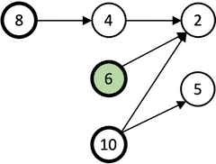

# Taxman
A program to find optimal solutions to the taxman game along with some heuristic
approaches to more quickly find approximate solutions.

**The game.**  The pot holds the numbers 1 to n; each turn the player takes a number that still has a proper divisor
in the pot and scores it, and the taxman takes every divisor of it still in the pot.  The game ends when no number in
the pot has a divisor left in it, and an optimal game scores the most (n = 4: take 3, then 4, for 7).

See the [project wiki](https://github.com/bvchess/taxman/wiki) for more information about the game and the
algorithm implemented by this program. Heuristic approaches are [here](heuristics).

Robert Moniot's C++ program implementing seven heuristic strategies is included in
[moniot](moniot), redistributed with his permission.

## The frame solver, in Rust

The frame solver, a Rust reimplementation of the exact algorithm, built to use many CPUs and for long resumable runs,
has solved every board up to n = 2175 in one contiguous chain from n = 1, each game proven optimal within its frame
model with nothing assumed (the Java program got to 1000; the table of optimal games,
[src/main/resources/optimal.json](src/main/resources/optimal.json), has the frame solver's games for 1001 to 1300, and
its games to 2175 are in [rust/results/strict.jsonl](rust/results/strict.jsonl)).  Every game up to 2175 is also proven
optimal on the whole board by the prover in [rust/prover](rust/prover/README.md), which uses no frame model (Theorem 10
of [heuristics/THEORY.md](heuristics/THEORY.md)).
It is a Cargo crate in [rust](rust) with its own build, run and test instructions: start with
[rust/README.md](rust/README.md) (`cd rust && cargo build --release`), and see
[rust/tools/cloud/RUNBOOK.md](rust/tools/cloud/RUNBOOK.md) for running it on a large cloud machine.

The sections "Usage", "Implementation" and "Build" below describe the Java program.

## Usage
`bin/taxman [options] <board size or range>`  

Where `board size or range` is an integer or range of integers.  Run the taxman command with no options in order to
learn more.  Here are some examples:

This command will show the moves made and the tax paid for optimal games from N=1 to
N=10:  
    `bin/taxman -s 1-10`

This command will show debugging output as it searches for an optimal solution for N=450:  
    `bin/taxman -d 3 450`

## Implementation
The program includes pre-computed solutions to games from 1 to 1300 so that it can make use of the solution to N-1
without having to compute it on every run.  These pre-computed solutions are available in JSON format
[here](src/main/resources/optimal.json).  Games 1 to 1000 are this program's; games 1001 to 1300 come from an earlier
run of the solver's chain from n = 1, which assumes nothing beyond its frame model
([rust/results/strict.jsonl](rust/results/strict.jsonl) has the same games but for game 1215, where it found another
optimal set of moves with the same score).

I use the Java [BitSet](https://docs.oracle.com/en/java/javase/11/docs/api/java.base/java/util/BitSet.html) class for
fast operations on sets of small integers.  I use
Java [Streams](https://docs.oracle.com/en/java/javase/11/docs/api/java.base/java/util/stream/Stream.html)
and [ForkJoinPool](https://docs.oracle.com/en/java/javase/11/docs/api/java.base/java/util/concurrent/ForkJoinPool.html)
to take advantage of multiple CPUs.

## References and Links
- The On-Line Encyclopedia of Integer Sequences documents the Taxman Sequence (the optimal player score)
as [A019312](https://oeis.org/A019312).
- Interactive online implementations of the taxman game are <http://davidbau.com/archives/2008/12/07/taxman_game.html> and
<https://www.cryptool.org/en/cto/taxman>.
  
## Build
Build using Maven:  
    `mvn install`  

Tested using Java 18.

## Acknowledgements
Thanks to EJ Technologies for the use of their excellent
[Java profiler](https://www.ej-technologies.com/products/jprofiler/overview.html).
