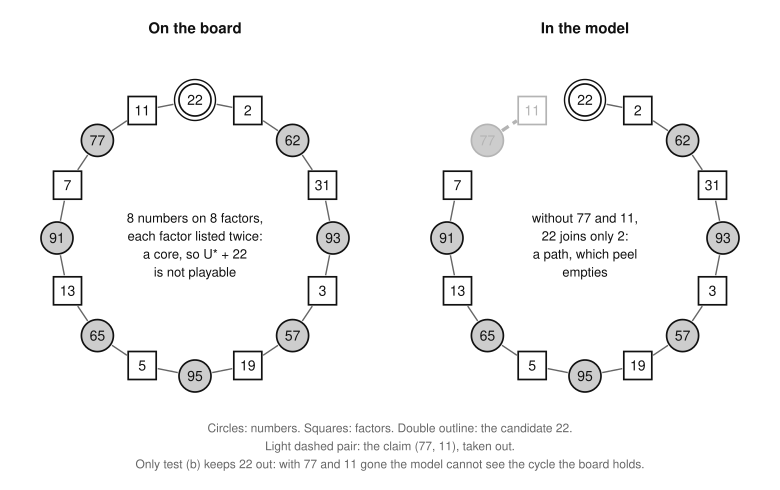

# The exactness of the frame model

Part of [the theory](../THEORY.md).

The frame solver's answer for game n is ΣU\* + P\*: the sources U\* plus the heaviest promotion set of the root problem
Π_n.  This file proves what that answer is.  [The exactness theorem (X7)](#the-exactness-theorem) shows that the
promotion sets of every root problem of game n are exactly the sets L of numbers up to n/2 for which U\* ∪ L is
[playable](../GLOSSARY.md#the-game).  With [the bottom-layers theorem (F4)](frame-model.md#the-bottom-layers-theorem),
it leaves one open statement between the model and the game, [statement U](#statement-u): the answer is
[opt(n)](../GLOSSARY.md#the-game) exactly when some [optimal set](../GLOSSARY.md#the-game) contains every member of U\*
in layers 3 and up (X8).  [The holes theorem (X9)](#boards-with-holes) carries the result to boards with numbers taken
off.  The proof of X7 does not need two of the lemmas, X1 and the third part of X5; they show that setup's longer route
computes the model.

*Words.*  [Sources](../GLOSSARY.md#the-frame-model), [layers](../GLOSSARY.md#the-frame-model) and [maximal
factors](../GLOSSARY.md#the-game) are the glossary's.  [U\*](sources.md#descending-greedy) is what descending greedy
keeps of the sources, U\*_{≥3} its part in layers 3 and up, and ΣS the sum of a set S
([notation](statements.md#notation)); [q(n)](neighbors.md#neighboring-games) is the largest prime ≤ n.
[Frames](frame-model.md#frames), their moves, freedoms and closed frames are defined in frame-model.md's section
"Frames", and frame h, taking a number on, the candidates' tests (a) and (b), claim sequences, the claims of frame h,
reduction, root problems, homes, applying a set and promotion sets in its section ["The frame
model"](frame-model.md#the-frame-model).  The facts on instances used here, [the playability theorem
(P2)](playability.md#the-playability-theorem), [the flat-cycle lemma (P3)](playability.md#the-flat-cycle-lemma), [the
peel theorem (P4)](playability.md#the-peel-theorem), restriction and "playable against", are listed at the top of
[frame-model.md](frame-model.md#frames-and-the-frame-model).  The proofs use [the frame lemma
(F1)](frame-model.md#the-frame-lemma), [the joining lemma (F2)](frame-model.md#the-joining-lemma), [the winnability
lemma (F5)](frame-model.md#the-winnability-lemma) and [clean numbering (F6)](frame-model.md#clean-numbering) throughout.

## The exactness theorem

The model's promotion sets are exactly the games that play U\*.  The idea: a payment scheme of U\* ∪ L splits into one
scheme for each frame h with L applied, and the claims and drops of a root problem are front and back moves of these,
which keep each playable or unplayable.  Lemmas X2 to X6 prove the pieces in order, and X7 assembles them.

**Lemma X1 (the kept-sources lemma).**  Descending greedy over the sources of a frame D, against F_D, keeps U\* ∩ D.
After the claims of a claim sequence of D or of frame h, descending greedy over the sources left, against the factors
left, keeps them all.  So setup plays U\* when it promotes nothing.

*Proof.*  1.  The sources of the frames are the components of the sources' instance.  So by the items "Playability
splits over the components" and "So does descending greedy" of [sources.md](sources.md) ([components and
truncations](sources.md#components-and-truncations)), descending greedy over the sources of D keeps U\* ∩ D.

2.  The claims are front and back moves of the instance with members U\* ∩ D and pool F_D: a front claim's move lists
only its factor once the earlier claims are out, and a back claim's factor is listed by its move alone.  By
[P4](playability.md#the-peel-theorem) their remainder, the sources left against the factors left, is playable, and so is
every subset of it (restriction), so descending greedy keeps them all.  For frame h the same holds, since U\* ∩ frame h
is playable against F_h: by [F2](frame-model.md#the-joining-lemma), as each frame's moves list only that frame's
factors.  ∎

In game 21, after the back claim (15, 5), frame 0 has the sources 14 and 21 left against the factors 2, 3 and 7, and a
second pass of descending greedy keeps both.

**Lemma X2 (the closed-frames lemma).**  Let S ⊆ {2, …, n} be a playable set that contains U\*, and D a closed frame.
In every scheme of S, the factors of D pay exactly the members of U\* ∩ D: none is in S or pays for another member.

*Proof.*  The members of U\* ∩ D pay with distinct factors outside S, which lie in F_D, as many as D has.  ∎

**Lemma X3 (the one-frame-forward lemma).**  Let U\* ∪ L be playable, with L ⊆ {2, …, ⌊n/2⌋}, and fix a scheme.
Every member x of L is a factor of a frame numbered h ≥ 1, and pay(x) is a factor of frame h − 1.  Every member of U\*
pays with a factor of its own frame.

*Proof.*  The member x is a factor of a frame D ([F1](frame-model.md#the-frame-lemma)), not closed (X2), so numbered h.
Its payer pay(x), a maximal factor of x, lies in a frame D′ in front of D (F1), not closed (X2), so numbered h − 1
([F6](frame-model.md#clean-numbering)), and h ≥ 1.  A source's maximal factors lie in its frame.  ∎

In game 21 the optimal set is U\* ∪ {9}, and 9, a factor of frame 1, pays with 3, a factor of frame 0.

**Lemma X4 (the candidate lemma).**  If U\* ∪ L is playable, with L ⊆ {2, …, ⌊n/2⌋}, every member of L is a candidate.

*Proof.*  Let x ∈ L be a factor of D, numbered h (X3).  (a) U\* ∩ D pays with factors of D other than x (X3), since x
is in the set: restrict.  (b) The moves of frame h − 1 and x pay with factors of frame h − 1 (X3): restrict.  ∎

The claims lemma says four things about a claim sequence: a candidate is never claimed; a back claim's factor never
pays for a candidate; so the claims stay front and back moves however a set of candidates is promoted; and setup's test
(a), made after its first claims, picks the same candidates.

**Lemma X5 (the claims lemma).**  Let W be a frame numbered h, or frame h, with a claim sequence.

1. No candidate is the factor of one of its claims.
2. If W is frame h, no candidate has the factor of one of its back claims among its maximal factors.  So for every set
   L of candidates, the claims are, in order, front and back moves of frame h with L applied, and none of them takes a
   member of L.
3. If W is a frame D numbered h ≥ 1, a factor x of D that passes test (b) passes test (a) iff no claim takes x and the
   remainder of the claims, with x taken from its pool, is playable.

*Proof of part 1.*  Candidates lie in frames numbered at least 1, so let h ≥ 1.  Let (s, f) be a claim, and D the frame
of W that holds f.

* If it is a back claim, no frame of the layer below can take f on, so neither can frame h − 1, by [the take-on lemma
  (F7)](frame-model.md#the-take-on-lemma).  So f fails test (b).
* If it is a front claim, look at the claims of W whose moves lie in D, up to (s, f), and at the instance with members
  U\* ∩ D and pool F_D ∖ {f}.  None of those before (s, f) takes f, so they are front and back moves of that instance,
  as in X1.  If the instance were playable, it would stay playable through them (P4); but after them s lists nothing,
  since f was its only factor left and f is not in the pool.  So the instance is unplayable, and f fails test (a).

*Proof of part 2.*  Let c be a candidate with the factor f of a back claim among its maximal factors.  Then c is a
factor of a frame numbered at least 1 that lies behind the frame of f, so its number is h + 1 (F6): c is a factor of
frame h + 1 that has f as a maximal factor.  The back claim's last condition says that frame h cannot take c on, so c
fails test (b), which is a contradiction.

Now let L be a set of candidates, and take the claims in order, the earlier ones made.  Frame h with L applied has as
members the moves of frame h and the members of L promoted into it, and as pool the factors of frame h less L.

* A front claim (s, f): s lists only f among the factors not yet taken, and f is in the pool, since it is not in L
  (part 1).  It is a front move.
* A back claim (s, f): f is in the pool, since it is not in L (part 1).  Of the moves of frame h left, only s lists it,
  by the claim's rule, and no member of L lists it, by the first sentence of this part.  It is a back move.

*Proof of part 3.*  In either direction no claim takes x: if x passes (a), by part 1, since x passes (b) too, and in the
other direction by hypothesis.  Then the claims are front and back moves of the instance with members U\* ∩ D and pool
F_D ∖ {x}, as in part 1, and they keep it playable or unplayable (P4).  So that instance is playable iff the remainder
of the claims, with x taken from its pool, is.  ∎

In game 21 the claims of frame 0 and frame 1 are the back claims (15, 5) and (20, 10).  With L = {9}, frame 0 has the
moves 14, 15, 21 and 9 against 2, 3, 5 and 7, and only 15 lists 5: (15, 5) is a back move.  Frame 1 has the moves 12,
18 and 20 against 4, 6 and 10, and only 20 lists 10: (20, 10) is a back move.  What is left is root frame 0 and root
frame 1 with 9 applied.

*Why test (b) is needed.*  Without it a back claim could hide a cycle.  At n = 98, the smallest board where this
happens, frame 0 has the back claim (77, 11), with 77 = 7·11; and 22 = 2·11, a factor of frame 1, passes (a).  The
moves frame 0 keeps after its claims, 62, 93, 57, 95, 65 and 91, form a path on the factors 2, 31, 3, 19, 5, 13 and 7.
With 11 gone, 22 would take the factor 2 and leave root frame 0 winnable, and root frame 1 does not need 22.  On the
board, though, 22 and 77 close the path into a [core](playability.md#cores-and-the-residual) of eight numbers on eight
factors, each listed twice, so U\* ∪ {22} is not playable.  Only test (b) keeps 22 out: frame 0 cannot take 22 on, so
22 is no candidate, and the back claim's last condition holds.

*The cycle of game 98 on the board (left) and in the model (right), where the claim (77, 11) is taken out.  Gray
circles: members of U\*.  Double outline: the number 22, which is no candidate.*

**Lemma X6 (the reduction-step lemma).**  Take a root problem of game n.  The drops that reduce frame h less its
claims are front claims, which join the claims in one claim sequence of frame h.  Every candidate of a frame numbered h
has the home h.  For every set L of candidates, root frame h with L applied is winnable iff frame h with L applied is
playable.

*Proof.*  A drop pairs a source of frame h with its one live factor, the only maximal factor of the source not taken
before: a front claim.  So the claims and the drops form one claim sequence, and by X5 (part 1) none of them takes a
candidate: a candidate of a frame numbered h stays a factor of root frame h.  Since homes are frame numbers, applying L
to root frame h is applying L to frame h and then removing the claims and the drops.  By X5 (part 2) these are front
and back moves of frame h with L applied, which keep it playable and keep it unplayable (P4), and a pair is winnable
iff it is playable ([F5](frame-model.md#the-winnability-lemma)).  ∎

**Theorem X7 (the exactness theorem).**  Take a root problem of game n.  For every L ⊆ {2, …, ⌊n/2⌋}, U\* ∪ L is
playable iff L is a promotion set of the root problem, and then Σ(U\* ∪ L) = ΣU\* + ΣL.

*Proof.*  *Only if.*  Let U\* ∪ L be playable, with an acyclic scheme.

1. Every member of L is a candidate (X4), with a home (X6).
2. The members of frame h with L applied pay with factors of frame h outside L (X3), so by restriction frame h with L
   applied is playable, and root frame h with L applied is winnable (X6).

*If.*  Let L be a promotion set.

3. Every frame h with L applied is playable (X6).  Its moves list only factors of frame h.  A member of L promoted
   into it, a factor of a frame numbered h + 1, lists maximal factors in the frames in front of its own, which are
   frames of frame h or closed frames (F1, F6).  The factors of the closed frames are outside L, since candidates lie
   in numbered frames.
4. Join schemes by the joining lemma (F2): first U\* ∩ D against F_D, for each closed frame D; then each frame h with L
   applied, against F_h ∖ L.  Each member lists only factors of its own part's pool and of the closed frames' pools,
   which come first, so the joint scheme is acyclic.
5. It pays every member of U\* ∪ L, each source in its frame's part and each member of L in the part of the frame in
   front of its home, with a maximal factor outside U\* ∪ L.  So it is an acyclic scheme of the own instance of U\* ∪ L,
   which is therefore playable ([P2](playability.md#the-playability-theorem)).  Its weight is ΣU\* + ΣL, since L holds
   only factors.  ∎

## Statement U

**Statement U, at n.**  Some optimal set of n contains U\*_{≥3}.

U is a statement about the game, open in general: [the table of statements](statements.md#the-statements) gives its
standing, and [evidence.md](evidence.md) the computations behind it.  It is all that stands between the model and
opt(n):

**Corollary X8 (the corollary of U).**  ΣU\* + P\*(Π_n) ≤ opt(n), with equality iff U holds at n.

*Proof.*  1.  Every playable set S ⊇ U\* is U\* ∪ L with L ⊆ {2, …, ⌊n/2⌋}: descending greedy rejected each other
source s because the kept sources above s with s are unplayable, and so is any set that contains them.

2. By [X7](#the-exactness-theorem), ΣU\* + P\* is the largest weight of a playable set containing U\*, at most opt(n).
3. U\*_1 = {q(n)}, since descending greedy keeps the largest of the primes above n/2, which all need the factor 1.  So
   by [F4](frame-model.md#the-bottom-layers-theorem) every optimal set contains U\*_1 and U\*_2.
4. If U holds, an optimal set contains all of U\*, so opt(n) ≤ ΣU\* + P\*.  If not, no optimal set contains U\*, so
   every playable set that contains U\* weighs less than opt(n).  ∎

The solver's results that rest on a search of Π_n assume U at n ([which they
are](../../results/README.md#what-supports-the-scores)), and [the certificate theorem
(E2)](extended-problem.md#the-certificate-theorem) proves U game by game.

### Where a proof stops

This is a sketch.  Let an optimal S miss a member of U\*_{≥3}, and let d be the largest source where S and U\* disagree;
by [F4](frame-model.md#the-bottom-layers-theorem) it lies in a layer k ≥ 3.  If d were in S, S would hold d with the
members of U\* above d in its frame, which descending greedy found unplayable together; so d ∈ U\* ∖ S.  The set S ∪ {d}
is heavier than S, so it is unplayable, and adding the source d changes only the layer instance at k ([the layer theorem
(F3)](frame-model.md#the-layer-theorem)).  So S_k ∪ {d} is unplayable in S's layer instance at k, it holds a
[core](playability.md#the-core-theorem), and every core holds d, since S_k is playable.

Two exchanges would beat S.  One gives up a member v < d of S_k that lies in every minimal core, for (S ∖ {v}) ∪ {d}.
The other gives up a number y ≤ n/2 of layer k − 1 that S plays, which returns y to the pool at k, if that breaks every
core, for (S ∖ {y}) ∪ {d}.  A counterexample to U must defeat both.  It may do so with a single minimal core, made of d
and members of U\* above it: the pool at k lacks the numbers of layer k − 1 that S plays, so such a core can exist.
Where d lies in several minimal cores, at most one of them is even.  Two even ones, each listing every factor an even
number of times, would have a nonempty symmetric difference that also lists every factor an even number of times and
avoids d: a core inside the playable S_k.  The others are [odd cores](playability.md#odd-cores), which have a member
listing three or more factors ([the two-factor proposition (P11)](playability.md#the-two-factor-proposition)), and
there the argument that settles layer 2 stops.  The same picture appears among the sources in [the frontier theorem
(S3)](sources.md#the-frontier-theorem): in game 9170 one of the two minimal cores is odd and the other is not.

## Boards with holes

The model applies to a board with numbers taken off, and a bound on opt(n) computed on such boards rests on it.  Let Z
⊆ {1, …, n} be the *holes* and Y = {1, …, n} ∖ Z the board.  On Y a move needs one of its maximal factors in the pot, a
hole is never in the pot, and a move takes all its divisors in the pot.  On the full board this *maximal-factor rule*
changes nothing, by [the lifting lemma (P1)](playability.md#the-lifting-lemma), but on Y it can forbid a move: on the
board 1 to 9 without 3, the move 9 has the divisor 1 in the pot, but its one maximal factor, 3, is a hole.  The frames
of Y join each number of Y above n/2 to its maximal factors in Y, and a number of Y up to n/2 that joins no source is a
frame alone, one layer above that number.  U\*(Y) is what descending greedy keeps of the sources of Y, and the root
problems of Y are built from these frames as those of game n are.

**Theorem X9 (the holes theorem).**  Take a root problem of the board Y.  For every L ⊆ Y ∩ {2, …, ⌊n/2⌋},
U\*(Y) ∪ L is playable on Y iff L is a promotion set of the root problem, and then it weighs ΣU\*(Y) + ΣL.  So
ΣU\*(Y) plus the heaviest promotion set's weight is the best score on Y exactly when some best game of Y plays all of
U\*(Y).

*Proof.*  Two things change on Y.  A frame alone, a number up to n/2 that joins no source, has no moves and one factor,
so one freedom: it is never closed, it can set k₀, it can hold a candidate (test (a) asks nothing of it, since it has no
moves), and its factor can pay for a promoted number.  And the rule of play changes, so
[P2](playability.md#the-playability-theorem) must be checked again.  Then the proofs of [X1](#the-exactness-theorem) to
X7 go through with U\*(Y) for U\*, since they use only these facts, each checked on Y:

* *P2 on Y,* with the own instance's pool the maximal factors outside S that lie in Y.  A legal game pays each move with
  a maximal factor in the pot, by the rule itself, distinct and outside S, and plays a before b when pay(a) divides b
  or a divides b, since b's tax would take pay(a) or a.  Conversely, in a topological order of an acyclic scheme, only
  later moves divide a or pay(a), so both are in the pot at a's turn.
* *P3, P4, restriction, F2 and F5* are about instances and pairs, and hold as they stand.
* *F1:* every number of Y lies in one frame, by construction; a frame alone lies in its layer by definition; and step 3
  of the proof holds, since a maximal factor in Y of a factor of a frame is a factor of the frame that holds it.
* *F6* follows from F1, and [F7](frame-model.md#the-take-on-lemma) and [F8](frame-model.md#the-reduction-lemma) from F2,
  F5 and P4.
* *A set that holds an unplayable set is unplayable,* by restriction.

The last sentence is [X8](#statement-u)'s argument without its step 3.  ∎

[The bottom-layers theorem (F4)](frame-model.md#the-bottom-layers-theorem) is not claimed on Y, since [the prime lemma
(N1)](neighbors.md#the-prime-lemma) is about the full board; so Y needs all of U\*(Y) played, not only its part in
layers 3 and up.  On Y a layer between k₀ and the highest with freedoms can hold only closed frames; its frame h is then
empty, and nothing is promoted through it.
