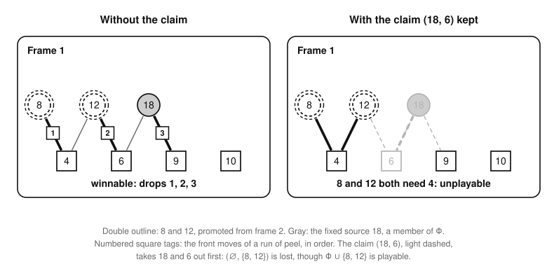

# The extended problem and the certificates of U

Part of [the theory](../THEORY.md).

The *extended problem* Π⁺(O) is the frame model with a set O of the sources of U\* left optional instead of fixed.  It
is exact as the frame model is: [the extended exactness theorem (E1)](#the-extended-exactness-theorem).  So a search of
it that finds nothing better than a recorded score proves the score optimal, once the other members of U\* in layers 3
and up are certified: [the certificate theorem (E2)](#the-certificate-theorem).  When the recorded game plays U\*, this
proves [statement U](exactness.md#statement-u) at that game.  That is how a certificate of U is made, game by game.

*Words.*  [Sources](../GLOSSARY.md#the-frame-model) are the glossary's, and [U\*](sources.md#descending-greedy) is what
descending greedy keeps of them; U\*_k and U\*_{≥3} are its parts in layer k and in layers 3 and up, and ΣS is the sum
of a set S ([notation](statements.md#notation)).  [q(n)](neighbors.md#neighboring-games) is the largest prime ≤ n.
Frames, their moves and factors, frame h, taking a number on, the tests (a) and (b), claims, reduction, homes, applying
a set, winnable pairs and promotion sets are those of [the frame model](frame-model.md#the-frame-model), and so are the
facts on instances used here: [restriction](frame-model.md#frames-and-the-frame-model), "playable against", and
[peel](playability.md#peel)'s front and back moves, which keep an instance playable and keep it unplayable ([the peel
theorem (P4)](playability.md#the-peel-theorem)).  Results cited by label F or X are those of frame-model.md and of
[exactness.md](exactness.md).  A frame is a component of the frame graph, which lies in one layer ([the frame lemma
(F1)](frame-model.md#the-frame-lemma)), and a frame h is a union of frames.

## The extended problem

Let O ⊆ U\* be the *open* sources, and Φ = U\* ∖ O the *fixed* ones.  Let J be the sources that descending greedy
rejected in the frames that hold a member of O.

* The *freedoms⁺* of a frame D are |F_D| − |Φ ∩ D|, its freedoms plus |O ∩ D|, and D is *inert* when it has none.  A
  frame that holds an open source therefore has freedoms⁺.
* Let k₀⁺ be the lowest layer of a frame with freedoms⁺.  A frame with freedoms⁺ in layer k gets the number k − k₀⁺,
  and *frame h* of Π⁺(O) is the union of the frames numbered h, with the moves Φ ∩ frame h and the factors F_h.  It
  takes a number on as a frame of the model does, with these moves.
* A *two-sided candidate* is a factor x of a frame D numbered h ≥ 1 that passes the tests with Φ for U\*: (a) Φ ∩ D is
  playable against F_D ∖ {x}; (b) frame h − 1 can take x on.
* The *one-sided candidates* are the members of O ∪ J.  The *own frame* of one is the frame h that holds the frame of
  that source.
* The root frame h is frame h, reduced; nothing is claimed.  ΣΦ is the score with no promotions.
* *Applying* (K, L) to frame h, or to root frame h, adds to its moves the members of K whose own frame is h and the
  members of L whose home is h + 1, and removes from its factors the members of L whose home is h.  A *promotion set*
  of Π⁺(O) is a pair (K, L), K ⊆ O ∪ J and L a set of two-sided candidates, such that every root frame is winnable with
  (K, L) applied.  It is worth ΣK + ΣL, and P\*(Π⁺(O)) is the most a promotion set is worth.

The certificates take O in layers 3 and up.  Then J is empty unless descending greedy rejects a source of layer 3 or
more in a frame of O, which first happens at n = 741: there it rejects 374 = 2·11·17 in a frame of layer 3, and J =
{374} for every O that holds a member of U\* in that frame.

At n = 24 with O = {16, 20, 24}, Φ is {14, 15, 18, 21, 22, 23}, with ΣΦ = 113.  Frame 0 has the moves 14, 15, 21 and 22
and the factors 2, 3, 5, 7 and 11; frame 1, the union of the frames of 18 and of 20, has the move 18 and the factors 4,
6, 9 and 10; frame 2 has no move and the factors 8 and 12.  The two-sided candidates are 4, 9, 8 and 12, and the
one-sided ones are 20, of frame 1, and 16 and 24, of frame 2.  In the frame model of 24 the frame of 16 and 24 is
closed; opening its sources gives it two freedoms⁺, and makes its factors candidates.  With O empty, the extended
problem has the promotion sets of the frame model, and with the claims it is a root problem of game n ([the formulation
corollary (E5)](#the-kept-claims-lemma)).

## The extended exactness theorem

**Theorem E1 (the extended exactness theorem).**  Let O ⊆ U\* and Φ = U\* ∖ O, and let S ⊆ {2, …, n} contain Φ.  Write
K for the sources of S outside Φ and L = S ∩ {2, …, ⌊n/2⌋}.  Then S is playable iff (K, L) is a promotion set of
Π⁺(O), and then ΣS = ΣΦ + ΣK + ΣL.

*Proof.*  It is the proof of [the exactness theorem (X7)](exactness.md#the-exactness-theorem) and its lemmas, read with
Φ for U\*, freedoms⁺ for freedoms, inert frames for closed ones and the numbering of Π⁺(O), with one new kind of member:
the members of K, each a move of its own frame.  One fact serves both directions.

*The drops.*  For every K ⊆ O ∪ J and every set L of two-sided candidates, every two-sided candidate of a frame numbered
h has the home h, and root frame h with (K, L) applied is winnable iff frame h with (K, L) applied is playable.  This is
[the reduction-step lemma (X6)](exactness.md#the-exactness-theorem) read with Φ for U\*.  The drops are front claims of
frame h, whose moves are Φ ∩ frame h.  By the proof of [the claims lemma (X5)](exactness.md#the-exactness-theorem), part
1, read with Φ ∩ D for U\* ∩ D, none of them takes a factor that passes test (a).  A front move stays one when members
of K and L are added, and the rest is X6's argument.

*Only if.*  Let S be playable, with an acyclic scheme.

1. K ⊆ O ∪ J.  A source s of K is open, or descending greedy rejected it in the frame D that holds it.  If D held no
   open source, U\* ∩ D would lie in Φ ⊆ S.  By [the kept-sources lemma (X1)](exactness.md#the-exactness-theorem),
   descending greedy found s and the members of U\* ∩ D above it unplayable against F_D, yet in S they pay with
   factors of D, and restriction would make them playable.  So D holds an open source: s ∈ J.
2. As in [the closed-frames lemma (X2)](exactness.md#the-exactness-theorem), the factors of an inert frame D pay the
   members of Φ ∩ D: none is in S or pays for another member, and no member of K lies in D.
3. As in [the one-frame-forward lemma (X3)](exactness.md#the-exactness-theorem), each member of L is a factor of a frame
   numbered h ≥ 1 and pays with a factor of frame h − 1; each member of Φ or K pays with factors of the frame that
   holds it.
4. As in [the candidate lemma (X4)](exactness.md#the-exactness-theorem), each member x of L, a factor of a frame D
   numbered h, is a two-sided candidate: restrict to Φ ∩ D for (a), and to x and the moves of frame h − 1 for (b).
5. As in X7, the members of frame h with (K, L) applied pay with factors of frame h outside L: by restriction frame h
   with (K, L) applied is playable, and by the drops root frame h with (K, L) applied is winnable.

*If.*  Let (K, L) be a promotion set.

6. Each frame h with (K, L) applied is playable, by the drops.  A member of K is a source of its own frame and lists
   only factors of the frame that holds it, so steps 3 to 5 of X7's proof apply as they stand: they join schemes of
   these and of Φ ∩ D against F_D, for each inert frame D, into an acyclic scheme of the own instance of S.  So S is
   playable, and ΣS = ΣΦ + ΣK + ΣL.  ∎

At n = 24 with O = {16, 20, 24}, the heaviest promotion set is ({16, 20, 24}, {9}), worth 69.  By E1 it is the playable
set U\* ∪ {9}, of weight 113 + 69 = 182, which is ΣU\* + P\*(Π_24) and opt(24).

The extended problem has the frame model's form, with one more kind of candidate, a one-sided member counting as one
more move of its own frame.  Read so, [the state lemma (R1)](search-rules.md#the-state-lemma), [the dual-bound lemma
(R4)](search-rules.md#the-dual-bound-lemma) and [the floor lemma (R5)](search-rules.md#the-floor-lemma) hold for a
search of it, and [the frame bound for the extended problem
(B3)](frame-bounds.md#the-frame-bound-for-the-extended-problem) bounds its promotion sets and counts a completion's
members.  The prime-exchange rules (R2, R3) and the repeat and near-repeat lemmas (R6, R7) are not claimed for it: its
search uses no symmetric pair and no near-repeat source, and the same-problem corollary (E6) takes the place of the
repeat lemma.

## The certificate theorem

Let V be the score of a game of n.  A member u of U\*_{≥3} is *certified against* V when every playable set that
[obeys F4](parity-bound.md#the-barred-bound) and weighs more than V contains u; a set obeys F4 when it holds q(n) and
no other prime, and exactly U\*_2 among the sources of layer 2, as every optimal set does by the bottom-layers theorem
(F4).  [The barred bound (W2)](parity-bound.md#the-barred-bound) certifies u against V when, with u barred, it is at
most V.  A member certified against V is certified against every V′ ≥ V, since a set that weighs more than V′ weighs
more than V.

**Theorem E2 (the certificate theorem).**  Let V be the score of a game of n, and Φ a set with U\*_1 ∪ U\*_2 ⊆ Φ ⊆ U\*
whose members of layer 3 or more are certified against V.  If no promotion set of Π⁺(U\* ∖ Φ) is worth more than
V − ΣΦ, then opt(n) = V.  If moreover V = ΣU\* + P\*(Π_n), the score of a game that plays U\*, then statement U holds
at n.

*Proof.*  The idea: an optimal set heavier than V would contain Φ, and so be a promotion set heavier than the search
allows.  Suppose opt(n) > V.  An optimal set S obeys F4 ([the bottom-layers theorem
(F4)](frame-model.md#the-bottom-layers-theorem); U\*_1 = {q(n)}) and weighs more than V, so it contains every certified
member, and with U\*_1 ∪ U\*_2 all of Φ.  By E1 it gives a promotion set of Π⁺(U\* ∖ Φ) worth ΣS − ΣΦ > V − ΣΦ, a
contradiction.  So opt(n) ≤ V, and V is the score of a game.  If V = ΣU\* + P\*(Π_n), then ΣU\* + P\*(Π_n) = opt(n),
which is U at n by [the corollary of U (X8)](exactness.md#statement-u).  ∎

At n = 24 with Φ = U\* ∖ {16, 20, 24} and V = 182, the heaviest promotion set is worth 69 = V − ΣΦ; so once 16, 20 and
24 are certified against 182, E2 proves opt(24) = 182, and U at 24.  In a search for opt(n), rather than a check of V,
V can be the search's starting incumbent: the members certified against it are certified against every set that beats
it.  [results/README.md](../../results/README.md#certificates) lists the games with a certificate.

A search for a certificate can also stop at the ceiling of [the ceiling lemma (N4)](neighbors.md#the-ceiling-lemma),
but then it rests on the game before.

**Corollary E3 (the ceiling-stop corollary).**  Let V(n − 1) be the score of a game of n − 1, and Φ a set with
Φ ⊆ U\*.  If some promotion set (K, L) of Π⁺(U\* ∖ Φ) is worth n + V(n − 1) − ΣΦ, and V(n − 1) = opt(n − 1), then no
promotion set is worth more, and Φ ∪ K ∪ L is an optimal set: opt(n) = n + V(n − 1).

*Proof.*  By E1, Φ ∪ K ∪ L is playable and weighs n + V(n − 1).  By N4, opt(n) ≤ n + opt(n − 1) = n + V(n − 1).  So
the set is optimal, and by E1 every promotion set (K′, L′) is a playable set Φ ∪ K′ ∪ L′, worth at most
opt(n) − ΣΦ.  ∎

So a certificate that stops at the ceiling proves opt(n) without the certified members, but it also rests on the
recorded game of n − 1 being optimal: the score of a game of n − 1 is at most opt(n − 1), and the stop needs equality.

## The kept-claims lemma

The claims of Π_n shrink its frames, so the extended problem keeps those it safely can.  It cannot keep them all.  A
back claim (s, f) of Π_n is safe because no candidate of Π_n has f among its maximal factors (X5), and Π⁺(O) has more
candidates: opening sources gives frames more freedoms⁺, so that a closed frame can be numbered and a frame can take
more on.  At n = 24 with O = {16, 20, 24}, the factor 12 = 2²·3 becomes a two-sided candidate, and its maximal factor 6
is the factor of Π_24's back claim (18, 6).  Kept, that claim would leave 8 and 12 both needing the factor 4 in frame
1, and lose the promotion set (∅, {8, 12}), although Φ ∪ {8, 12} is playable.

*Frame 1 of Π⁺(O) at n = 24 with 8 and 12 (double outline) promoted into it.  Gray circle: the fixed source 18, a
member of Φ.  Numbered square tags: the front moves of a run of peel, in order.  With the claim (18, 6) taken out first
(light dashed pair), 8 and 12 both need 4.*

So the claims are kept frame by frame, with a check.  Take the claims of the frames h of a root problem of game n, Π_n's
or any other's, not its drops, and give each the frame D of its move, which holds its factor too.  D *keeps* its claims
if it holds no member of O (and then none of J), and each of its back claims (s, f) passes the *check*: f is not a
two-sided candidate of Π⁺(O), and no two-sided candidate has f among its maximal factors.  *Π⁺(O) with claims* takes the
claims of the frames that keep theirs out of its frames h, before the root is reduced; its candidates and ΣΦ are
Π⁺(O)'s.

**Lemma E4 (the kept-claims lemma).**  Let a frame D keep its claims, D in frame h of Π⁺(O); let K ⊆ O ∪ J, and L a
set of two-sided candidates.  Then D's claims are, in order, front and back moves of frame h with (K, L) applied, and
none takes a member of L.

*Proof.*  The idea: D holds no open source, so it sees Π⁺(O) as Π_n does, and only the check is new.  The members of
that instance that list factors of D are the members of Φ ∩ D, which is U\* ∩ D, and the members of L promoted into
frame h.  No member of K lies in D, and a member of K lists only factors of its own frame.  Claims of other frames touch
none of D's moves and factors.  Take D's claims in order, the earlier ones made.

* A front claim (s, f): s lists only f.  And f ∉ L: test (a) of Π⁺(O) on D is that of Π_n, since Φ ∩ D = U\* ∩ D,
  and f fails it, by the proof of X5, part 1.
* A back claim (s, f): s is the only move of D left with f as a maximal factor, by the claim's rule, since the moves
  of a frame of the model are its members of U\*.  By the check no member of L lists f, and f ∉ L.  ∎

**Corollary E5 (the formulation corollary).**  Π⁺(O) and Π⁺(O) with claims have the same promotion sets: in both,
they are the pairs (K, L), K ⊆ O ∪ J and L a set of two-sided candidates, with every frame h with (K, L) applied
playable.  So E1 holds for both.  And with O = ∅, Π⁺(∅) with the claims of a root problem of game n is that root
problem.

*Proof.*  The idea: in both formulations, what leaves frame h before the search is front and back moves.  A root frame
h of Π⁺(O) with claims is frame h less the kept claims of its frames, then reduced.  The kept claims are front and back
moves of frame h with (K, L) applied, none taking a member of L (E4).  The drops that follow are front moves that take
no two-sided candidate, as in the drops of E1's proof, with the kept claims among the earlier moves of their frame.  So
in both formulations every two-sided candidate has a home, and root frame h with (K, L) applied is winnable iff frame
h with (K, L) applied is playable (P4, and [the winnability lemma (F5)](frame-model.md#the-winnability-lemma)).  With
O = ∅, Φ is U\*, freedoms⁺ are freedoms and J is empty, so Π⁺(∅) has Π_n's frames h and candidates.  Every frame keeps
its claims, since a back claim's factor passes the check (X5).  So the frames h of Π⁺(∅) with claims are those of the
root problem less its claims, which are winnable and reduce to its root frames in any order ([the reduction lemma
(F8)](frame-model.md#the-reduction-lemma)).  ∎

So a bound on the promotion sets shown in one formulation holds in the other.

## The same-problem corollary

Two extended problems are *equal* when they have the same root frames, numbered alike, the same two-sided candidates
with the same homes, and the same one-sided candidates with the same own frames.  A problem's promotion sets are defined
from these alone, so equal problems have the same promotion sets, worth the same.

**Corollary E6 (the same-problem corollary).**  Let V(n) be the score of a game of n, and Φ_n a set as in E2 for game n
and V(n).  Let m be another game, Φ_m ⊆ U\*(m), and β a number such that no promotion set of Π⁺(U\*(m) ∖ Φ_m) of game
m is worth more than β.  If Π⁺(U\*(n) ∖ Φ_n) of game n equals Π⁺(U\*(m) ∖ Φ_m) of game m in one formulation, and
V(n) − ΣΦ_n ≥ β, then opt(n) = V(n).

*Proof.*  By E5 a bound on the promotion sets holds in both formulations, whichever one it was shown in.  In the
formulation where the two problems are equal, no promotion set of game n's problem is worth more than
β ≤ V(n) − ΣΦ_n, and E2 gives opt(n) = V(n) without a search of game n.  ∎

With the claims, a claimed pair that only one of two consecutive games has is part of neither problem, which can leave
the two problems equal.
