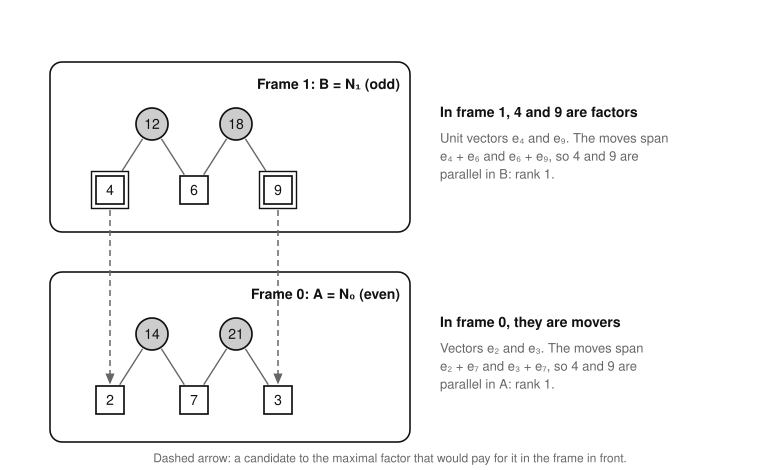
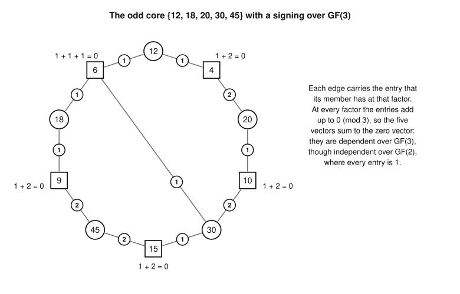

# Bounds on the promotions

Part of [the theory](../THEORY.md).

The frame model's promotions obey linear algebra frame by frame, as the moves of the whole game do in [the parity bound
(W1)](parity-bound.md#the-parity-bound).  In a [frame](frame-model.md#frames), give the factors coordinates, each move
and each number promoted into the frame a vector of its maximal factors there, with any nonzero entries, and each number
promoted out of it its unit vector.  A promotion set makes these vectors linearly independent in every frame, over every
field: [the signed frame theorem (B1)](#the-signed-frame-theorem).  With every entry 1 over GF(2), the heaviest set of
candidates independent in every frame, with no more members than the promotion limit, bounds the best promotion set, at
the root and at every node of a search: [the frame bound (B2)](#the-frame-bound).  The same holds for the extended
problem ([B3](#the-frame-bound-for-the-extended-problem)), whose searches make the certificates of [statement
U](exactness.md#statement-u).  Proofs of scores rest on these three.  Two more results serve studies of stronger bounds,
and no proof of a score rests on them: frames under other signings join the frame bound through Lagrange multipliers in
[the decomposition bound (B4)](#the-decomposition-bound), and over GF(3) the signings together lose nothing that
winnability keeps ([the GF(3) proposition, B5](#the-gf3-proposition), explanatory).  A set of candidates is independent
in every frame exactly when it is [independent at both parities](parity-bound.md#the-parity-vectors) together with U\*
([the comparison theorem, B6](#the-comparison-theorem), explanatory).  All six are proved, a part of B6 given the span
conjecture (♦).

*Words.*  Frames, their numbering, [candidates, homes, winnable frames and promotion
sets](frame-model.md#the-frame-model), and [nodes, completions, state(P) and the promotion
limit](frame-model.md#searching-the-frame-model) are defined in frame-model.md.  Fields are explained in [the
primer](primer.md#finite-fields-and-gf2), and linear independence in [its section on linear
independence](primer.md#linear-independence).

## Signed frames

Fix a *state* of the frame model: the root of a root problem such as Π_n, or the state(P) that a node's promotions P
leave.  Its frames are numbered h = 0, 1, 2, …; write Q_h for the factors of frame h in the state.  Its *candidates*
are, at the root, the root problem's candidates, and in state(P), the candidates outside P that are still factors of
their homes there.  A candidate of home h ≥ 1 is one of the factors Q_h.  The *movers* of frame h are its moves and the
candidates of home h + 1, which become its moves when promoted.  The candidates that *touch* frame h, T_h, are those of
home h, which leave Q_h when promoted, and those of home h + 1.

**Definition (signing).**  An *incidence* of frame h is a mover z of frame h together with a maximal factor f of z in
Q_h.  A *signing* σ of frame h over a field 𝔽 gives each incidence a value σ(z, f) of 𝔽 other than 0.  A mover z then
has the vector v_σ(z) = Σ_f σ(z, f) e_f of 𝔽^{Q_h}, and each factor y in Q_h has its unit vector e_y.  The *plain*
signing gives every incidence the value 1; over GF(2) it is the only signing.

**Definition (independence in a frame).**  A set X of candidates is *independent in frame h* under a signing σ of frame
h when the vectors v_σ of frame h's moves and of X's members of home h + 1, with the unit vectors e_y of X's members y
of home h, are linearly independent; X's other members play no part.  Unless a signing is named, it is the plain one
over GF(2).  X is independent in frame h *together with* a set P when P ∪ X is.

*The quotient form.*  The moves' vectors are independent in every state, under every signing: the promotions P of a
state form a promotion set (at the root P is empty, a promotion set by [the exactness theorem
(X7)](exactness.md#the-exactness-theorem), as U\* is playable), so every frame of the state is winnable with nothing
applied, its moves peel completely ([the peel theorem (P4)](playability.md#the-peel-theorem)), and [the peel-order lemma
(P9)](playability.md#the-peel-order-lemma), part 2, applies.  A family made of the moves' vectors and others is then
independent exactly when the others' *classes* modulo the moves' span are ([quotients](primer.md#linear-independence)):
a set is independent in frame h exactly when the classes of its members that touch frame h are.  The quotient has
dimension |Q_h| less the number of moves, the frame's freedoms, so a set independent in frame h has at most that many
members in T_h.

**Every frame at once.**  A set X of candidates is *independent in every frame* when it is independent in each frame
under the plain signing over GF(2), and *together with* a set P when P ∪ X is.  A candidate of home h touches frames h
and h − 1 only, one even and one odd, so the even frames' sets T_h partition the candidates, as do the odd frames'.
Independence in every frame is then two conditions, the even frames' and the odd frames', each the independence of one
family of vectors: give each candidate its class in the even frame it touches, in the direct sum of the even frames'
quotient spaces, where each frame's quotient meets the sum of the others only in 0, so that a set is independent exactly
when its part in each even frame is (the primer, the item "Disjoint blocks").  Likewise for the odd frames.  Weighted
matroid intersection finds a heaviest set independent in two such families, within a limit on its size ([the
primer](primer.md#two-families-at-once)).  The frame bound needs only weak duality, by which a weight split that attains
a value proves it; one exists under the limit too (the primer's paragraph "For families of vectors").

*Example.*  On the board of 21, setup leaves two frames with freedoms: frame 0, with the moves 14 and 21 and the factors
2, 3 and 7, and frame 1, with the moves 12 and 18 and the factors 4, 6 and 9 (15 has taken 5, and 20 has taken 10).  The
board's candidates are 4 and 9, both of home 1.  In frame 0 they are movers, with the vectors e₂ and e₃.  The moves'
vectors are e₂ + e₇ and e₃ + e₇, so both classes equal that of e₇, and {4, 9} is dependent in frame 0.  In frame 1 they
are factors, with the vectors e₄ and e₉, and the moves' vectors are e₄ + e₆ and e₆ + e₉, so again both classes are e₆'s,
and {4, 9} is dependent in frame 1.  Each frame has one freedom.  The sets independent in every frame are ∅, {4} and
{9}, and the heaviest, {9}, is worth P\* = 9: on this board the frame bound is exact.  The frames do no work here,
though: the promotion limit of 1 alone allows only one of the two candidates, and so bounds P\* by 9 too.

*Each candidate touches one odd and one even frame: it is a factor of frame 1 and a mover of frame 0, and in each frame
4 and 9 have one class.  Dashed arrow: a candidate to the maximal factor that would pay for it in frame 0.*

## The signed frame theorem

**Theorem B1 (the signed frame theorem).**  Let L be a promotion set of a root problem Π of the frame model, h a frame
of Π, and σ a signing of frame h over a field 𝔽.  Then the vectors v_σ of frame h's moves and of L's members of home
h + 1, and the unit vectors e_y of L's members y of home h, are linearly independent; that is, L is independent in frame
h under σ.  Moreover:

1. *Class 0.*  A candidate whose class in frame h under σ is 0, its vector in the span of the moves' vectors, lies in no
   promotion set.
2. *Nodes.*  At a node with the promotions P, every completion P ∪ X has X independent in frame h together with P, under
   σ.  A set of candidates of state(P) is independent in frame h together with P exactly when it is independent in frame
   h of state(P), under the values of σ on the incidences that remain.  A candidate y of home h that state(P) has taken
   out of its home has P ∪ {y} dependent in frame h.

Each frame's condition concerns its own vectors alone, so every promotion set is independent in every frame at once,
under whatever signing and field each frame is given.

*Proof.*  The idea: a winnable frame peels completely, and the order of its peel makes its vectors triangular, whatever
their nonzero entries.

1. *Frame h peels completely.*  L is a promotion set, so frame h is winnable with L applied: the instance whose members
   are the moves of frame h and L's members of home h + 1, and whose pool is Q_h less L's members of home h, each member
   listing its maximal factors in the pool, is playable.  By [the peel theorem (P4)](playability.md#the-peel-theorem),
   peel pairs all of its members.
2. *The vectors are independent.*  By [the peel-order lemma (P9)](playability.md#the-peel-order-lemma), part 2, the
   members' vectors v_σ, for any nonzero values, are then linearly independent together with the unit vectors of the
   coordinates outside the pool, which are the e_y of L's members of home h: L is independent in frame h under σ.
3. *The classes.*  By [the quotient form](#signed-frames), so are the classes of L's members that touch frame h.
4. *Class 0.*  An independent family of classes holds no class 0, so by step 3 no promotion set holds a candidate whose
   class is 0.
5. *Nodes.*  A completion P ∪ X is a promotion set, so by step 2 it is independent in frame h under σ: X is independent
   in frame h together with P.
6. *Together with P is the node's frame.*  By step 2 for P, the moves' vectors and those of P's members that touch frame
   h are independent, so X is independent together with P exactly when its classes modulo the span of all of these are
   ([independence together with a set](primer.md#linear-independence)).  Adding the vectors of P's members of home
   h + 1 to the span makes them moves, as they are in state(P).  Quotienting by the e_y of P's members y of home h
   deletes the coordinates y: they leave the factors, as in state(P).  The frames of state(P) are then reduced, as [its
   definition](frame-model.md#searching-the-frame-model) has it: a move a left with a single factor f among the factors
   that remain is dropped with f.  Modulo the coordinates already deleted, v_σ(a) is σ(a, f) e_f, so the quotient by it
   deletes the coordinate f, and every other number's class is its vector on the factors left, modulo the moves left,
   as in the reduced frame.  So, by the quotient form in state(P), X is independent together with P exactly when it is
   independent in frame h of state(P).  If f is a candidate of home h, its class e_f is now 0: P ∪ {f} is dependent in
   frame h.  ∎

*Example.*  At the node of game 21 that promotes 9, root frame 1 loses the factor 9, so 18 is left with 6 alone and
drops with it, and then 12 drops with 4: state({9}) has taken 4 out of its home.  So {4} is dependent together with 9 in
frame 1: e₄ = (e₄ + e₆) + (e₆ + e₉) + e₉.  It is in frame 0 too, since frame 0, with 9 as a move, has no freedom left.

## The frame bound

**Corollary B2 (the frame bound).**  Let Π be a root problem of the frame model.  Every promotion set of Π is
independent in every frame, and has no more members than the promotion limit, so

    P*(Π) ≤ max { ΣI : I independent in every frame, with no more members than the promotion limit }.

At a node with the promotions P and the candidates C, every completion P ∪ X has X independent in every frame together
with P, with no more members than the node's promotion limit, so

    ΣX ≤ max { ΣI : I ⊆ C independent in every frame together with P,
                    with no more members than the node's promotion limit }.

The right side plus ΣP is the node's *frame bound*; at the root, where P is empty, it is the first right side.  By
[B1](#the-signed-frame-theorem) (2), on the candidates of state(P), independence in every frame together with P is
independence in every frame of state(P), and no set I holds a candidate that state(P) has taken out of its home.

*Proof.*  B1 with the plain signing over GF(2) makes every promotion set independent in every frame.  A promotion set
has no more members than the promotion limit, and a completion P ∪ X has |X| at most the node's promotion limit ([the
promotion-limit lemma (F9)](frame-model.md#the-promotion-limit-lemma), part 2).  At a node, P ∪ X is a promotion set, so
it is independent in every frame: X is independent in every frame together with P.  ∎

In game 21, the node that promotes 9 has the frame bound 9: its candidate 4 is dependent together with 9 in both frames,
and its promotion limit is 0.

*What it misses.*  Where every member of a frame's instance, with a set applied, lists at most two factors of the pool,
winnability and independence over GF(2) are the same condition, that the lists form a forest ([the two-factor
proposition (P11)](playability.md#the-two-factor-proposition)), so on such frames the frame bound loses nothing.  It
misses the unwinnable frames whose vectors are independent over GF(2), each of which holds an [odd
core](playability.md#odd-cores), with a mover of three or more factors.

*Against the matching bound.*  The frame bound is never above [the matching bound](../GLOSSARY.md#bounds)
([solver/docs/design/search.md](../../solver/docs/design/search.md#the-matching-bound)), which asks only that each move
and each promoted number get a distinct maximal factor in its frame, none of them a promoted number.  If a frame's
family of vectors is independent, the matrix with a row for each vector has a nonsingular square submatrix on as many
columns as rows, and a nonzero term of its determinant gives each row a distinct column where its entry is nonzero.  A
unit vector e_y can only take y, so the movers take distinct factors of the frame that are not promoted: the matching
bound's assignment.  So every set the frame bound admits, the matching bound admits.

*Against the parity bound.*  The parity bound is the same construction on the whole board.  It is never below ΣU\* plus
the frame bound, and given (♦) the two differ only by what the numbers up to n/2 that are no candidates add ([the
comparison theorem (B6)](#the-comparison-theorem)).  They are equal at every board from 2 to 8191
([evidence.md](evidence.md#observations)), where fixing the sources to U\* and the promotions to the candidates costs
the bound nothing: the prover's bound on the whole board and the frame solver's bound at the root agree.  On 5,496 of
those boards, from 1173 on, B6 does not account for the equality: some numbers that are no candidates are [independent
at both parities](parity-bound.md#the-parity-vectors) together with U\*, though the heaviest sets found hold none of
them.

The frame solver's node bound is the frame bound, under the solver's name for it, the GF(2) bound; it computes a node's
independence as the root's together with the node's promotions, by B1 (2) ([solver/docs/design/gf2-bound.md, "The GF(2)
bound"](../../solver/docs/design/gf2-bound.md#the-gf2-bound)).

## The frame bound for the extended problem

The [extended problem](extended-problem.md#the-extended-problem) Π⁺(O) leaves the sources O ⊆ U\*_{≥3} optional.  Its
promotion sets (K, L) hold *one-sided* candidates K ⊆ O ∪ J, sources that are moves of their own frame if promoted and
touch no other frame, besides the two-sided candidates L, which are the frame model's kind.  The two kinds are disjoint
(the one-sided are sources, the two-sided at most n/2), so below a promotion set is written as the set K ∪ L.  The
*freedoms* of a pair of Taxman Mini are its factors less its moves ([searching the frame
model](frame-model.md#searching-the-frame-model)).

**Corollary B3 (the frame bound for the extended problem).**  Let O ⊆ U\*_{≥3}.  Define independence in each frame of
Π⁺(O) as for a root problem of the frame model, under the plain signing over GF(2), with each one-sided candidate s a
mover of its own frame h and of no other, with the vector v(s) on frame h's factors.  Then:

1. every promotion set K ∪ L of Π⁺(O) is independent in every frame;
2. for every subset P of a promotion set K ∪ L, such as the promotions of a node, (K ∪ L) ∖ P is independent in every
   frame together with P;
3. if P is itself a promotion set, the two-sided members of (K ∪ L) ∖ P number at most the promotion limit of the
   freedoms of the root frames of Π⁺(O) with P applied, and each one-sided member of it has an own frame with a freedom
   there.

So at a node with the promotions P and the candidates C, every completion P ∪ X has ΣX at most the heaviest ΣI over the
sets I ⊆ C independent in every frame together with P, with no more members than that promotion limit plus the number of
one-sided candidates in C.

In the two families of vectors of [signed frames](#signed-frames), a one-sided candidate is a mover in the family of its
own frame's parity, by its class there, and has a private coordinate in the other, so it joins any set independent
there, and the bound is computed as the frame bound is.

*Proof.*

1. *Each frame.*  It is the proof of [B1](#the-signed-frame-theorem) with the plain signing over GF(2) and one more kind
   of mover.  Frame h of Π⁺(O) is winnable with K ∪ L applied: its instance has as members the fixed sources of the
   frame, which are its moves, the members of K whose own frame it is, and the members of L of home h + 1, and as pool
   its factors less the members of L of home h.  By [P4](playability.md#the-peel-theorem) and
   [P9](playability.md#the-peel-order-lemma) their vectors, with the unit vectors of L's members of home h, are
   independent, so K ∪ L is independent in frame h.
2. *Every frame.*  A member of K touches no frame but its own, so step 1 for each frame gives part 1.  Part 2 follows by
   the definition of independence together with P, as in B1, step 5.
3. *The count.*  Let r_h be the freedoms of root frame h with P applied, and let (K ∪ L) ∖ P have x_h two-sided members
   of home h and g_h one-sided members whose own frame is h.  Applying them to that frame adds g_h + x_{h+1} moves and
   removes x_h factors, and it stays winnable, so it keeps at least as many factors as moves: x_h + x_{h+1} + g_h ≤ r_h.
   No candidate has the home 0, so x_0 = 0, and with no frame beyond the last the sequence (x_h) is one of those that
   the promotion limit of the freedoms r_h ranges over, as in the proof of
   [F9](frame-model.md#the-promotion-limit-lemma), part 2.  So Σx_h is at most that limit, and g_h ≥ 1 only if r_h ≥ 1.
   The bound at a node follows from parts 2 and 3, since a completion's one-sided members are among the one-sided
   candidates of C.  ∎

[The certificate theorem (E2)](extended-problem.md#the-certificate-theorem) searches Π⁺(O), and its search cuts by this
bound ([solver/docs/design/extended-mode.md](../../solver/docs/design/extended-mode.md)).

## The decomposition bound

Independence under other signings, over any fields, combines with the frame bound into one bound by splitting the
weights among the conditions, as weak duality allows ([the primer](primer.md#weak-duality-and-lagrangian-relaxation)).
Nothing that proves a score rests on this bound; studies of stronger bounds use it.

**Theorem B4 (the decomposition bound).**  Let Π be a root problem of the frame model, and σ_1, …, σ_t signings of
frames h_1, …, h_t of Π, each over some field (several may share a frame).  For a weight function ω on the candidates,
let MI(ω) be the largest ω(I) of a set I independent in every frame with no more members than the promotion limit (I = ∅
included); for one on T_{h_j}, write max_j for the largest weight of a set independent in frame h_j under σ_j.  Then for
all real vectors λ_1, …, λ_t, with λ_j on T_{h_j} and 0 off it, every promotion set L of Π satisfies

    ΣL ≤ MI(w − Σ_j λ_j) + Σ_j max_j λ_j = dec(λ),

where w(x) = x.  The same holds with the sets I kept from the candidates of class 0 in any frame h_j under σ_j.  At a
node with the promotions P, it holds for ΣX of every completion P ∪ X, with each independence taken together with P, and
with the node's promotion limit.

*Proof.*  Split the weight: ΣL = (w − Σ_j λ_j)(L) + Σ_j λ_j(L ∩ T_{h_j}).  L is independent in every frame with no more
members than the promotion limit ([B2](#the-frame-bound)), so the first term is at most MI(w − Σ_j λ_j).  L is
independent in frame h_j under σ_j ([B1](#the-signed-frame-theorem)), so the j-th term of the sum is at most max_j λ_j.
L holds no candidate of class 0 in any frame h_j under σ_j (B1 (1)), so keeping the sets I from them keeps L among them.
At a node, the same argument runs with X in place of L, by B1 (2) and B2.  ∎

Each term is a standard computation: MI weighs a heaviest set independent in the two families of [signed
frames](#signed-frames) within the promotion limit, which weighted matroid intersection finds and a weight split checks
([the primer](primer.md#two-families-at-once); under the limit, the paragraph "For families of vectors"), and max_j the
greedy algorithm on frame h_j's classes under σ_j ([the primer](primer.md#the-greedy-algorithm)).  At λ = 0 the sum is
0 and dec(0) is the frame bound, so the best multipliers do at least as well.  The least value of dec over the
multipliers is that of a linear program over the convex hulls of the sets that each condition admits (the primer, the
paragraph "The best bound"), whose parts have the hulls that the paragraph "For families of vectors" describes.  That
says what the bound can reach; it holds at every λ, so nothing rests on how the multipliers are found.
[solver/docs/design/gf2-bound.md, "The decomposition
bound"](../../solver/docs/design/gf2-bound.md#the-decomposition-bound) says how a study's code evaluates it exactly.

## The GF(3) proposition

Over GF(3), a frame that is not winnable has a signing that shows it.  This is explanatory, and nothing rests on it; it
says why frames signed over GF(3) can close what the frame bound misses.

**Proposition B5 (the GF(3) proposition).**  Let L be a set of candidates of a state of the frame model, and h a frame
of the state.  Frame h is winnable with L applied if and only if L is independent in frame h under every signing of
frame h over GF(3).

*Proof.*  The idea: the members that a peel cannot pair list each of their remaining factors at least twice, so values
that cancel at every such factor make the vectors dependent.

1. *Only if.*  This is [B1](#the-signed-frame-theorem)'s argument, steps 1 and 2, which uses only that frame h is
   winnable with L applied.
2. *The stall.*  Suppose frame h is not winnable with L applied.  Run peel on its instance (the moves and L's members of
   home h + 1, over the pool Q_h less L's members of home h) until it stalls.  By [P4](playability.md#the-peel-theorem)
   some members are left unpaired: the *stalled* members, with the factors still live.  Each live factor that a stalled
   member lists is listed by at least two of them, or peel would make a back move.
3. *The signing.*  For each live factor listed by stalled members, give their incidences with it values in GF(3) that
   sum to 0: 1 and 2 for two members, 1, 1 and 1 for three, and for more, values 1 and 2 by twos with at most one triple
   of 1s.  Give every other incidence the value 1.
4. *The block structure.*  Order the members as [P9](playability.md#the-peel-order-lemma) does, with the stalled ones
   between its two kinds: peel's back moves in the order made, then the stalled members, then peel's front moves in the
   reverse of the order made; and order the pool's factors the same way, the back moves' factors, the live factors, the
   front moves' factors.  The argument of P9, part 1, holds with the stalled members counted as members paired after
   every move: a back move's factor is listed by no member that was live at its turn but its own, and the stalled
   members were live throughout; a front move's member lists no factor that was live at its turn but its own, and the
   live factors were live throughout.  So the vectors, restricted to the pool, form a block upper triangular matrix:

       rows \ columns    back moves'     live            front moves'
       back moves        triangular      anything        anything
       stalled           0               columns sum 0   anything
       front moves       0               0               triangular

   with nonzero diagonals in the two triangular blocks, and the stalled members' columns at the live factors summing to
   0 by step 3.
5. *A dependency.*  Give the stalled rows the coefficient 1 and the back rows 0.  The combination vanishes on the back
   moves' factors and on the live ones, and the triangular front block gives the front rows the coefficients that make
   it vanish on the front moves' factors too.  So it vanishes on the pool, and with the unit vectors e_y of L's members
   of home h it gives a vanishing combination of the whole family, with the coefficient 1 on every stalled member.
6. *L is dependent.*  The combination of step 5 is not trivial, so L is dependent in frame h under σ.  The moves'
   vectors of a state are independent, so its coefficients on L are not all 0, and it is a relation among the classes of
   L's members too ([the quotient form](#signed-frames)).  ∎

The same holds over every field with three or more elements, by D. Hershkowitz and H. Schneider's characterization of
the zero patterns all of whose matrices have the same rank ("Ranks of zero patterns and sign patterns", *Linear and
Multilinear Algebra* 34 (1993) 3–19): over such a field, every matrix with a given pattern of nonzero entries has full
row rank exactly when some matching of all the rows to columns is the only perfect matching between those rows and the
columns it uses, and such a matching orders them triangularly, which lets peel pair every member.  Over GF(2) the
proposition fails: the plain signing is the only one there, and an odd core is independent under it.

*Examples.*  The odd core {12, 18, 20, 30, 45} of the board of 45 lists the factors 4, 6, 9, 10 and 15 (12: 4, 6; 18: 6,
9; 20: 4, 10; 30: 6, 10, 15; 45: 9, 15), each by two of its members or, for 6, three, so peel has no move on it.  Under
the plain signing its five vectors have the determinant 3: odd, so independent over GF(2), but divisible by 3, so the
plain signing over GF(3) already shows the core.  With the values of step 3, 1 and 2 at 4, 9, 10 and 15 and 1, 1, 1 at
6, the five vectors sum to 0 over GF(3).

*The core with one choice of the values of step 3: the entries at every factor sum to 0 (mod 3).*

The signing matters for the odd core {20, 27, 28, 30, 42, 50, 63, 75} of the board of 75, which lists 4 (20 and 28), 6
(30 and 42), 9 (27 and 63), 10 (20, 30 and 50), 14 (28 and 42), 15 (30 and 75), 21 (42 and 63) and 25 (50 and 75), and
no part of which is a core.  Under the plain signing its eight vectors have the determinant −1, so they are independent
over GF(2), over GF(3) and over the rationals alike.  With the values of step 3, 1, 1, 1 at 10 and 1 and 2 at each other
factor, the eight vectors sum to 0 over GF(3).

## The comparison theorem

A set of candidates is independent in every frame exactly when it is [independent at both
parities](parity-bound.md#the-parity-vectors) together with U\*, so the frame bound is [the parity bound
(W1)](parity-bound.md#the-parity-bound) with picks and bars.  Nothing that proves a score rests on this.

**Theorem B6 (the comparison theorem).**  Let n ≥ 2, Π a root problem of game n with the candidates C, and k₀ the lowest
layer of a frame with freedoms.

1. *Independence.*  A set X ⊆ C is independent in every frame exactly when X ∪ U\* is independent at both parities: in
   every even frame exactly when at parity a, and in every odd frame exactly when at parity b, where a and b are the
   parities of k₀ − 1 and k₀.
2. *The limit.*  No set of candidates independent in every frame has more members than the promotion limit.
3. *One side.*  The frame bound of Π at the root, plus ΣU\*, is the parity bound of n with the picks U\* and the bars
   every number outside U\* ∪ C, so it is at most the parity bound of n.
4. *The other side, given (♦).*  If [(♦)](sources.md#the-span-conjecture) holds in game n, the parity bound of n is ΣU\*
   plus the heaviest ΣI over the sets I of numbers up to n/2 independent at both parities together with U\*; and it is
   ΣU\* plus the frame bound if every number up to n/2 that is independent at both parities together with U\* is a
   candidate.

If no frame has freedoms, C is empty, the frame bound is 0, and parts 2 to 4 hold as stated.

*Proof.*  The idea: the parity vectors split into blocks of coordinates by layer, working modulo U\*'s vectors clears
the closed frames from each block and leaves one frame h modulo its moves, and the claims change nothing on the
candidates.

1. *Blocks.*  Let block j be the coordinates up to n/2 in layer j.  A number s has v(s) in block Ω(s) − 1 and, if
   s ≤ n/2, e_s in block Ω(s), so each parity-i vector lies in a block of parity i or, for a number above n/2, on a
   private coordinate, and a set is independent at parity i exactly when its vectors in each block are ([vectors on
   disjoint coordinates](primer.md#linear-independence)).  Block j is the union of the pools F_D of the frames D of
   layer j + 1 ([the frame lemma (F1)](frame-model.md#the-frame-lemma)).
2. *Working modulo U\*.*  U\* is playable, so independent at both parities (W1), and X ∪ U\* is independent at parity i
   exactly when the classes of X's parity-i vectors modulo the span of U\*'s are.  At parity i a member of U\* has a
   private coordinate or has its v(s) in a block, on the pool of its own frame.  For a closed frame D, U\* ∩ D is
   playable against F_D, so its |F_D| vectors on F_D are independent ([P10](playability.md#the-independence-lemma)) and
   span all of them.  So, modulo U\*'s vectors, block j becomes the vectors on F_h, where h = j + 1 − k₀, modulo the
   span of frame h's moves, or nothing if layer j + 1 has no frame with freedoms.
3. *The candidates.*  A candidate x of home h + 1 has v(x) in block k₀ + h − 1, with the class of its vector on F_h, and
   a candidate y of home h has e_y there too.  So X ⊆ C has X ∪ U\* independent at parity a exactly when, for every even
   h, the classes of X's members that touch frame h are independent modulo frame h's moves on F_h, and at parity b
   likewise for the odd h.  By [the quotient form](#signed-frames), it remains to show that these classes have the
   dependencies of those of root frame h, modulo its moves on Q_h.
4. *The claims.*  Root frame h is frame h less a claim sequence, its drops included ([the reduction-step lemma
   (X6)](exactness.md#the-exactness-theorem)).  Let (s, f) be a claim, with the moves M and the factors K before it; f
   is no candidate ([the claims lemma (X5)](exactness.md#the-exactness-theorem), part 1).  A front claim's move s has
   the vector e_f on K, so working modulo it deletes the coordinate f.  A back claim's f is listed by s alone among M,
   and by no candidate (X5, part 2), so a vanishing combination of vectors of M and of candidates gives s the
   coefficient 0, and a set X of candidates has X ∪ M independent on K exactly when X ∪ (M − s) is independent on K − f.
   Either way, removing s and f keeps the dependencies among the candidates.
5. *Part 2.*  If I is independent in every frame, with x_h members of home h, then x_h + x_{h+1} ≤ ρ_h, the freedoms of
   root frame h, which bound the members in T_h of a set independent in it (signed frames).  With x_h at most the number
   of candidates of home h and x_0 = 0, (x_h) is one of the sequences over which the promotion limit is the largest sum
   ([searching the frame model](frame-model.md#searching-the-frame-model)).
6. *Part 3.*  By parts 1 and 2, the frame bound is the heaviest ΣI over the sets I ⊆ C with I ∪ U\* independent at both
   parities.  U\* is independent at both parities (step 2), and that sum plus ΣU\* is the parity bound with those picks
   and bars, by its definition, which is at most the parity bound of n.
7. *Part 4.*  Given (♦), every heaviest set independent at both parities holds U\* and no other source, by [the
   greedy-basis proposition (W3)](parity-bound.md#the-greedy-basis-proposition), whose step 6 then gives the first
   sentence.  The heaviest set I of that sentence holds no number dependent together with U\* at some parity, so under
   the hypothesis I ⊆ C, and step 6 applies.  ∎

In game 21, k₀ = 2, so frame 0 goes with parity 1.  Modulo the parity-1 vectors of U\*_2 = {14, 15, 21}, e₂ + e₇,
e₃ + e₅ and e₃ + e₇, the primes 2, 3, 5 and 7 have one class.  So v(4) = e₂ and v(9) = e₃ have one class, as in frame 0,
while v(6) = e₂ + e₃ and v(10) = e₂ + e₅ have the class 0: 6 and 10, which fail test (b), are dependent together with
U\*, and each other number up to 10 but 4 and 9 is too, at one parity.  At parity 0, 4 and 9 have one class as well, and
the claims (15, 5) and (20, 10) play no part.  Part 4 applies: the parity bound of 21, 144, is ΣU\* = 135 plus the frame
bound 9.

Every candidate x has U\* ∪ {x} independent at both parities, since {x} is a promotion set, by tests (a) and (b) and X6,
so U\* ∪ {x} is playable ([the exactness theorem (X7)](exactness.md#the-exactness-theorem)), and W1 applies.  So the
hypothesis of part 4 says that the candidates are the numbers that pass tests (a) and (b) read over GF(2), with
independence in place of playability.  It fails first at 1173, where 242, 286 and 374 fail test (b) through an odd core
but are independent at both parities together with U\*, and part 4's conclusion holds there all the same (the paragraph
"Against the parity bound").
