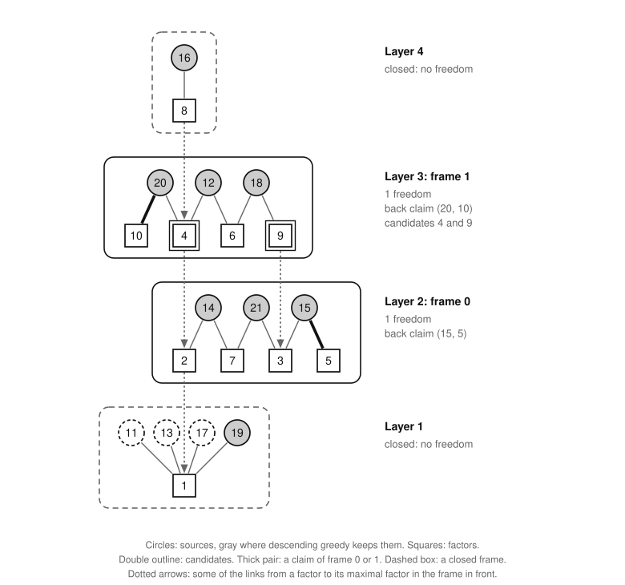
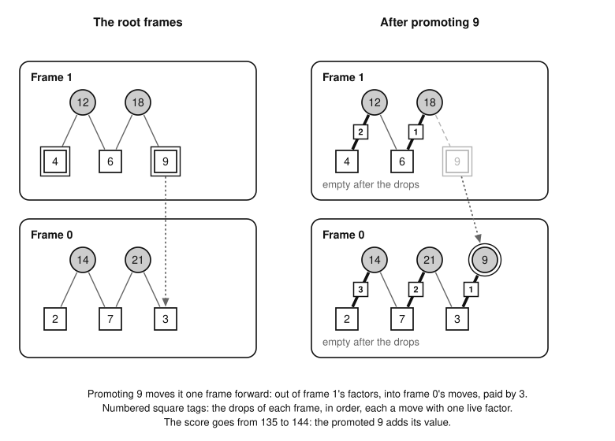

# Frames and the frame model

Part of [the theory](../THEORY.md).

The frame solver does not search the games of n.  It splits the board into *frames*, fixes the sources it plays to
U\*, and searches only over which factors to *promote*, that is, to play as moves.  This file defines that model, the
*frame model*, and the words a search of it uses.  [The exactness theorem (X7)](exactness.md#the-exactness-theorem)
shows that the model is exact: its promotion sets are exactly the sets L of numbers up to n/2 with U\* ∪ L playable.
[The corollary of U (X8)](exactness.md#statement-u) leaves one open statement between the model and the game, statement
U: the solver's answer ΣU\* + P\* is opt(n) exactly when some optimal set contains every member of U\* in layers 3 and
up.  [The extended problem](extended-problem.md) builds on the model, [frame-bounds.md](frame-bounds.md) bounds its
promotion sets, and [search-rules.md](search-rules.md) says what a search of it proves.  Game 21 is the example
throughout.

*Words.*  [Sources](../GLOSSARY.md#the-frame-model), [factors](../GLOSSARY.md#the-frame-model), [maximal
factors](../GLOSSARY.md#the-game), [layers](../GLOSSARY.md#the-frame-model) and [playable
sets](../GLOSSARY.md#the-game) are the glossary's.  Ω(x) is the layer of x, and [q(n)](neighbors.md#neighboring-games)
the largest prime ≤ n.  [Descending greedy](sources.md#descending-greedy), and U\*, the sources it keeps, are defined
in sources.md.  U\*_k and S_k are the parts of U\* and of a set S in layer k, and ΣS is the sum of S
([notation](statements.md#notation)).

*Instances.*  The words for instances are [playability.md](playability.md#payment-schemes)'s: members, pool, lists
(a member's maximal factors in the pool), payment schemes, precedence, playable instances, [peel](playability.md#peel)'s
front and back moves, and the remainder they leave.  A set T is *playable against* a set F when the instance with
members T and pool F is playable.  Four facts are used throughout:

* [the playability theorem (P2)](playability.md#the-playability-theorem): a set S ⊆ {2, …, n} is playable iff its own
  instance, with pool the maximal factors of its members outside S, is playable;
* [the flat-cycle lemma (P3)](playability.md#the-flat-cycle-lemma): every cycle of a scheme's precedence is flat: its
  members lie in one layer, and on each edge a → b, pay(a) is a maximal factor of b;
* [the peel theorem (P4)](playability.md#the-peel-theorem): a front move (a member with one live factor, paired with
  it) or a back move (a live factor in one list only, paired with that member) keeps an instance playable and keeps it
  unplayable, and a run of peel that pairs every member yields an acyclic scheme;
* *restriction*: if an acyclic scheme pays the members of a subset T with factors of a set F, then T is playable
  against F, since the scheme restricted to T is a scheme of that instance and its precedence is part of the old one;
  and a scheme against a pool is one against any larger pool.  So a set that holds an unplayable set is unplayable.

## Frames

The *frame graph* of game n joins each source to its maximal factors.  A *frame* is a component of it: some sources
with every factor that can pay for one of them.  We write D for a frame and F_D for its factors.  A frame D is *in front
of* a frame D′ ≠ D, and D′ *behind* D, when a factor of D′ has a maximal factor in D.  Game 21 has four frames, each in
front of the next (9 has the maximal factor 3, for instance):

| layer | sources | factors |
|---|---|---|
| 1 | 11, 13, 17, 19 | 1 |
| 2 | 14, 15, 21 | 2, 3, 5, 7 |
| 3 | 12, 18, 20 | 4, 6, 9, 10 |
| 4 | 16 | 8 |

A layer can hold several frames: in game 20 the frames of 14 (with the factors 2 and 7) and of 15 (with 3 and 5) both
lie in layer 2.

### The frame lemma

**Lemma F1 (the frame lemma).**  Let n ≥ 2.  Every number of the board lies in exactly one frame.  In each frame the
sources all have one layer k and the factors the layer k − 1: the frame *lies in layer k*.  A frame in front of a frame
of layer k lies in layer k − 1.

*Proof.*  An edge lowers the layer by one.

1. Every source s ≥ 2 has a maximal factor.  Every x ≤ n/2 is a maximal factor of a source: with m = ⌊n/(2x)⌋ ≥ 1,
   Bertrand's postulate gives a prime p with m < p ≤ 2m, so n/2 < xp ≤ n.  So every number is in the graph, and the
   components partition it.
2. Each edge joins a source s to a factor s/p, with Ω(s/p) = Ω(s) − 1.  Along a path the layers alternate k, k − 1,
   k, …, so in a component the sources share a layer and the factors lie one below.
3. A factor y of a frame of layer k has Ω(y) = k − 1, and a maximal factor z of y has Ω(z) = k − 2.  Since z ≤ n/2, z
   is a factor of the frame holding it (step 1), whose sources therefore lie in layer k − 1 (step 2).  ∎

So a factor has no proper divisor in its own frame, and the maximal factors of a frame's factors lie in the frames in
front of it.

### The joining lemma

Schemes on disjoint pools join into one scheme, and the joint scheme has no cycle when no member reaches into a later
pool.  Several proofs join schemes this way: of the layers, of the frames, and of the frames with a set promoted.

**Lemma F2 (the joining lemma).**  Let T_1, …, T_r be disjoint sets of members and F_1, …, F_r disjoint pools, with an
acyclic payment scheme of each T_i against F_i.  Suppose that each member of T_j lists, in F_1 ∪ ⋯ ∪ F_r, only factors
of F_1, …, F_j.  Then the union of the schemes is an acyclic payment scheme of T_1 ∪ ⋯ ∪ T_r against F_1 ∪ ⋯ ∪ F_r.

*Proof.*  The union pays each member with a factor it lists, no two the same, since the pools are disjoint.  On each
edge a → b of a cycle of its precedence, pay(a) is a maximal factor of b ([P3](playability.md#the-flat-cycle-lemma)).
If a ∈ T_i, then pay(a) ∈ F_i, so b lists a factor of F_i, and b ∈ T_j for some j ≥ i.  Around a cycle the index never
falls, so it never changes: the cycle lies in the scheme of one T_i, which has none.  ∎

### The layer theorem

For S ⊆ {2, …, n}, the *layer instance* of S at k has the members S_k and the pool of the numbers of layer k − 1 up to
n/2 that are not in S.

**Theorem F3 (the layer theorem).**  A set S ⊆ {2, …, n} is playable iff every layer instance of S is playable.

*Proof.*  The maximal factors of a member of layer k lie in layer k − 1 and are at most n/2.  So a member of S_k has the
same list in S's own instance as in the layer instance at k, and it lists only factors of that instance's pool.  If
every layer instance is playable, [the joining lemma (F2)](#the-joining-lemma) joins their schemes into an acyclic
scheme of S's own instance.  Conversely, a scheme of S's own instance pays S_k with factors of the pool at k, so by
restriction each layer instance is playable.  [P2](playability.md#the-playability-theorem) finishes the proof.  ∎

A game is thus a chain of layer games, coupled only through the numbers up to n/2 that it plays, and the frame model
is this chain with the sources fixed to U\*.  The [parity bound](parity-bound.md#the-parity-bound) groups the same
layers by parity.

**Freedoms.**  U\* is playable, and the members of U\* ∩ D pay with factors of D, since a source has all its maximal
factors in its own frame; so U\* ∩ D is playable against F_D (restriction).  The *moves* of a frame D are U\* ∩ D, and
its *freedoms* are its factors less its moves, |F_D| − |U\* ∩ D|, which is never negative, since a scheme pays with
distinct factors.  D is *closed* when it has none.  In game 21 the frames of layers 1 and 4 are closed (U\* keeps only
19 of layer 1), and those of layers 2 and 3 have a freedom each.

### The bottom-layers theorem

In layers 1 and 2 every optimal set plays exactly the sources of U\*.  Let G_n be the graph whose vertices are the
primes up to n/2 and one more vertex g, and whose edges are the numbers of layer 2 up to n: pq is the edge p–q, and p²
the edge p–g.

**Theorem F4 (the bottom-layers theorem).**  Let n ≥ 2 and S an optimal set of n.  Then S_1 = {q(n)}, the sources of S
in layer 2 are exactly U\*_2, and S_2 is a forest in G_n.  Where the frames of layer 2 are closed, S plays no number of
layer 2 up to n/2.

*Proof.*  In layer 2 descending greedy keeps an edge unless it closes a cycle with the edges kept: it is the scan,
[the greedy algorithm](primer/greedy.md#the-greedy-algorithm) on the [forests](primer/linear-algebra.md#forests) of G_n.  An exchange shows
that S_2 is what the scan keeps of S_2 ∪ U\*_2.  Parts (b) and (d) cited below are the primer's, in its section on the
greedy algorithm, and a forest spans an edge outside it when the edge closes a cycle with it.

1. S_1 = {q(n)} by [the prime lemma (N1)](neighbors.md#the-prime-lemma), so the pool of S's layer instance at 2 is
   every prime up to n/2.
2. A set of numbers of layer 2 is playable against those primes iff it is a forest in G_n, by [the two-factor
   proposition (P11)](playability.md#the-two-factor-proposition).
3. Adding a source s of layer 2 to the kept sources changes only their layer instance at 2 ([F3](#the-layer-theorem)),
   so descending greedy keeps s iff s closes no cycle with the kept sources of layer 2: on these sources it is the scan.
   By part (b), the edges the scan keeps before an edge x span all the edges above x, so it keeps x iff x closes no
   cycle with the edges above x.
4. Let I be what the scan keeps of W = S_2 ∪ U\*_2.  The members of W above a source x of W are sources of layer 2.  If
   x ∈ U\*_2, x closes no cycle with them, since it closes none with all the sources of layer 2 above x (step 3).  If
   x ∉ U\*_2, it closes a cycle with the members of U\*_2 above it.  So I = U\*_2 ∪ E, with E made of numbers of S_2 up
   to n/2.
5. The weights, the numbers themselves, are distinct and positive, so by part (d) I is the only heaviest forest in W.
   S_2 is a forest (F3 and step 2), so ΣI ≥ ΣS_2, with equality only if I = S_2.
6. S′ = (S ∖ S_2) ∪ I is playable by F3: at layer 2 it has the forest I against the same pool; at layer 3 the pool
   only grows, since S plays the numbers E too; the other layers do not change.  So ΣS′ ≤ ΣS, which forces
   S_2 = I = U\*_2 ∪ E.
7. The frames of layer 2 hold the primes up to n/2 as factors ([F1](#the-frame-lemma)).  When they are closed, U\*_2 has
   one edge for each of these primes, one fewer than G_n has vertices: it is a spanning tree, so E is empty.  ∎

In game 21, G_n has the vertices 2, 3, 5, 7 and g, and U\*_2 = {14, 15, 21} is the forest of the edges 2–7, 3–5 and
3–7, which leaves g alone.  So one more edge fits.  The edge 4 = 2² (2–g) or 9 = 3² (3–g) closes no cycle, while
6 = 2·3 and 10 = 2·5 would, and 4 and 9 together close the cycle 2–g–3–7–2.  The optimal set takes the larger, 9.  The
frames of layer 2 are closed from game 187 on ([the square theorem (F10)](#the-square-theorem)).  [The barred bound
(W2)](parity-bound.md#the-barred-bound) fixes layers 1 and 2 by this theorem.

## The frame model

The model keeps the sources of U\*, leaves out the closed frames, merges the rest by layer, and asks which factors to
promote.

**The frame's game.**  *Taxman Mini* is played on a pair W of disjoint sets, its *moves* and its *factors*, the moves in
one layer and the factors in the layer below.  A move's *live* factors are its maximal factors among W's factors.  The
moves are taken one at a time; each must have a live factor when taken, and taking it removes its live factors.  W is
*winnable* when some order takes every move.  We read W as the instance with members its moves and pool its factors,
and its *freedoms* are its factors less its moves.

### The winnability lemma

**Lemma F5 (the winnability lemma).**  A pair W of Taxman Mini is winnable iff, read as an instance, it is playable.
So a winnable pair has at least as many factors as moves.

*Proof.*  No move divides another, since they lie in one layer, and a move's divisors among the factors are its live
factors.  A winning order pays each move with a live factor present at its turn, and these payments are distinct.  When
pay(a) divides b, b comes after a, or b would have removed pay(a): the order is a topological order of the precedence,
which is therefore acyclic ([topological orders](primer/graphs.md#topological-orders)).  Conversely, in a topological order of
an acyclic scheme every move that lists pay(a) comes after a, so pay(a) is there at a's turn, and the order wins.  A
scheme pays the moves with distinct factors.  ∎

**Numbering.**  Let k₀ be the lowest layer of a frame with freedoms.  A frame with freedoms in layer k gets the number
k − k₀, a closed frame none.  *Frame h* is the union of the frames numbered h, with the moves U\* ∩ frame h and the
factors F_h; it is empty if no frame of layer k₀ + h has freedoms.  In game 21 frame 0 is the frame of layer 2 and
frame 1 that of layer 3; in game 20 frame 0 is the union of the two frames of layer 2.  If no frame has freedoms, as in
games 2 to 7, 9 to 11 and 15, there is no frame h, the root problem below is empty, and P\* = 0.

### Clean numbering

**Proposition F6 (clean numbering).**  Every frame with freedoms in front of a frame numbered h is numbered h − 1.

*Proof.*  It lies one layer lower ([F1](#the-frame-lemma)), and the numbers follow the layers.  ∎

The proof of exactness uses nothing else about the numbering: a promoted number pays one layer down (F1), and F6 puts
the frames there that can pay for it in frame h − 1.

**Taking a number on.**  A frame D, or a frame h, *can take x on* when its moves together with x are playable against
its factors: x could become one more move without leaving the others short.  A closed frame can take nothing on, since
its moves already need all its factors.  In game 21, frame 0 can take 9 on: 9 takes 3, 15 takes 5, 21 takes 7 and 14
takes 2.  It cannot take 6 on: 15 still takes 5, by a back move, and then 14, 21 and 6 list each of 2, 3 and 7 twice,
so peel stalls.

### The take-on lemma

**Lemma F7 (the take-on lemma).**  Frame h can take x on iff one of its frames can.

*Proof.*  This needs an argument, because x can have maximal factors in several frames of frame h.  If frame h can take
x on, take an acyclic scheme, and let D be the frame of frame h that holds pay(x).  The moves of D pay with factors of
D, since a move's maximal factors lie in its own frame, and so does x: by restriction, D can take x on.  Conversely, let
a frame D of frame h take x on.  The moves of each other frame of frame h list only factors of that frame, and are
playable against them.  [The joining lemma (F2)](#the-joining-lemma), with those frames first and D with x last, joins
the schemes into an acyclic scheme of the moves of frame h with x against F_h.  ∎

**Candidates.**  A *candidate* is a factor x of a frame D numbered h ≥ 1 that passes two tests: (a) U\* ∩ D is
playable against F_D ∖ {x}; (b) frame h − 1 can take x on.  Test (a) asks that D can spare x, and test (b) that the
frame in front can pay for it.  In game 21 the candidates are 4 and 9, factors of frame 1.  All four factors of frame 1
pass (a), and 6 and 10 fail (b); 10 = 2·5 fails as 6 does, since 14, 15, 21 and 10 list each of 2, 3, 5 and 7 twice.

**Claims.**  A *claim* (s, f) pairs a move s of frame h with a factor f of frame h, and takes both out.  A *claim
sequence* of frame h is a sequence of claims, each one of two kinds given those before it:

* a *front claim*: f is the only maximal factor of s that no earlier claim took;
* a *back claim*: no earlier claim took f; s is the only move of frame h left with f as a maximal factor; no frame of
  the layer below can take f on; and frame h cannot take on any factor of frame h + 1 that has f as a maximal factor.

A front claim settles a move with one choice left, and a back claim a factor that one move alone wants.  The last two
conditions of a back claim say that f has no other use: it cannot be promoted, and it cannot pay for a number promoted
into frame h.  Read with a frame D numbered h in place of frame h, the same rules give the claim sequences of D, which
[the claims lemma (X5)](exactness.md#the-exactness-theorem) uses to check setup.

*The claims of frame h* are one claim sequence, made in rounds.  In each round, go through the factors of frame h not
yet claimed, in increasing order, and make each back claim that the rules allow at its turn; then make the front claim
of the largest move that has one, if any.  Stop after a round that makes no claim.  No move is then left with only one
factor not yet claimed.

In game 21 the claims of frame 0 are the one back claim (15, 5): only 15 has the maximal factor 5, the frame of layer 1
is closed, and frame 0 cannot take on 10, the one factor of frame 1 with the maximal factor 5.  The claims of frame 1
are the back claim (20, 10).  The last two conditions of a back claim each earn their place.  Once 15 is claimed, only
21 has the maximal factor 3, but frame 0 can take on 9, which has it; and only 18 has the maximal factor 9, but frame 0
can take 9 on.  The claim (21, 3) or (18, 9) would lose the promotion set {9} (below).  The order of the claims matters:
in game 8, frame 0 has the move 6 and the factors 2 and 3, and the back claims (6, 2) and (6, 3) exclude each other.
The claims of frame 0 make (6, 2), the first in increasing order.

*The frames of 21 by layer, layer 4 at the top.  Gray circles: U\*; hollow: the rejected 11, 13 and 17.  Double
outline: the candidates 4 and 9.  Thick pair: a claim of frame 0 or 1.  Dashed box: a closed frame.  Dotted arrows: some
of the links from a factor to its maximal factor in the frame in front.*

**Reduction.**  To *reduce* a pair of Taxman Mini is to drop a move with one live factor, together with that factor,
until no such move is left; each step is a *drop*.

**The root problem.**  A *root problem* of game n has, for each number h, the *root frame h*, which is frame h less a
claim sequence of it, then reduced; and it has the candidates.  *The root problem* Π_n uses the claims of frame h,
which leave no move with one live factor, so its root frame h is frame h less its claims.  The *root* is the root frames
before any promotion.  A number's *home* is the number h of the root frame whose factors hold it, if one does; every
candidate of a frame numbered h has the home h (the reduction-step lemma (X6)).
ΣU\* is the score with no promotions (the kept-sources lemma (X1)).  In game 21,
root frame 0 has the moves 14 and 21 and the factors 2, 3 and 7, and root frame 1 has the moves 12 and 18 and the
factors 4, 6 and 9; the candidates 4 and 9 have the home 1.  In game 8, the claim (6, 3) in place of (6, 2) would give
another root problem, with root frame 0 holding the factor 2 instead of 3.  The exactness theorem
(X7) holds for every root problem of game n, so they all have the same promotion
sets, and P\* does not depend on the claims.

**Promotion sets.**  *Applying* a set L to frame h adds to its moves the members of L in F_{h+1} and removes from its
factors those in F_h; applying L to root frame h adds the members of L whose home is h + 1 and removes those whose home
is h.  A *promotion set* of a root problem is a set L of candidates such that every root frame is winnable with L
applied.  *Promoting* x thus moves it from the factors of root frame h, its home, to the moves of root frame h − 1.
P\* = P\*(Π_n) is the largest ΣL over the promotion sets of Π_n.  A promotion set has at most as many members as the
freedoms and the candidates allow, the promotion limit ([the promotion-limit lemma (F9)](#the-promotion-limit-lemma)).

In game 21, {9} is a promotion set.  Root frame 0 with 9 applied has the moves 14, 21 and 9 against 2, 3 and 7, and
reduces to nothing by the drops (9, 3), (21, 7) and (14, 2); root frame 1 loses 9 and reduces to nothing by (18, 6) and
(12, 4).  So is {4}, but not {4, 9}, which would leave root frame 0 four moves for three factors.  So P\* = 9, and
ΣU\* + P\* = 135 + 9 = 144 = opt(21), the score of the game 19; 9, 15, 21, 14; 18, 12, 20; 16, which plays the frames
one after another from the front.

*Promoting 9 moves it from the factors of root frame 1 to the moves of root frame 0.  Numbered square tags: the drops
of each frame, in order.*

### The reduction lemma

Reducing is safe: a dropped pair could never have gone otherwise, now or after later promotions, as long as its factor
stays.

**Lemma F8 (the reduction lemma).**  Let W be a pair of Taxman Mini, and x a move of W whose only live factor is f.

1. Dropping x and f never changes whether the pair is winnable, now or after later edits that keep f: for every set Y
   of numbers of the moves' layer outside W's moves, and every set Z of factors with f ∉ Z, W with Y added to its moves
   and Z removed from its factors is winnable iff W less x and f, edited alike, is.
2. If W is winnable, reducing it ends at the same pair whatever the order of the drops.

*Proof of part 1.*  After the edits x still has the single live factor f: added moves change no move's live factors, and
Z leaves f.  So (x, f) is a front move of the edited pair, which keeps it playable and keeps it unplayable
([P4](playability.md#the-peel-theorem)), and a pair is winnable iff it is playable ([F5](#the-winnability-lemma)).

*Proof of part 2.*  The idea is the diamond argument.  Two different drops available at once commute: each leaves the
other available, and doing both in either order reaches the same pair.  An induction spreads this local agreement to
whole reductions.

1. *Every pair reached is winnable,* by part 1 with nothing added or removed.  So no two of its moves have the same
   single live factor, since a winnable pair pays its moves with different factors.
2. *The diamond.*  Let (x₁, f₁) and (x₂, f₂) be different drops available in a winnable pair.  Then x₁ ≠ x₂, since a
   move with one live factor gives one drop, and f₁ ≠ f₂ by step 1.  Dropping (x₁, f₁) removes only x₁ and f₁, so x₂
   still has the single live factor f₂, and (x₂, f₂) is still available.  Both drops, in either order, leave W less the
   two pairs.
3. *The induction.*  We show, by induction on the number of moves, that all reductions of a winnable pair W end at the
   same pair.  If no move of W has one live factor, the only reduction is the empty one.  Otherwise let two reductions
   of W begin with the drops d₁ and d₂.  If d₁ = d₂, the rest of each is a reduction of W less d₁, which has fewer
   moves, so they end together.  If d₁ ≠ d₂, take any reduction of W less both pairs, its tail.  By step 2, d₂ followed
   by the tail is a reduction of W less d₁, as is the rest of the first reduction, so by the induction hypothesis they
   end together.  Likewise d₁ followed by the tail and the rest of the second reduction end together.  And d₁, d₂ and
   the tail, and d₂, d₁ and the tail, both end where the tail does.  So the two reductions end at the same pair.  ∎

In game 21 the drops of root frame 0 with 9 applied can come in no other order, since each makes the next possible.
Winnability is needed in part 2: against the factor 3, the moves 6 and 9 reduce to 9 alone or to 6 alone.

Setup builds the root problem by a longer route, which [the design of the frame
model](../../solver/docs/design/frame-model.md#setup-in-the-code) follows step by step: it makes claims in rounds before
and after merging, runs descending greedy again after each round, tests (a) after its first claims, and reduces at the
end.  [X1](exactness.md#the-exactness-theorem) and part 3 of X5 show that these steps change neither the sources nor the
candidates.

## Searching the frame model

A search of Π_n branches on which candidates to promote; [search-rules.md](search-rules.md) proves the rules by which it
cuts, and [frame-bounds.md](frame-bounds.md) the bounds it cuts with.  A *node* has *promotions* P, a promotion set, and
*candidates* C, a set of candidates disjoint from P that it may still promote.  Its *completions* are the promotion sets
P ∪ X with X ⊆ C; the root node, with no promotions and every candidate, has a heaviest completion worth P\*.  The
*state* state(P) is the root frames with P applied, then [reduced](#the-frame-model).  These frames are winnable, so by
[the reduction lemma (F8)](#the-reduction-lemma) the reduced frames do not depend on the order of the drops.  [The state
lemma (R1)](search-rules.md#the-state-lemma) shows that state(P) decides which completions are promotion sets.  In game
21, state({9}) has two empty frames, by the drops above.

Claims and drops keep a pair's freedoms, and a promotion into or out of a frame spends one.  So frame h of state(P)
has the freedoms of the frames numbered h, less the members of P promoted into or out of it.  For a node, let ρ_h be
the freedoms of frame h of state(P), for the frames 0 to t, and κ_h the number of its candidates that are factors of
frame h of state(P).  The node's *promotion limit* is the largest c_1 + ⋯ + c_t over integers c_h with 0 ≤ c_h ≤ κ_h
and c_h + c_{h+1} ≤ ρ_h for every h, where c_0 = c_{t+1} = 0.  Here c_h counts the promotions out of frame h, each of
which spends a freedom of frame h and one of frame h − 1.  The promotion limit of Π_n is that of the root node.

### The promotion-limit lemma

**Lemma F9 (the promotion-limit lemma).**  Let a node have the freedoms ρ_h and the counts κ_h.

1. Taking each c_h as large as fits from the front, c_h = min(ρ_h, κ_h, ρ_{h−1} − c_{h−1}) for h = 1, …, t, reaches
   the node's promotion limit.
2. Every completion P ∪ X of the node has |X| at most its promotion limit, and a candidate whose home is h is in some
   X only if frames h and h − 1 of state(P) both have freedoms.

*Proof of part 2.*  Let x_h be the number of members of X whose home is h; x_0 = 0, since no candidate has the home 0.

1. *Each member of X is a factor of its home's frame in state(P).*  Otherwise a drop of the reduction that made frame h
   of state(P) took one; take the first drop whose factor X removes.  The drops before it keep their factors under X, so
   by [F8](#the-reduction-lemma), part 1, root frame h with P ∪ X applied is winnable iff the pair after those drops,
   with X applied, is.  There the drop's move has its one live factor removed, so the pair is unwinnable, and P ∪ X is
   no promotion set.  So x_h ≤ κ_h.
2. *The freedoms.*  Root frame h with P ∪ X applied has the freedoms ρ_h − x_h − x_{h+1}, and it is winnable, so it
   has at least as many factors as moves ([F5](#the-winnability-lemma)): x_h + x_{h+1} ≤ ρ_h.
3. So (x_h) is one of the sequences that the promotion limit ranges over, and |X| = Σx_h is at most the limit.  If
   x_h ≥ 1, the conditions at h and h − 1 give ρ_h ≥ 1 and ρ_{h−1} ≥ 1.

*Proof of part 1.*  The idea is an exchange: wherever a sequence falls short of the front-to-back choice, moving
promotions forward from the next frame keeps it within the conditions and never lowers its sum.

1. *The choice (c_h) meets the conditions.*  By construction c_h ≤ ρ_h, c_h ≤ κ_h and c_{h−1} + c_h ≤ ρ_{h−1}, and
   c_h ≥ 0, since c_{h−1} ≤ ρ_{h−1}.
2. *A sequence that agrees with it before h falls short at h.*  Let (d_h) meet the conditions, with d_j = c_j for every
   j < h.  Then d_h ≤ ρ_h, d_h ≤ κ_h, and d_h ≤ ρ_{h−1} − c_{h−1} by the condition at h − 1, so d_h ≤ c_h.
3. *The exchange.*  Raise d_h to c_h, and lower d_{h+1} by as much, but not below 0.  The condition at h − 1 holds,
   since c_{h−1} + c_h ≤ ρ_{h−1}, and c_h ≤ κ_h.  The one at h holds: d_h + d_{h+1} has not grown, unless d_{h+1}
   reached 0, and then it is c_h ≤ ρ_h.  Those at h + 1 only loosen.  The sum has not fallen.
4. Doing this for h = 1, 2, …, t turns (d_h) into (c_h) without lowering its sum, so the sum of (c_h) is the largest.  ∎

In game 21 the root has the freedoms 1 and 1 and two candidates of home 1, so c₁ = min(1, 2, 1) = 1: the promotion limit
is 1, which {4, 9} exceeds.  In game 98 the freedoms are 1, 6, 3 and 2, and the candidates of homes 1, 2 and 3 number
4, 8 and 4; the front-to-back choice is c₁ = min(6, 4, 1) = 1, c₂ = min(3, 8, 6 − 1) = 3 and c₃ = min(2, 4, 3 − 3) = 0,
so the promotion limit is 4.  The sequence 0, 3, 0 meets the conditions too; the exchange raises it to 1, 2, 0 and then
to 1, 3, 0.  The solver keeps state(P) as a node's frames and cuts by the promotion limit ([its
search](../../solver/docs/design/search.md)).

## The square theorem

**Theorem F10 (the square theorem).**  Let n ≥ 2.

1. A frame of layer 2 has one freedom if none of its sources is the square of a prime, and none if one is.
2. If n ≥ 187, layer 2 is one frame, with a square among its sources.  So every optimal set plays exactly U\*_2 in
   layer 2 and no number of layer 2 up to n/2 ([F4](#the-bottom-layers-theorem)), and k₀ ≥ 3.

The bound is sharp: at 186 a frame of layer 2 has a freedom.

*Proof.*  Part 1 is a count, and part 2 rests on primes in short intervals.  Let H_n be G_n with the sources of layer 2
alone as edges, and d the number of frames of layer 2 with no square.

1. A source pq joins p and q in the frame graph, and p² hangs on p alone.  So H_n has d + 1 components: each frame with
   no square, and g with the rest.
2. U\*_2, which the scan keeps (step 3 of F4's proof), is a maximal forest in H_n ([part
   (a)](primer/greedy.md#the-greedy-algorithm)).  So it has d fewer members than the primes up to n/2
   ([rank](primer/linear-algebra.md#forests)), the frames' factors ([F1](#the-frame-lemma)): the frames have d freedoms in all.  A
   frame with no square has as moves a forest on its own primes, so a freedom at least: each of the d has one, and the
   others none.
3. *Nagura's theorem:* for every real x ≥ 25 some prime lies in (x, 6x/5].  It follows from Dusart's Proposition 6.8
   ([arXiv:1002.0442](https://arxiv.org/abs/1002.0442)) for x ≥ 396,738, and from a computation below.
4. Let n ≥ 2500, s < s′ consecutive primes up to √n, and x = n/(2s) > √n/2 ≥ 25.  Since s′ ≤ 5s/3 (step 3 from 25 on,
   the primes to 29 below), step 3 gives a prime r in (x, 6x/5] ⊆ (x, n/s′].  Then sr and s′r lie in (n/2, n]: they
   join s and s′ through r, or one is ss′ if r is s or s′.  So the primes up to √n share a frame, and a prime ℓ in
   (√n, n/2] joins it through a source ℓp with p ≤ n/ℓ < √n (step 1 of F1's proof).  And step 3 at x = √(n/2) gives a
   prime p < √n with p² a source.
5. A computation covers 187 ≤ n ≤ 2499.  Part 1 closes the frame, F4 gives the optimal sets, and k₀ ≥ 3, since the
   frame of layer 1 has one factor and one move, q(n).  ∎

The script of [its notebook entry](../../solver/notebook/the-closed-frames-of-layer-2-2026-10/README.md) makes both
computations in under a second, and the entry shows why 6/5 is needed; one trusts the script and Dusart's proposition.
