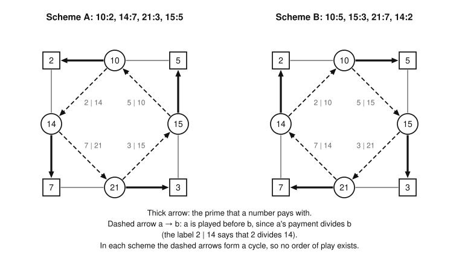

# Neighboring games

Part of [the theory](../THEORY.md).

Game n differs from game n − 1 by one number, and much passes between them.  The best score never falls, and never
rises by more than n.  At a prime it rises by an exact amount, and at its ceiling a game's optimal sets are those of the
game before that stay playable with n added.  The proofs rest on the rules alone and two facts about primes, so this
file needs nothing else from the theory.  Monotonicity, the ceiling lemma and the prime formula each come with a
construction that turns a game of one board into a game of the other.  It needs of that game only that it be finished,
not that it be optimal, which lets the bounds carried between games be the scores of real games
([search-rules.md](search-rules.md#bounds-carried-between-games)).

The words of the game (board, pot, move, tax, score, opt(n), optimal set, playable, ceiling) are the
[glossary's](../GLOSSARY.md#the-game).  A *game of n* is a legal sequence of moves on the board 1, …, n.  Write q(n) for
the largest prime at most n, ΣG for the score of a game G and ΣS for the sum of a set S.  An optimal set is written S\*;
a game can have several, and each statement below says whether it holds for every optimal set or for some.

Two facts about primes are used throughout.

* **A prime can only open a game.**  The number 1 divides every number, so the first move takes 1 as tax.  A prime's
  only proper divisor is 1, so a prime is legal only as the first move, and a game plays at most one prime.
* **The largest prime of a board divides nothing else on it.**  Bertrand's postulate puts a prime p with m < p ≤ 2m
  for every m ≥ 1.  With m = ⌊n/2⌋ it puts a prime in (n/2, n] for every n ≥ 2, so q(n) > n/2 and 2q(n) > n: on the
  board of n, q(n) divides no other number and is never tax.

## The prime lemma

An optimal game always opens with the largest prime of its board.  On the board of 21 that prime is 19, and the optimal
game 19, 9, 15, 21, 14, 18, 12, 20, 16 opens with it; without its first move it is still a legal game, which scores 19
less.

**Lemma N1 (the prime lemma).**  Let n ≥ 2.  Every optimal game of n plays q(n), as its first move, and no other prime.
So every optimal set of game n holds q(n) and no other prime.

*Proof.*  A game without q(n) can always take it, either in place of its first move or in front of it, since q(n) takes
only 1 and is never anyone's tax.  Let G be a game of n that does not play q(n).  We build a game that scores more.

1. *G is empty.*  The game whose one move is q(n) scores q(n) > 0.
2. *G opens with a prime r.*  Then r < q(n).  Let G′ be G with r replaced by q(n).  After the first move, G′'s pot
   with r taken out equals G's pot with q(n) taken out: both are the board less 1, r and q(n).  A later move c of G is
   neither r nor q(n), since a prime can only open a game, and q(n) does not divide it.  In G it took some proper
   divisor d from the pot, and d ≠ r, since r left G's pot with the first move.  So d is in G′'s pot too, and c is legal
   in G′.  The move c takes the same numbers out of both pots, except perhaps r, which only G′ still holds, so the
   equality persists.  So G′ is a game of n, and it scores q(n) − r more than G.
3. *G opens with a composite c.*  Let G′ be q(n), followed by the moves of G.  After q(n) the pot is the board less 1
   and q(n).  The composite c has a proper divisor other than 1, which q(n) did not take, so c is legal.  It takes what
   it took in G, except 1, which is already gone.  So after the first two moves of G′ its pot is G's pot after c, less
   q(n).  The number q(n) is never tax and never a move of G, so every later move of G is legal in G′ with the same tax.
   So G′ is a game of n, and it scores q(n) more than G.

So an optimal game plays q(n).  It plays it first and plays no other prime, since a prime can only open a game.  ∎

The game 9, 15, 21, 14, 18, 12, 20, 16 of 21 is case 3: it opens with the composite 9 and scores 125, and 19 in front of
it makes the optimal game, which scores 144.

## Finished games

A *finished game* of n ≥ 2 is a game of n that opens with q(n) and is over: no number left in the pot has a proper
divisor in the pot, so no move is left.  The optimal game of 21 above is finished.  The game 9, 15, 21, 14, 18, 12,
20, 16 is over, since it leaves 11, 13, 17 and 19, which have no divisor left, but it is not finished, since it does not
open with 19.

**Lemma N2 (the finished-game lemma).**  Every optimal game of n ≥ 2 is finished.  So opt(n) is the best score of a
finished game of n.

*Proof.*  An optimal game opens with q(n), by the prime lemma (N1).  It is over, since a move still left could be played
for a higher score.  ∎

The constructions of the lemmas below take finished games to finished games.  A bound carried from one game to another
is therefore the score of a finished game, which a referee can replay, and not only an inequality.

## Monotonicity

The best score never falls from one game to the next: a game of n − 1 is a game of n.

**Lemma N3 (monotonicity).**  Let n ≥ 2.  A game of n − 1 is a game of n, with the same taxes, and a game of n that does
not play n is a game of n − 1.  So opt(n − 1) ≤ opt(n), and a set that does not hold n is playable in game n exactly
when it is playable in game n − 1.  If n is composite and G is a finished game of n − 1, then G, followed by n if n is
still legal after G, is a finished game of n, which scores ΣG or ΣG + n.

*Proof.*  The number n divides no smaller number, so it takes no part in any move below it.

1. *The same game on both boards.*  The tax of a move c < n is its proper divisors in the pot, and n is not one of them.
   So a sequence of moves below n takes the same numbers out of the pot on the board of n as on the board of n − 1,
   leaves n in the pot on the board of n, and is legal on one board exactly when it is legal on the other.  This gives
   the first two claims; the inequality follows from an optimal game of n − 1.
2. *Finished.*  Let P be the pot that G leaves on the board of n − 1.  On the board of n it leaves P with n added.  No
   number of P has a proper divisor in P, since G is over, and n is not a proper divisor of anything on the board.  So n
   is the only move that can be left.  Playing it takes numbers out of the pot, and what remains is part of P, in which
   no number has a proper divisor.  Either way the game is over.  It opens with q(n − 1), which is q(n), since n is
   composite.  ∎

On the board of 22 the game of 21 above, followed by 22, is a finished game; it scores 166, which is opt(22).  For a
prime n the game G is over on the board of n too, but it does not open with q(n) = n; the prime formula (N5) handles
that case.

## The ceiling lemma

The best score never rises by more than n from one game to the next: deleting the move n from a game of n leaves a game
of n − 1.  The bound opt(n − 1) + n is the [ceiling](../GLOSSARY.md#the-game) of game n, and a game scoring it is *at
its ceiling*.

**Lemma N4 (the ceiling lemma).**  Let n ≥ 2.  If G is a game of n, the moves of G other than n, in G's order, are a
game of n − 1.  So opt(n) ≤ opt(n − 1) + n, and if a set S is playable in game n, then S without n is playable in game
n − 1.  If n is composite and G is a finished game of n, then G without the move n, followed by legal moves for as long
as there are any, is a finished game of n − 1, which scores at least ΣG − n.

*Proof.*  Deleting the move n only leaves more in the pot for the other moves.  Let G′ be the moves of G other than n,
in G's order, played on the board of n − 1.

1. *An invariant.*  Before each move of G′, its pot holds G's pot before the same move, less n.  Both pots start full.
   A move common to both takes the same set, the move and its divisors, out of each pot, which keeps the one pot
   holding the other.  The move n of G takes numbers out of G's pot only.
2. *G′ is legal.*  A move c of G′ is in G's pot, and is not n, so it is in G′'s pot.  In G it took a proper divisor d
   from the pot, and d ≠ n since d < c < n.  So d is in G′'s pot too.
3. *The bound.*  Applied to an optimal game of n, this gives a game of n − 1 scoring at least opt(n) − n, so opt(n − 1)
   ≥ opt(n) − n.  For a set S played by G, the moves of G′ are S without n.
4. *Finished.*  The moves added after G′ are legal by choice, and they stop when no move is left, so the game ends over.
   It opens as G does, with q(n), which is not n, since n is composite, and so is q(n − 1).  It scores ΣG − n, or ΣG if
   G does not play n, plus what the added moves score.  ∎

The construction needs n composite: a finished game of a prime n opens with n, so without that move it does not open
with q(n − 1).  The prime formula (N5) exchanges n for q(n − 1) instead.

Game 21 is not at its ceiling: opt(20) + 21 = 124 + 21 = 145, and opt(21) = 144.  Game 22 is: opt(22) = 166 = 144 + 22.
The step theorem (N6) says what keeps 21 from its ceiling.  The construction, applied to the optimal game of 21, gives
19, 9, 15, 14, 18, 12, 20, 16, a finished game of 20 scoring 123, one less than opt(20).

The solver proves a game at its ceiling with no search: a game that scores opt(n − 1) + n is optimal by this lemma.

## The prime formula

At a prime p the best score rises by exactly p − q(p − 1), the gap from the prime before it.  For p = 23, q(22) = 19 and
opt(23) = opt(22) + 4 = 170, and the optimal game of 23 is that of 22 with its first move, 19, exchanged for 23.

**Lemma N5 (the prime formula).**  Let p ≥ 3 be prime, and q = q(p − 1) the largest prime below it.  A game of p − 1
that opens with q becomes a game of p when that move is exchanged for p.  A game of p that opens with p becomes a game
of p − 1 when that move is exchanged for q.  Each exchange keeps a game over if it was over, so it takes finished games
to finished games, and it changes the score by p − q and by q − p respectively.  Hence

    opt(p) = opt(p − 1) + p − q.

(For p = 2, opt(1) = 0, since the board of 1 has no move, and opt(2) = 2.)

*Proof.*  Each of p and q takes only 1 when it opens a game, and neither divides another number of either board, so the
rest of the game cannot tell them apart.

1. *Neither divides another number.*  The prime p is the largest number of its board.  Bertrand's postulate puts a prime
   in (q, 2q], and the first prime after q is p, so p ≤ 2q; and p ≠ 2q, since p is prime.  So 2q > p, and q divides no
   other number of the board of p.
2. *From p − 1 to p.*  Let G open with q, and let G\* be G with q exchanged for p.  After the first move, G's pot is 2,
   …, p − 1 less q, and G\*'s pot is 2, …, p − 1: G\*'s pot is G's with q added.  No later move is q or p, since a prime
   can only open a game, and none has q as a divisor, by step 1.  So each later move is legal in G\* with the same tax,
   and G\*'s pot stays G's with q added.  If G ends over, so does G\*, since q has no proper divisor left, 1 being gone,
   and is a proper divisor of nothing.
3. *From p to p − 1.*  Let G open with p, and let G′ be G with p exchanged for q.  After the first move, G's pot is 2,
   …, p − 1, and G′'s pot is the same less q.  No later move is q, and q is a proper divisor of none, so each later move
   of G took a divisor other than q and is legal in G′, with the same tax.  The pot of G′ stays G's less q.  If G ends
   over, so does G′, since a number with no proper divisor in a pot has none in any part of it.
4. *The formula.*  An optimal game of p − 1 is finished (N2), so it opens with q, and step 2 makes it a game of p
   scoring opt(p − 1) + p − q.  An optimal game of p opens with p, and step 3 makes it a game of p − 1 scoring opt(p) −
   p + q.
   So opt(p) ≥ opt(p − 1) + p − q and opt(p − 1) ≥ opt(p) − p + q.  ∎

The solver proves a prime game by this formula, with the game of p − 1 exchanged as its optimal game.

## The step theorem

At the ceiling and at a prime, the optimal sets of game n follow from those of game n − 1.

**Theorem N6 (the step theorem).**  Let n ≥ 2.

* *At the ceiling.*  If opt(n) = opt(n − 1) + n, the optimal sets of game n are exactly the sets T ∪ {n} playable in
  game n, with T an optimal set of game n − 1.  In particular, game n is at its ceiling exactly when some optimal set of
  game n − 1 stays playable with n added.
* *At a prime.*  If n = p is a prime p ≥ 3 and q = q(p − 1), then T ↦ (T ∖ {q}) ∪ {p} is a one-to-one map from the
  optimal sets of game p − 1 onto the optimal sets of game p.

*Proof.*  The ceiling lemma (N4) and the prime formula (N5) give the scores; what remains is to follow the sets.

1. *At the ceiling, an optimal set of n.*  Let S\* be an optimal set of game n.  It scores opt(n − 1) + n, more than
   opt(n − 1), so it holds n: a set without n that is playable in game n is playable in game n − 1, by monotonicity
   (N3), and scores at most opt(n − 1).  Then S\* ∖ {n} is playable in game n − 1, by the ceiling lemma, and scores
   opt(n) − n = opt(n − 1): it is an optimal set of game n − 1.
2. *At the ceiling, the converse.*  If T is an optimal set of game n − 1 and T ∪ {n} is playable in game n, then T ∪
   {n} scores opt(n − 1) + n = opt(n), so it is optimal.
3. *Which games are at their ceiling.*  If game n is at its ceiling, step 1 gives an optimal set T of game n − 1 with T
   ∪ {n} playable.  Conversely, if such a T exists, opt(n) ≥ opt(n − 1) + n, and the ceiling lemma gives equality.
4. *At a prime.*  Let T be an optimal set of game p − 1 and G an optimal game that plays it.  It opens with q and plays
   no other prime (N1, N2), so the exchange of the prime formula makes it a game of p that plays (T ∖ {q}) ∪ {p} and
   scores opt(p − 1) + p − q = opt(p): an optimal set.  Conversely, an optimal game of p opens with p and plays no other
   prime, so for its set S the exchange makes it a game of p − 1 that plays (S ∖ {p}) ∪ {q} and scores opt(p) − p + q =
   opt(p − 1).  The two maps undo each other, since an optimal set of p − 1 holds q and not p, and one of p holds p and
   not q.  ∎

Game 22 is at its ceiling, so its optimal set is that of 21 with 22 added: {9, 12, 14, 15, 16, 18, 19, 20, 21, 22}.  At
the prime 23 the optimal set is that of 22 with 19 exchanged for 23.  Game 21 is below its ceiling, and the step
theorem says why: no optimal set of game 20 stays playable with 21 added.  The only optimal set of game 20 is {10, 12,
14, 15, 16, 18, 19, 20}, and with 21 added it holds 10, 14, 15 and 21, whose maximal factors form a cycle:

    10: 2, 5      15: 5, 3      21: 3, 7      14: 7, 2

*Each of the two ways to pay the four numbers with their primes forces an order of play that runs round the square,
so neither is an order.*

These four moves come after 19, which takes 1, so each must be paid with one of its maximal factors still in the pot
(the [lifting lemma (P1)](playability.md#the-lifting-lemma)), that is with 2, 3, 5 or 7.  A move takes every divisor it
has in the pot.  So the first of the four to be played takes both of its maximal factors, or whichever of them is left,
and at most two of the four factors remain for the other three moves.  Each of those takes the factor it is paid with,
so the last finds none.  The set is not playable, although its members can be given distinct maximal factors outside
it, and opt(21) < 145.

By the step theorem, the number of optimal sets is the same at a prime as at the game before.  At a ceiling, S\* ↦ S\*
∖ {n} maps the optimal sets of game n one to one into those of game n − 1, so their number cannot grow there.  It falls
there when some optimal set of n − 1 does not stay playable with n: game 685 has three optimal sets, only two of them
stay playable with 686, and game 686, at its ceiling, has two.  The number can grow only at a composite game below its
ceiling.

A step to the ceiling needs every optimal set of n − 1, not just one.  The optimal game of 685 recorded in
[results/optimal.json](../../results/optimal.json) is the one whose set does not stay playable with 686, yet 686 is at
its ceiling.  Where the optimal set of n − 1 is known to be unique, one test of T ∪ {n} decides whether n is at its
ceiling, and if it is, the optimal set of n is known with no search.

The examples of this file are replayed by the rules with `heuristics/core.py`.  The optimal sets of games 18 to 24 are
each unique, by the exhaustive search of `heuristics/evaluation/certify.py`, which takes under a second for these
boards.  The three optimal sets of 685 are the recorded one and its exchanges listed in
[solver/noframe/docs/uniqueness.md](../../solver/noframe/docs/uniqueness.md), which enumerates them all.
