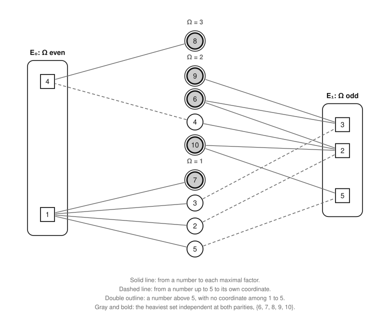

# The parity bound on the whole game

Part of [the theory](../THEORY.md).

Linear algebra over GF(2) bounds the best score of a game from above.  Each number gets a vector over GF(2) for each
parity of the number of prime factors, and every playable set is *independent at both parities*: its vectors at each
are linearly independent.  So the heaviest set independent at both parities bounds opt(n): [the parity bound
(W1)](#the-parity-bound).  A classical algorithm, weighted matroid intersection, computes it in polynomial time, and a
weight split checks its value without trusting the algorithm that found it.  With some numbers fixed in and others fixed
out, it bounds the sets that make the same choices.  [The barred bound (W2)](#the-barred-bound) fixes the bottom two
layers as every optimal set has them and leaves out one more number: when it is at most a score, every set that beats
the score plays that number.  The sources are the largest numbers, and the heaviest set independent at both parities
holds those that the greedy algorithm keeps from their vectors, which are U\* exactly when [the span conjecture
(♦)](sources.md#the-span-conjecture) holds: [the greedy-basis proposition (W3)](#the-greedy-basis-proposition).  All
three results are proved.  The prover bounds its searches by W1.  W2 settles most of [statement
U](exactness.md#statement-u), the open statement that some optimal set plays every member of U\* with three or more
prime factors, game by game, and [the certificate theorem (E2)](extended-problem.md#the-certificate-theorem) rests on
it.  The same construction, frame by frame, bounds the frame model's promotions ([bounds on the
promotions](frame-bounds.md)).

*Words.*  Playable sets, maximal factors, layers and sources are the [glossary's](../GLOSSARY.md), and U\* is defined in
[sources.md](sources.md#descending-greedy).  The incidence vector v(s) of a number s, the unit vector e_s of s ≤ n/2,
and a set *independent with its own coordinates* (its members' v(s) together with the e_s of its members up to n/2) are
those of [playability.md](playability.md#independence).  GF(2) is explained in [the
primer](primer/linear-algebra.md#finite-fields-and-gf2), and linear independence, spans, circuits, private coordinates and quotients by
a span in [its section on linear independence](primer/linear-algebra.md#linear-independence).

## The parity vectors

Fix a board n ≥ 2, with the coordinates 1 to ⌊n/2⌋.  Split them by the parity of their layer Ω, with Ω(1) = 0 even:
E₀ holds the coordinates with Ω even, and E₁ those with Ω odd.  A maximal factor f of s has Ω(f) = Ω(s) − 1, so v(s)
lies in the part whose parity is not Ω(s)'s, and e_s in the part of Ω(s)'s own parity.  Each number has at most one
vector in each part.

**Definition (the parity vectors).**  For i = 0 and i = 1, the *parity-i vector* of a number s of 2..n is

* v(s), if Ω(s) and i have different parities;
* e_s, if they have the same parity and s ≤ n/2;
* the unit vector of an *extra coordinate*, a private coordinate beside E_i, if they have the same parity and s > n/2,
  since s then has no vector in E_i.

A set S ⊆ {2, …, n} is *independent at parity i* when the parity-i vectors of its members are linearly independent over
GF(2), and *independent at both parities* when it is independent at parity 0 and at parity 1.  A *circuit at parity i*
is a nonempty set whose parity-i vectors sum to 0 while those of no smaller nonempty part of it do.  For a set Y, a set
I disjoint from Y is independent at parity i *together with Y* when Y ∪ I is independent at parity i, and at both
parities together with Y when it is at each.  When Y is independent at parity i, this says that the classes of I's
parity-i vectors modulo the span of Y's are independent ([the primer](primer/linear-algebra.md#linear-independence)).

*Extra coordinates.*  At parity i, no vector but a number's own has a 1 at its extra coordinate, so no combination of
the other members' parity-i vectors reaches the number's, and no nonempty set whose parity-i vectors sum to 0 holds it.
So a set is independent at parity i exactly when its members without an extra coordinate at parity i are.  A member with
one lies in no circuit at parity i, and it joins any set independent at parity i without making it dependent.

*Example.*  On the board of 10 the coordinates are 1 to 5, with E₀ = {1, 4} and E₁ = {2, 3, 5}.  In the table,
*extra* stands for a number's extra coordinate.

| number | Ω | at parity 0 | at parity 1 |
|---|---|---|---|
| 2, 3, 5 | 1 | e₁ | e₂, e₃, e₅ |
| 7 | 1 | e₁ | extra |
| 4 | 2 | e₄ | e₂ |
| 6, 9, 10 | 2 | extra | e₂ + e₃, e₃, e₂ + e₅ |
| 8 | 3 | e₄ | extra |

At parity 0 the primes all have the vector e₁, since 1 is the only maximal factor of each, so a set independent at
parity 0 holds at most one prime, as a game does.  The numbers 4 and 8 share the vector e₄ there too, and no game plays
both, since 4 is the only maximal factor of 8.  At parity 1, {4, 6, 9} is dependent (v(4) + v(9) = v(6)), though it is
independent at parity 0, and it is unplayable: its three members have only the two maximal factors 2 and 3 between
them.  The heaviest set independent at both parities is {6, 7, 8, 9, 10}, worth 40.  It is playable, in the order 7, 9,
6, 10, 8, so here the bound is opt(10) = 40.

*A number's solid lines land in one box and its dashed line in the other.  The numbers above 5 have no coordinate e_s in
either box (double outline), and each has an extra coordinate, not drawn, at the parity of its layer.  Gray and bold:
the heaviest set independent at both parities.*

## The parity bound

**Theorem W1 (the parity bound).**  Let n ≥ 2, and let Y and Z be disjoint sets of numbers of 2..n, the *picks* and the
*bars*.  Every playable set S ⊆ {2, …, n} is independent at both parities.  Hence, if Y is independent at both
parities, every playable S with Y ⊆ S and S ∩ Z = ∅ satisfies

    ΣS ≤ ΣY + max { ΣI : I ⊆ {2, …, n} ∖ (Y ∪ Z) independent at both parities together with Y },

and if Y is dependent at either parity, there is no such S.  In particular, with no picks and no bars, opt(n) is at most
the heaviest sum ΣI of a set I independent at both parities.

The right side is the *parity bound of n with the picks Y and the bars Z*, taken as −∞ when Y is dependent at either
parity; with no picks and no bars it is *the parity bound of n*.

*Proof.*  The idea: a playable set is independent with its own coordinates, each of those vectors lies in one parity's
part, and the two halves are exactly the set's parity-0 and parity-1 vectors but for the extra coordinates, which change
nothing.

1. *A set S is independent at both parities iff it is independent with its own coordinates.*  Every vector of that
   family lies in E₀ or in E₁, two disjoint blocks of coordinates, so the family is independent iff its vectors in E₀
   are and its vectors in E₁ are ([the primer](primer/linear-algebra.md#linear-independence)): a nonempty part of the family whose
   vectors sum to 0 splits into its vectors in E₀ and its vectors in E₁, each of which sums to 0 alone, and one of them
   is nonempty.  Its vectors in E_i are exactly the parity-i vectors of the members of S that have no extra
   coordinate at parity i: v(s) when Ω(s) and i differ in parity, and e_s when they agree and s ≤ n/2.  And a set is
   independent at parity i iff those members are, since a member with an extra coordinate joins every set independent
   at parity i ([the parity vectors](#the-parity-vectors), the paragraph "Extra coordinates").
2. *A playable set is independent with its own coordinates,* by [the independence lemma
   (P10)](playability.md#the-independence-lemma), over GF(2).
3. *The bound.*  The moves of a game form a playable set, and a playable set can be played and the game continued, so
   opt(n) is the largest sum of a playable set; by steps 1 and 2 it is at most the heaviest sum of a set independent at
   both parities.
4. *Picks and bars.*  Let S be playable, with Y ⊆ S and S ∩ Z = ∅.  By steps 1 and 2, S is independent at both
   parities, so its subset Y is, since part of an independent family is independent.  The set S ∖ Y is disjoint from
   Y, and Y ∪ (S ∖ Y) = S, so S ∖ Y is independent at both parities together with Y.  It avoids Y and Z, so it is one
   of the sets I of the maximum, and ΣS = ΣY + Σ(S ∖ Y).  If Y is dependent at either parity, no playable set contains
   it, since every subset of a playable set is independent at both parities.  ∎

By step 1, the sets independent at both parities are exactly the sets independent with their own coordinates: the
parity bound is the heaviest of these.

### Computing and checking the bound

Three properties make the bound useful.

* **It takes polynomial time.**  The heaviest set independent at both parities is found by weighted matroid
  intersection, a classical algorithm ([the primer](primer/bounds.md#two-families-at-once)), which needs only a test of
  independence at each parity, here on sparse vectors over GF(2).  No proof depends on the algorithm, since the next
  property certifies its answer.
* **Its value can be checked without trusting the algorithm.**  Let w = w₀ + w₁ be a split of the weights under which
  a set I independent at both parities is a heaviest set independent at parity 0 for w₀ and a heaviest set independent
  at parity 1 for w₁.  Then every set J independent at both parities has w(J) = w₀(J) + w₁(J) ≤ w₀(I) + w₁(I) = w(I),
  so the split proves w(I) the maximum, whatever produced I ([the primer](primer/bounds.md#two-families-at-once), the
  paragraph "Certificates").  For the two parities such a split always exists (the primer, the paragraph "For families
  of vectors").  The prover accepts a value only with its split.
* **The same split bounds the sets that avoid a member x of I.**  Such a set weighs at most the heaviest set without x
  that is independent at parity 0, for w₀, plus the heaviest without x that is independent at parity 1, for w₁, by the
  same weak duality, and each term is one exchange from I.  The prover's search relies on this: a member whose bound
  without it is at most the value to beat is held by every set that beats it, so the search picks it.

**The exchange from a heaviest set.**  Give each member of a finite set E a vector over a field, and call a subset of E
independent when its members' vectors are linearly independent.  Let I be a heaviest independent set for weights w of
either sign, and x a member of I.  Let y be the heaviest member outside I with I − x + y independent, if there is one.
Then a heaviest independent set that avoids x is I − x + y if y exists and w(y) > 0, and I − x otherwise; it weighs
w(I) − w(x) + max(0, w(y)), where max(0, w(y)) is 0 if there is no y.

*Proof.*  The idea is the symmetric exchange property of bases (R. A. Brualdi, "Comments on bases in dependence
structures", *Bulletin of the Australian Mathematical Society* 1 (1969) 161–167), here for vectors and for sets of any
size: a set that avoids x either admits x as it is, or trades for x one of its members that can replace x in I.  The
set named in the statement avoids x, since y is outside I, and it is independent and has that weight.  It remains to
show that every independent set J that avoids x has w(J) ≤ w(I) − w(x) + max(0, w(y)).

1. *If J + x is independent,* then w(J) + w(x) ≤ w(I), since I is heaviest, so w(J) ≤ w(I) − w(x).
2. *Otherwise* x's vector is a linear combination of the vectors of J, since J is independent; let C be the members of
   J with a nonzero coefficient in it.  Not every member of C has its vector in the span of the vectors of I − x, or
   x's vector would be there too, and I would be dependent.  Take y′ in C with its vector outside that span.  Then
   I − x + y′ is independent, and y′ is outside I, since it is not in I − x and J avoids x; so y exists and
   w(y′) ≤ w(y).
3. *Then J − y′ + x is independent.*  In a vanishing combination of its vectors, x has the coefficient 0: otherwise x's
   vector would be a combination of the vectors of J − y′, as well as one in which y′ has a nonzero coefficient, and
   the difference of the two would make J dependent.  Then the vectors of J − y′ have the coefficient 0 too.  Since I
   is heaviest, w(J) − w(y′) + w(x) ≤ w(I), that is w(J) ≤ w(I) − w(x) + w(y′) ≤ w(I) − w(x) + w(y).

Either way w(J) ≤ w(I) − w(x) + max(0, w(y)).  ∎

The prover bounds every node of its searches by W1, with the node's picks and bars ([solver/noframe/docs/proofs.md,
"The search"](../../solver/noframe/docs/proofs.md#the-search)).

## The barred bound

The barred bound fixes what [the bottom-layers theorem (F4)](frame-model.md#the-bottom-layers-theorem) says every
optimal set plays in layers 1 and 2, and bars one more number.

**Definition.**  A set S ⊆ {2, …, n} *obeys F4* when it holds [q(n)](neighbors.md#neighboring-games), the largest
prime ≤ n, and no other prime, and holds exactly U\*_2 among the sources of layer 2.  The *picks of F4* are q(n) and the
members of U\*_2.  The *bars of F4* are the other primes, the sources of layer 2 outside U\*_2, and, when the frames of
layer 2 are closed, every number of layer 2 up to n/2.  The frames of layer 2 are closed when U\*_2 has one member for
each prime up to n/2, which makes it a spanning tree of F4's graph G_n with its ground vertex.  For a number b of 2..n
that is not a pick of F4, the *barred bound* of b is the parity bound of n with the picks of F4 and with the bars of F4
and b.

By F4, every optimal set of n obeys F4.  A playable set obeys F4 exactly when it holds the picks of F4 and none of its
bars.  The only bars that the definition of obeying leaves unnamed are the numbers of layer 2 up to n/2 when the frames
of layer 2 are closed, and a playable set that obeys F4 holds none of them.  Such a number is an edge of G_n, so it
closes a cycle with the spanning tree U\*_2.  The cycle's members list each of its primes twice, and the set holds no
prime up to n/2, so the cycle is [self-covering](playability.md#cores-and-the-residual), and no playable set contains a
self-covering set ([the core theorem (P7)](playability.md#the-core-theorem)).

In game 21, U\*_2 = {14, 15, 21} has three members for the four primes 2, 3, 5 and 7: the frame of layer 2 has a
freedom, so the numbers of layer 2 up to 10 are not barred, and the optimal set of 21, which plays 9 = 3², obeys F4.

**Corollary W2 (the barred bound).**  Let n ≥ 2, V a number, and b a number of 2..n that is not a pick of F4.  If the
barred bound of b is at most V, every playable set that obeys F4 and weighs more than V holds b.  In particular, if
opt(n) > V, every optimal set of n holds b.

*Proof.*  Let S be playable, obey F4, and miss b.  Then S holds the picks of F4 and avoids its bars and b, so by
[W1](#the-parity-bound), ΣS is at most the barred bound of b, which is at most V.  So a playable set that obeys F4 and
weighs more than V cannot miss b.  If opt(n) > V, every optimal set weighs more than V, and it obeys F4.  ∎

W2 is applied to the members of U\*_{≥3}, the sources that [statement U](exactness.md#statement-u) asks some optimal
set to play.  Its conclusion is what [the certificate theorem (E2)](extended-problem.md#the-certificate-theorem) asks of
a member *certified against* V, so a member whose barred bound is at most V is certified against V.  The barred bound
does not depend on V, so a member certified against one score is certified against every higher one.  The prover
computes the barred bounds game by game ([solver/noframe/docs/proofs.md, "The upper part, game by
game"](../../solver/noframe/docs/proofs.md#the-upper-part-game-by-game)).

## The greedy-basis proposition

The sources are the largest numbers, and each has an extra coordinate at one parity, so the parity bound takes them as
the greedy algorithm would at the other: by decreasing value, each one whose vector is no sum of those taken before it.
The *sources' vectors* of game n are the incidence vectors v(s) over GF(2) of its sources s.  Their *greedy basis* is
the set of sources that [the greedy algorithm](primer/greedy.md#the-greedy-algorithm) keeps when it takes the sources by
decreasing value and keeps each whose vector is not in the span of the vectors of those kept.

**Proposition W3 (the greedy-basis proposition).**  Let n ≥ 2.  Every heaviest set independent at both parities holds,
among the sources, exactly the greedy basis of the sources' vectors.  The greedy basis is U\* if and only if
[(♦)](sources.md#the-span-conjecture) holds in game n, and then the parity bound of n equals the parity bound with the
picks U\* and with the bars the other sources.

*Proof.*  The idea: a source left out of a heaviest set could replace any smaller member of its circuit, so its circuit
is made of larger sources, which is how the greedy algorithm rejects.

1. *Sources at the two parities.*  A source s of layer k exceeds n/2, so it has an extra coordinate at the parity of k,
   and its vector at the other parity is v(s).  So a set of sources is independent at both parities exactly when its
   vectors v(s) are independent, by step 1 of the proof of [W1](#the-parity-bound), since sources have no e_s.
2. *The first difference.*  Let I be a heaviest set independent at both parities, G the greedy basis, and suppose that
   they hold different sources.  Let d be the largest source in one of them and not the other; above d they agree.
3. *d is not in I alone.*  The greedy algorithm rejected d, so v(d) is a sum of vectors of members of G above d, which
   are members of I.  Then I is dependent at a parity, by step 1.
4. *d is not in G alone.*  The set I + d is independent at the parity of d's extra coordinate ([the parity
   vectors](#the-parity-vectors), the paragraph "Extra coordinates").  At the other parity, i, it is dependent, or it
   would be independent at both and outweigh I.  So v(d), the parity-i vector of d, is the sum of the parity-i vectors
   of exactly one set of members of I, since I is independent at parity i.  With d, this set is the circuit H of I + d
   at parity i, and a member e of I lies in H exactly when I − e + d is independent at parity i ([the
   primer](primer/linear-algebra.md#linear-independence)).  If H held a member e smaller than d, I − e + d would be independent at
   parity i, and at the other parity too, where d has its extra coordinate, and it would outweigh I.  So the other
   members of H are larger than d: sources above d, members of G.  A member with an extra coordinate at parity i lies
   in no circuit at parity i, so the parity-i vector of each is its v, and these vectors sum to v(d).  Then the greedy
   algorithm would have rejected d.
5. *U\* and (♦).*  The set U\* is playable, so its vectors are independent ([the independence lemma
   (P10)](playability.md#the-independence-lemma)).  If (♦) holds, the greedy algorithm decides every source as
   descending greedy does, by induction down the sources: where descending greedy keeps x, v(x) is no sum of vectors of
   U\* above x, by that independence, and where it rejects x, (♦) makes v(x) such a sum.  Conversely, if G = U\*, the
   vector of each source that descending greedy rejects is a sum of vectors of members of U\* above it: (♦).
6. *The bound.*  Given (♦), a heaviest set I independent at both parities holds U\* and no other source.  So I ∖ U\*
   avoids U\* and the other sources, and it is independent at both parities together with U\*, since
   U\* ∪ (I ∖ U\*) = I; the parity bound with those picks and bars is at least ΣI.  It is at most ΣI, since every set
   it counts, together with U\*, is independent at both parities.  ∎

The span conjecture holds in game 21, so the parity bound's heaviest set of 21 holds
U\* = {12, 14, 15, 16, 18, 19, 20, 21} and no other source: it is U\* and 9, worth 144.  The conjecture holds in every
game checked ([evidence.md](evidence.md#the-open-statements-about-the-sources)), so W3 settles the sources of the parity
bound in all of them.  [The comparison theorem (B6)](frame-bounds.md#the-comparison-theorem) uses it to compare the
parity bound with the frame bound.

## What the parity bound misses

The parity bound admits exactly the sets independent with their own coordinates (step 1 of the proof of
[W1](#the-parity-bound)), so it exceeds opt(n) only through an unplayable set of that kind, which holds an [odd
core](playability.md#odd-cores).  It equals opt(n) on every board below 45, which has no odd core ([the first-odd-core
proposition (C3)](franklin-moniot.md#the-first-odd-core)), and, as measured, on every board up to 77
([evidence.md](evidence.md#observations)).

Between it and the bounds it is compared with:

* It is never above the [Franklín–Moniot bound](franklin-moniot.md#what-the-paper-proves), the heaviest set whose
  members can be paid with distinct maximal factors outside it, since a set independent with its own coordinates has
  such a payment ([the counting theorem (C2)](franklin-moniot.md#the-counting-theorem)).
* It is never below ΣU\* plus the frame bound at the root, since a set X of candidates is independent in every frame
  exactly when X ∪ U\* is independent at both parities ([the comparison theorem
  (B6)](frame-bounds.md#the-comparison-theorem)), and the two are equal on every board measured
  ([frame-bounds.md](frame-bounds.md#the-frame-bound), the paragraph "Against the parity bound").
* A bound built the same way over the rationals would admit every set that the parity bound admits ([the
  primer](primer/linear-algebra.md#finite-fields-and-gf2), the paragraph "Comparing fields"), and more.  The triangle {6, 10, 15} is
  unplayable, since whichever member is played first leaves at most one of the factors 2, 3 and 5 for the other two,
  and its vectors are dependent over GF(2) but independent over the rationals ([the
  primer](primer/linear-algebra.md#finite-fields-and-gf2), the paragraph "Example").
* The bound asks for independence at two parities at once, and there the greedy algorithm, which takes the numbers in
  decreasing order of weight and keeps each that leaves the kept set independent at both parities, can miss the
  heaviest set.  On every board from 4 up, give 2 the weight 3, give 3 and 4 the weight 2, and give every other
  number 0.  The greedy algorithm keeps 2 and then neither 3 nor 4, since 2 shares the vector e₁ with 3 at parity 0 and
  e₂ with 4 at parity 1, so what it keeps weighs 3, while {3, 4} is independent at both parities and weighs 4.  So [the
  relaxation proposition (Q2)](uniqueness-and-longest-games.md#the-relaxation-proposition), by which no greedy
  relaxation of a game with two or more optimal sets is exact, does not apply to it: a greedy relaxation, as Q2 defines
  it, is a family on which the greedy algorithm finds a heaviest set for every nonnegative weighting.

## The parity steps

From game n − 1 to game n the parity bound moves in one of four ways, which the greedy basis decides with no search.
Where n's vector is a sum of old sources' vectors, the bound rises by n less the smallest source that the sum needs, and
the promotions it allows do not change ([W4](#the-parity-steps)).  So its excess over opt(n) stays at every prime and
every odd semiprime from 189 on ([W5](#where-the-parity-gap-stays)).

*Words.*  For a game m, G(m) is the greedy basis of its sources' vectors, V(m) their span, and PB(m) the parity bound of
m.  A set L of numbers of 2..⌊m/2⌋ is *admissible* for G(m) when G(m) ∪ L is independent at both parities, and Q\*(m) is
the largest ΣL of an admissible L.  By W3 the heaviest sets independent at both parities are the sets G(m) ∪ L with L
admissible, so PB(m) = ΣG(m) + Q\*(m).  The *parity gap* of game m is PB(m) − opt(m), as in [the
glossary](../GLOSSARY.md#bounds).  Game n ≥ 3 is an *exchange step* when n is odd and v(n) ∈ V(n − 1), and an *added
step* when n is odd and v(n) ∉ V(n − 1); with s = n/2 for even n, it is a *half-in step* when s ∈ G(n − 1), and a
*half-out step* when s ∉ G(n − 1).

**Theorem W4 (the parity steps).**  Let n ≥ 3.  Always PB(n) ≤ PB(n − 1) + n, and:

1. At an exchange step, exactly one set C ⊆ G(n − 1) has Σ_{c ∈ C} v(c) = v(n), and its members lie in n's layer.  With
   x_G its smallest member, G(n) = G(n − 1) − x_G + n, the same sets are admissible for G(n) and for G(n − 1), and
   PB(n) = PB(n − 1) + n − x_G.
2. At an added step, G(n) = G(n − 1) + n, and every set admissible for G(n) is admissible for G(n − 1).
3. At a half-in step, G(n) = G(n − 1) − s + n, every set admissible for G(n − 1) is admissible for G(n), and
   PB(n) ≥ PB(n − 1) + n − s.
4. At a half-out step, G(n) = G(n − 1) + n and PB(n) = PB(n − 1) + n.

None of it needs statement U or (♦).

*Proof.*  The vector of n is new, has a coordinate of its own, or is a sum of old vectors, and then n takes the place of
the smallest of them.

1. *The two boards.*  For odd n, ⌊n/2⌋ = (n − 1)/2, so the boards n − 1 and n have the same coordinates; for even n,
   board n has one more, s, and of the numbers below n only s has a parity vector there, e_s, since the next multiple of
   s is n.  So the numbers below n keep their parity vectors, but s, which trades its extra coordinate for e_s.  The
   sources of board n are those of board n − 1 and n, less s for even n, which is the smallest source of board n − 1.
2. *The ceiling.*  For a heaviest set I of board n, the parity vectors of I − n on board n − 1 are those of board n, but
   e_s, which becomes an extra coordinate, which no circuit holds.  So I − n is independent at both parities on board
   n − 1, and PB(n) ≤ Σ(I − n) + n ≤ PB(n − 1) + n.
3. *G(n) at the other steps.*  The greedy algorithm on board n keeps n first, as v(n) ≠ 0, and then decides the old
   sources in turn; let K_y be the members of G(n − 1) above y.  For even n, v(n) alone has a 1 at s, so v(y) lies in
   the span of K_y + n only if it lies in that of K_y.  At an added step, a member y of G(n − 1) with v(y) in the span
   of K_y + n would put v(n) in that of K_y + y, in V(n − 1).  Either way each old source is decided as before.
4. *G(n) at an exchange step.*  C exists and is unique, since G(n − 1) is a basis of V(n − 1) ([the greedy
   algorithm](primer/greedy.md#the-greedy-algorithm), part (a)).  The vectors of a layer k lie on the coordinates of
   layer k − 1, so members of C of another layer than n's would sum to 0 alone, and there are none.  Above x_G, a member
   y of G(n − 1) with v(y) in the span of K_y + n would give v(n) a second representation, missing x_G.  At x_G,
   v(x_G) = v(n) + Σ v(c) over C − x_G, which lies in K_{x_G}, so x_G is rejected.  Below it, K_y − x_G + n spans what
   K_y spans, as each of v(n) and v(x_G) is a sum of the other and of members of K_y.
5. *The admissible sets.*  The members of L have no extra coordinates, so whether L is admissible for G depends only on
   W₀(G) and W₁(G), with W_i(G) the span of v(g) over the members g of G whose layer is not of parity i ([the
   primer](primer/linear-algebra.md#linear-independence)).  At an exchange step x_G and n lie in n's layer, so at its
   parity they enter neither W_i, and at the other each of v(n) and v(x_G) is a sum of the other and of members of both
   G(n − 1) and G(n): the W_i agree.  At an added step G(n − 1) ∪ L is part of G(n) ∪ L.  At a half-in step an L
   admissible for G(n − 1) lies below s and keeps its vectors on board n, with G(n − 1) − s, and it stays independent
   with n, by s at one parity and n's extra coordinate at the other.
6. *The bound.*  PB = ΣG + Q\* gives parts 1 and 3.  At a half-out step a heaviest set of board n − 1 holds no s, by W3,
   and with n it is independent at both parities on board n, by s and n's extra coordinate; with step 2, part 4 follows.
   ∎

Game 39 is an exchange step: v(39) = e₃ + e₁₃ is the sum over C = {22, 26, 33} in G(38), so x_G = 22 and
PB(39) = PB(38) + 17 = 503.  Games 21, 22 and 20 are an added, a half-out and a half-in step: the bound rises by 20, by
22, and by 11, as 10 leaves the greedy basis (`solver/noframe/data/exact_parity_2_2531.jsonl`).

### Where the parity gap stays

At three kinds of game the parity gap stays.

**Corollary W5 (where the parity gap stays).**  Let n ≥ 3.

1. *Exchanges of U\*.*  For odd n, given (♦) in games n − 1 and n, U\*(n) = U\*(n − 1) − x + n for a source x of game
   n − 1 exactly at an exchange step, with x = x_G.  So there opt(n) = opt(n − 1) + n − x exactly when the parity gap
   stays.
2. *Primes and semiprimes.*  At every prime n, and every odd n ≥ 189 with two prime factors, the parity gap stays:
   opt(n) − opt(n − 1) = PB(n) − PB(n − 1).
3. *Half-out steps.*  At a half-out step, given statement U and (♦) in game n − 1, the parity gap stays.
4. *The gap.*  Given U and (♦) in game m, the parity gap of game m is Q\*(m) − P\*(Π_m).

*Proof.*  Each part puts W4 beside a result about opt.

1. By W3, (♦) makes G = U\* in both games.  An exchange of U\* is no added step (W4, part 2), so it is an exchange step,
   with x = x_G (part 1), and conversely.
2. At a prime n, v(n) = e₁, which only the primes have, and G(n − 1) holds one prime, q(n − 1), so C = {q(n − 1)} and
   [the prime formula (N5)](neighbors.md#the-prime-formula) gives opt(n) the same rise.  For odd n ≥ 189 with two prime
   factors, three facts make the part of G(n − 1) in layer 2 the U\*_2(n − 1) of [the bottom-layers theorem
   (F4)](frame-model.md#the-bottom-layers-theorem): the greedy basis splits by layer, as the layers' vectors lie on
   disjoint coordinates; numbers of layer 2 have independent vectors iff they are a forest in F4's graph G_n ([the
   two-factor proposition (P11)](playability.md#the-two-factor-proposition)); and descending greedy keeps a source of
   layer 2 iff it closes no cycle with those kept (F4's proof, step 3).  By [the semiprime formula
   (J3)](arrival.md#the-semiprime-formula), whose hypothesis holds from 189 on (its step 7), n closes a cycle with
   U\*_2(n − 1), and the cycle's other members sum to v(n), as a path from p to q sums to e_p + e_q and one from p to
   the ground vertex to e_p.  So C is that path, x_G is J3's x, and J3 gives opt(n) − opt(n − 1) = n − x.
3. W4 (part 4) gives the bound's rise, n.  By W3, (♦) leaves s out of U\*(n − 1).  Given U, some optimal set of game
   n − 1 holds U\*_{≥3}, so, with F4, all of U\*(n − 1) and, by step 1 of the proof of [the corollary of U
   (X8)](exactness.md#statement-u), no other source.  It does not play s, and [the half lemma
   (N7)](neighbors.md#the-half-lemma) puts game n at its ceiling.
4. Given U, X8 gives opt(m) = ΣU\*(m) + P\*(Π_m), and given (♦), W3 gives G(m) = U\*(m).  ∎

So, given U and (♦), the gap changes only at added and half-in steps and at the exchange steps where opt rises by other
than n − x_G.  The committed chain has none of the last, and at each of its exchange steps x_G is the shadow of n ([the
shadow law](arrival.md#the-shadow-law); [the standing](statements.md#the-parity-bound), [the
computation](evidence.md#observations)).

### The transfer lemma

The change from an optimal set of game n − 1 to one of game n keeps the parity gap from shrinking if it applies to a
heaviest set of the parity bound.

**Lemma W6 (the transfer lemma).**  Let T be an optimal set of game n − 1, and (T ∖ D) ∪ A ∪ {n} an optimal set of game
n, with D ⊆ T and A disjoint from T ∪ {n}.  If a heaviest set I independent at both parities on board n − 1 holds D and
avoids A, and (I ∖ D) ∪ A ∪ {n} is independent at both parities on board n, then the parity gap of game n is at least
that of game n − 1.

*Proof.*  PB(n) ≥ ΣI − ΣD + ΣA + n = PB(n − 1) − ΣD + ΣA + n, while opt(n) = opt(n − 1) − ΣD + ΣA + n.  ∎

The other direction needs no lemma: a game of n that scores opt(n − 1) + PB(n) − PB(n − 1) keeps the gap from growing.
