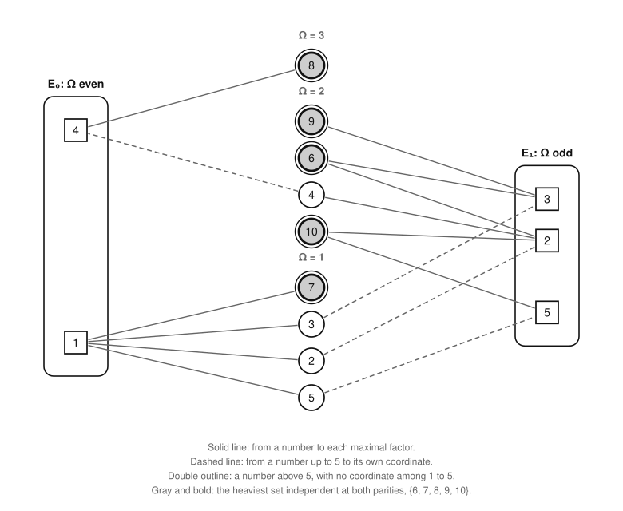

# The parity bound on the whole game

Part of [the theory](../THEORY.md).

Linear algebra over GF(2) bounds the best score of a game from above.  Every playable set is independent in two matroids
over GF(2), one for each parity of the number of prime factors, so the heaviest set independent in both bounds opt(n):
[the parity bound (W1)](#the-parity-bound).  Weighted matroid intersection computes it in polynomial time, and a weight
split checks its value without trusting the algorithm that found it.  With some numbers fixed in and others fixed out,
it bounds the sets that make the same choices.  [The barred bound (W2)](#the-barred-bound) fixes the bottom two layers
as every optimal set has them and leaves out one more number: when it is at most a score, every set that beats the score
plays that number.  The sources are the heaviest numbers, and the heaviest common independent set holds those that the
greedy algorithm of their own linear matroid keeps, which are U\* exactly when [the span conjecture
(♦)](sources.md#the-span-conjecture) holds: [the greedy-basis proposition (W3)](#the-greedy-basis-proposition).  All
three results are proved.  The prover bounds its searches by W1.  W2 settles most of [statement
U](exactness.md#statement-u), the open statement that some optimal set plays every member of U\* with three or more
prime factors, game by game, and [the certificate theorem (E2)](extended-problem.md#the-certificate-theorem) rests on
it.  The same construction, frame by frame, bounds the frame model's promotions ([bounds on the
promotions](frame-bounds.md)).

*Words.*  Playable sets, maximal factors, layers and sources are the [glossary's](../GLOSSARY.md), and U\* is defined in
[sources.md](sources.md#descending-greedy).  The incidence vector v(s) of a number s, the unit vector e_s of s ≤ n/2,
and a set *independent with its own coordinates* (its members' v(s) together with the e_s of its members up to n/2) are
those of [playability.md](playability.md#independence).  GF(2) is explained in [the
primer](primer.md#finite-fields-and-gf2), and matroids, parallel elements, coloops, contraction and deletion in [its
section on matroids](primer.md#matroids).

## The parity matroids

Fix a board n ≥ 2, with the coordinates 1 to ⌊n/2⌋.  Split them by the parity of their layer Ω, with Ω(1) = 0 even:
E₀ holds the coordinates with Ω even, and E₁ those with Ω odd.  A maximal factor f of s has Ω(f) = Ω(s) − 1, so v(s)
lies in the part whose parity is not Ω(s)'s, and e_s in the part of Ω(s)'s own parity.  Each number has at most one
vector in each part.

**Definition (the parity matroids).**  For i = 0 and i = 1, the parity matroid M_i is the linear matroid on {2, …, n}
over GF(2) in which s is represented by its vector in E_i:

* by v(s), if Ω(s) and i have different parities;
* by e_s, if they have the same parity and s ≤ n/2;
* as a coloop, if they have the same parity and s > n/2, since s then has no vector in E_i.

*Example.*  On the board of 10 the coordinates are 1 to 5, with E₀ = {1, 4} and E₁ = {2, 3, 5}.

| number | Ω | in M₀ | in M₁ |
|---|---|---|---|
| 2, 3, 5 | 1 | e₁ | e₂, e₃, e₅ |
| 7 | 1 | e₁ | coloop |
| 4 | 2 | e₄ | e₂ |
| 6, 9, 10 | 2 | coloops | e₂ + e₃, e₃, e₂ + e₅ |
| 8 | 3 | e₄ | coloop |

In M₀ the primes are parallel, since 1 is the only maximal factor of each, so a set independent in M₀ holds at most one
prime, as a game does.  The numbers 4 and 8 are parallel too, and no game plays both, since 4 is the only maximal
factor of 8.  In M₁, {4, 6, 9} is dependent (v(4) + v(9) = v(6)), though M₀ sees nothing wrong with it, and it is
unplayable: its three members have only the two maximal factors 2 and 3 between them.  The heaviest set independent in
both is {6, 7, 8, 9, 10}, worth 40.  It is playable, in the order 7, 9, 6, 10, 8, so here the bound is opt(10) = 40.

*A number's solid lines land in one box and its dashed line in the other.  The numbers above 5 have no coordinate of
their own (double outline); gray and bold: the heaviest set independent in both.*

## The parity bound

**Theorem W1 (the parity bound).**  Let n ≥ 2, and let Y and Z be disjoint sets of numbers of 2..n, the *picks* and the
*bars*.  Every playable set S ⊆ {2, …, n} is independent in both parity matroids M₀ and M₁.  Hence, if Y is independent
in both, every playable S with Y ⊆ S and S ∩ Z = ∅ satisfies

    ΣS ≤ ΣY + max { ΣI : I independent in M₀/Y ∖ Z and in M₁/Y ∖ Z },

and if Y is dependent in either matroid, there is no such S.  In particular, with no picks and no bars, opt(n) is at
most the heaviest sum ΣI of a set I independent in M₀ and in M₁.

The right side is the *parity bound of n with the picks Y and the bars Z*, taken as −∞ when Y is dependent in either
matroid; with no picks and no bars it is *the parity bound of n*.

*Proof.*  The idea: a playable set is independent with its own coordinates, each of those vectors lies in one parity's
part, and the two halves are exactly the set's representations in M₀ and M₁.

1. *A set S is independent in M₀ and in M₁ iff it is independent with its own coordinates.*  Every vector of that
   family lies in E₀ or in E₁, and GF(2)^{⌊n/2⌋} is the direct sum of the two parts, so the family is independent iff
   its vectors in E₀ are and its vectors in E₁ are ([direct sums](primer.md#deletion-contraction-direct-sums-and-truncation)).  Its
   vectors in E_i are exactly those that represent in M_i the members of S that are not coloops of M_i: v(s) when Ω(s)
   and i differ in parity, and e_s when they agree and s ≤ n/2.  And a set is independent in M_i iff its members that
   are not coloops are, since a coloop joins any independent set ([the primer](primer.md#matroids)).
2. *A playable set is independent with its own coordinates,* by [the independence lemma
   (P10)](playability.md#the-independence-lemma), over GF(2).
3. *The bound.*  The moves of a game form a playable set, and a playable set can be played and the game continued, so
   opt(n) is the largest sum of a playable set; by steps 1 and 2 it is at most the heaviest sum of a common independent
   set.
4. *Picks and bars.*  Let S be playable, with Y ⊆ S and S ∩ Z = ∅.  By steps 1 and 2, S is independent in M_i, so its
   subset Y is, and S ∖ Y is independent in the contraction M_i/Y, by the definition of contraction.  It avoids Z, so
   it is independent in M_i/Y ∖ Z, for i = 0 and 1, and ΣS = ΣY + Σ(S ∖ Y).  If Y is dependent in either matroid, no
   playable set contains it.  ∎

By step 1, the sets independent in both parity matroids are exactly the sets independent with their own coordinates:
the parity bound is the heaviest of these.

### Computing and checking the bound

Three properties make the bound useful.

* **It takes polynomial time.**  The heaviest common independent set of two matroids is found by weighted matroid
  intersection ([the primer](primer.md#matroid-intersection)), and the matroids here are given by sparse vectors over
  GF(2).
* **Its value can be checked without trusting the algorithm.**  A split w = w₀ + w₁ of the weights under which a common
  independent set I is heaviest in M₀ for w₀ and in M₁ for w₁ proves w(I) the maximum, whatever produced I ([the
  primer](primer.md#weak-duality-and-lagrangian-relaxation), the paragraph "Certificates"), and for two matroids such a
  split always exists ([the primer](primer.md#weak-duality-and-lagrangian-relaxation), the paragraph "For matroids").
  The prover accepts a value only with its split.
* **The same split bounds the sets that avoid a member x of I.**  Such a set weighs at most the heaviest independent set
  of M₀ ∖ x for w₀ plus that of M₁ ∖ x for w₁, by the same weak duality, and each term is one exchange from I.  The
  prover's search relies on this: a member whose bound without it is at most the value to beat is held by every set
  that beats it, so the search picks it.

**The exchange from a heaviest set.**  Let I be a heaviest independent set of a matroid for weights w of either sign,
and x a member of I.  Let y be the heaviest element outside I with I − x + y independent, if there is one.  Then a
heaviest independent set that avoids x is I − x + y if y exists and w(y) > 0, and I − x otherwise; it weighs
w(I) − w(x) + max(0, w(y)).

*Proof.*  Add as many coloops of weight 0, the *dummies*, as the matroid's rank r, and truncate to rank r.  The bases of
the result are the independent sets padded with dummies, at the same weights, so I padded is a heaviest basis G.  Let
G′ be any basis that avoids x.  By the symmetric exchange property of bases (R. A. Brualdi, "Comments on bases in
dependence structures", *Bulletin of the Australian Mathematical Society* 1 (1969) 161–167), some y′ ∈ G′ ∖ G makes
both G − x + y′ and G′ − y′ + x bases.  Since G is heaviest, w(G′ − y′ + x) ≤ w(G), that is w(G′) ≤ w(G − x + y′).
If y′ is a dummy, G − x + y′ is I − x padded, worth w(I) − w(x).  If y′ is an element, I − x + y′ is independent, so
y exists and w(y′) ≤ w(y), and G − x + y′ is worth at most w(I) − w(x) + w(y).  Either way
w(G′) ≤ w(I) − w(x) + max(0, w(y)), and the set named in the statement avoids x, is independent, and has that weight.  ∎

The prover bounds every node of its searches by W1, with the node's picks and bars ([solver/noframe/docs/proofs.md,
"With the parity bound (to 1300)"](../../solver/noframe/docs/proofs.md#with-the-parity-bound-to-1300)).

## The barred bound

The barred bound fixes what [the bottom-layers theorem (F4)](frame-model.md#the-bottom-layers-theorem) says every
optimal set plays in layers 1 and 2, and bars one more number.

**Definition.**  A set S ⊆ {2, …, n} *obeys F4* when it holds [q(n)](neighbors.md#neighboring-games), the largest
prime ≤ n, and no other prime, and holds exactly U\*_2 among the sources of layer 2.  The *picks of F4* are q(n) and the
members of U\*_2.  The *bars of F4* are the other primes, the sources of layer 2 outside U\*_2, and, when the frames of
layer 2 are closed, every number of layer 2 up to n/2.  The frames of layer 2 are closed when U\*_2 has one member for
each prime up to n/2, which makes it a spanning tree of F4's graph G_n with its ground vertex.  For a number b of 2..n
that is not a pick of F4, the *barred bound* of b is the parity bound of n with the picks of F4 and with the bars of F4
and b.

By F4, every optimal set of n obeys F4.  A playable set obeys F4 exactly when it holds the picks of F4 and none of its
bars.  The only bars that the definition of obeying leaves unnamed are the numbers of layer 2 up to n/2 when the frames
of layer 2 are closed, and a playable set that obeys F4 holds none of them.  Such a number is an edge of G_n, so it
closes a cycle with the spanning tree U\*_2.  The cycle's members list each of its primes twice, and the set holds no
prime up to n/2, so the cycle is [self-covering](playability.md#cores-and-the-residual), and no playable set contains a
self-covering set ([the core theorem (P7)](playability.md#the-core-theorem)).

In game 21, U\*_2 = {14, 15, 21} has three members for the four primes 2, 3, 5 and 7: the frame of layer 2 has a
freedom, so the numbers of layer 2 up to 10 are not barred, and the optimal set of 21, which plays 9 = 3², obeys F4.

**Corollary W2 (the barred bound).**  Let n ≥ 2, V a number, and b a number of 2..n that is not a pick of F4.  If the
barred bound of b is at most V, every playable set that obeys F4 and weighs more than V holds b.  In particular, if
opt(n) > V, every optimal set of n holds b.

*Proof.*  Let S be playable, obey F4, and miss b.  Then S holds the picks of F4 and avoids its bars and b, so by
[W1](#the-parity-bound), ΣS is at most the barred bound of b, which is at most V.  So a playable set that obeys F4 and
weighs more than V cannot miss b.  If opt(n) > V, every optimal set weighs more than V, and it obeys F4.  ∎

W2 is applied to the members of U\*_{≥3}, the sources that [statement U](exactness.md#statement-u) asks some optimal
set to play.  Its conclusion is what [the certificate theorem (E2)](extended-problem.md#the-certificate-theorem) asks of
a member *certified against* V, so a member whose barred bound is at most V is certified against V.  The barred bound
does not depend on V, so a member certified against one score is certified against every higher one.  The prover
computes the barred bounds game by game ([solver/noframe/docs/proofs.md, "The upper part, game by
game"](../../solver/noframe/docs/proofs.md#the-upper-part-game-by-game)).

## The greedy-basis proposition

The sources are the heaviest numbers, and each is a coloop of one parity matroid, so the parity bound takes them as the
greedy algorithm of the other would: by decreasing value, each one whose vector is no sum of those taken before it.
The *sources' linear matroid* of game n is the linear matroid over GF(2) on its sources, each source s represented by
v(s).  Its *greedy basis* is the set that its [greedy algorithm](primer.md#the-greedy-algorithm-of-a-matroid) keeps when
it takes the sources by decreasing value.

**Proposition W3 (the greedy-basis proposition).**  Let n ≥ 2.  Every heaviest set independent in M₀ and M₁ holds,
among the sources, exactly the greedy basis of the sources' linear matroid.  The greedy basis is U\* if and only if
[(♦)](sources.md#the-span-conjecture) holds in game n, and then the parity bound of n equals the parity bound with the
picks U\* and with the bars the other sources.

*Proof.*  The idea: a source left out of a heaviest set could replace any lighter member of its circuit, so its circuit
is made of heavier sources, which is how the greedy algorithm rejects.

1. *Sources in the parity matroids.*  A source s of layer k has no coordinate of its own, so it is a coloop of the
   parity matroid of k's parity, and v(s) represents it in the other.  So a set of sources is independent in M₀ and M₁
   exactly when its vectors v(s) are independent, by step 1 of the proof of [W1](#the-parity-bound): exactly when it
   is independent in the sources' linear matroid.
2. *The first difference.*  Let I be a heaviest set independent in both, G the greedy basis, and suppose that they
   hold different sources.  Let d be the largest source in one of them and not the other; above d they agree.
3. *d is not in I alone.*  The greedy algorithm rejected d, so v(d) is a sum of vectors of members of G above d, which
   are members of I.  Then I is dependent, by step 1.
4. *d is not in G alone.*  The set I + d is independent in the parity matroid in which d is a coloop.  In the other,
   M_i, it is dependent, or it would outweigh I.  Let H be the fundamental circuit of d over I in M_i ([the
   primer](primer.md#matroids)).  If H held a member e lighter than d, I − e + d would be independent in M_i, and in the
   other matroid too, since d is a coloop there, and it would outweigh I.  So the other members of H are heavier than d:
   sources above d, members of G.  A coloop lies in no circuit, so each is represented by its v in M_i, and these
   vectors sum to v(d).  Then the greedy algorithm would have rejected d.
5. *U\* and (♦).*  The set U\* is playable, so its vectors are independent ([the independence lemma
   (P10)](playability.md#the-independence-lemma)).  If (♦) holds, the greedy algorithm decides every source as
   descending greedy does, by induction down the sources: where descending greedy keeps x, v(x) is no sum of vectors of
   U\* above x, by that independence, and where it rejects x, (♦) makes v(x) such a sum.  Conversely, if G = U\*, the
   vector of each source that descending greedy rejects is a sum of vectors of members of U\* above it: (♦).
6. *The bound.*  Given (♦), a heaviest set I independent in both holds U\* and no other source, so I ∖ U\* is
   independent in M_i/U\* less the other sources, for i = 0 and 1, and the parity bound with those picks and bars is at
   least ΣI.  It is at most ΣI, since every set it counts, together with U\*, is independent in both.  ∎

The span conjecture holds in game 21, so the parity bound's heaviest set of 21 holds
U\* = {12, 14, 15, 16, 18, 19, 20, 21} and no other source: it is U\* and 9, worth 144.  The conjecture holds in every
game checked ([evidence.md](evidence.md#the-open-statements-about-the-sources)), so W3 settles the sources of the parity
bound in all of them.  [The contraction theorem (B6)](frame-bounds.md#the-contraction-theorem) uses it to compare the
parity bound with the frame bound.

## What the parity bound misses

The parity bound admits exactly the sets independent with their own coordinates (step 1 of the proof of
[W1](#the-parity-bound)), so it exceeds opt(n) only through an unplayable set of that kind, which holds an [odd
core](playability.md#odd-cores).  It equals opt(n) on every board below 45, which has no odd core ([the first-odd-core
proposition (C3)](franklin-moniot.md#the-first-odd-core)), and, as measured, on every board up to 77
([evidence.md](evidence.md#observations)).

Between it and the bounds it is compared with:

* It is never above the [Franklín–Moniot bound](franklin-moniot.md#what-the-paper-proves), the heaviest set whose
  members can be paid with distinct maximal factors outside it, since a set independent with its own coordinates has
  such a payment ([playability.md](playability.md#the-independence-lemma), the paragraph "Between playability and
  payment").
* It is never below ΣU\* plus the frame bound at the root, since on the candidates the frame matroids are the parity
  matroids contracted by U\* ([the contraction theorem (B6)](frame-bounds.md#the-contraction-theorem)), and the two
  are equal on every board measured ([frame-bounds.md](frame-bounds.md#the-frame-bound), the paragraph "Against the
  parity bound").
* A bound built the same way over the rationals would admit every set that the parity bound admits ([the
  primer](primer.md#finite-fields-and-gf2), the paragraph "Comparing fields"), and more.  The triangle {6, 10, 15} is
  unplayable, since whichever member is played first leaves at most one of the factors 2, 3 and 5 for the other two,
  and its vectors are dependent over GF(2) but independent over the rationals ([the
  primer](primer.md#finite-fields-and-gf2), the paragraph "Example").
* The bound joins two matroids, not one, so [the matroid proposition
  (Q2)](uniqueness-and-longest-games.md#optimal-sets-on-the-whole-board), by which no single matroid is exact for the
  whole game, does not apply to it.
