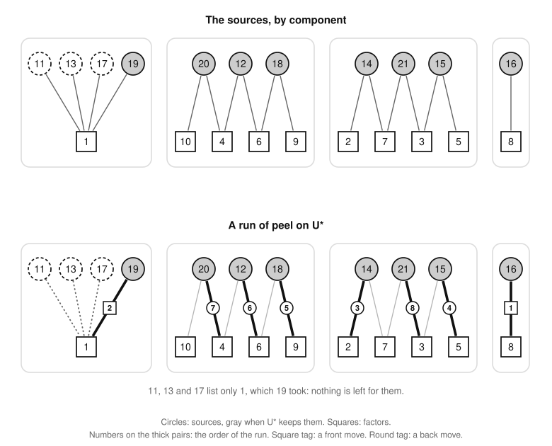

# Playability

Part of [the theory](../THEORY.md).

Which sets of numbers can all be played as moves of one game?  The rest of the theory builds on the answers here.  A set
is playable exactly when each member can be given a factor to pay with, no two the same, in an order that keeps each
payment in the pot until its move ([the playability theorem (P2)](#the-playability-theorem)).  Peel, a procedure that
makes only safe choices, finds such payments or proves that there are none ([the peel theorem
(P4)](#the-peel-theorem)).  A set fails exactly when it holds a *core*, a part in which every factor is wanted at least
twice ([the core theorem (P7)](#the-core-theorem)).  And a playable set's vectors are linearly independent.

The game's terms are the [glossary](../GLOSSARY.md)'s, the standard mathematics is explained in [the
primer](primer.md), and [the table of statements](statements.md#playability) gives each result's standing.  We write
mf(x) for the set of maximal factors of x, so mf(12) = {4, 6} and a prime's only maximal factor is 1, and Ω(x) for the
number of prime factors of x counted with multiplicity, its layer: Ω(12) = 3 and Ω(1) = 0.  Every f in mf(x) lies one
layer below x: Ω(f) = Ω(x) − 1.

## Payment schemes

A set of moves can be played together only if each has a divisor of its own to surrender to the taxman, and the moves
come in an order that keeps those divisors in the pot.

*Instance.*  An *instance*, in the theory never game n as in the glossary's sense of the word, is a finite set of
numbers ≥ 2, its *members*, and a finite set F of positive integers disjoint from it, its *pool*, whose numbers are its
*factors*.  A member x *lists* the factors in mf(x) ∩ F, its *list*.  A set S ⊆ {2, …, n} has its *own instance*:
members S, and as pool the maximal factors of its members that are not in S.

*Payment scheme.*  A *payment scheme* of an instance is a map pay that gives each member x a factor pay(x) that x lists,
no two members the same factor.

*Precedence.*  The *precedence* of a payment scheme, or of any map that gives each member of a set one of its divisors,
is the directed graph on the members with an edge a → b, for a ≠ b, whenever pay(a) divides b or a divides b.  The edge
says that a must be played before b, or else b's tax would take pay(a), or a itself.

*Playable instance.*  An instance is *playable* when it has a payment scheme whose precedence is acyclic.  By
[P2](#the-playability-theorem), a set is playable exactly when its own instance is.

*Induced instance.*  A set T of members of an instance *induces* the instance with members T and the same pool, in which
each member of T keeps its list, and T is *playable in* the instance when the instance it induces is playable.  A
payment scheme of the whole restricts to one of T, with the whole's precedence restricted to T; so in a playable
instance every set of members is playable in it.

*Example.*  On the board of 21, the own instance of {10, 14, 15, 21} has the pool {2, 3, 5, 7}: 10 lists 2 and 5, 14
lists 2 and 7, 15 lists 3 and 5, and 21 lists 3 and 7.  With the primes as vertices and each member as the edge between
the two primes it lists, the set is a cycle of four edges, 2 – 5 – 3 – 7 – 2.  A payment scheme pays each member with
one end of its edge, so there are two, around the cycle each way.  The scheme 10:2, 14:7, 21:3, 15:5 has the precedence
10 → 14 → 21 → 15 → 10, since 2 divides 14, 7 divides 21, 3 divides 15 and 5 divides 10; the other has the reverse
cycle.  So the instance is unplayable, and by P2 no game of 21 plays all four numbers.

*The two payment schemes of {10, 14, 15, 21}.  Thick arrows: what each number pays with.  Dashed arrows: the
precedence, labeled by the divisibility behind each edge (2 | 14 reads 2 divides 14).*

### The lifting lemma

**Lemma P1 (the lifting lemma).**  At any point of a game, if a proper divisor d of a number x is in the pot, then so is
a maximal factor f of x with d | f.  So a number in the pot can be played exactly when one of its maximal factors is in
the pot, and the taxman then takes that maximal factor with it.

*Proof.*  Whatever took f out of the pot would have taken d with it.  As x/d > 1, some prime p divides x/d; let f = x/p.
Then f is a maximal factor of x, and d | f, since f/d = (x/d)/p is a whole number.  Suppose that f is not in the pot.
The pot never gains a number, so f left it earlier, as a move or as tax.  If f was played, the taxman took with it every
proper divisor of f in the pot, d among them, since d was in the pot then as it is now; or d was f itself.  If the
taxman took f with a move y, then d divides y and d ≠ y, so the taxman took d too.  Either way d is not in the pot, a
contradiction.  ∎

### The playability theorem

**Theorem P2 (the playability theorem).**  Let S ⊆ {2, …, n}.  Then S is playable iff its own instance is: iff some
injective map pay gives each x in S a maximal factor of x outside S, and the precedence of pay is acyclic.  Moreover:

1. every [topological order](primer/graphs.md#topological-orders) of the precedence of such a map is the order of a game that
   plays S and nothing else; and
2. the order in which any game plays the members of S is a topological order of the precedence of such a map.

*Proof.*  A topological order keeps each payment in the pot until its move, and once [P1](#the-lifting-lemma) gives each
move a payment, the order of play is a topological order.  A map as in the statement is a payment scheme of S's own
instance, so part 1 gives "if" and part 2 "only if".  *Time i* is the moment just before the i-th move of the order at
hand.

1. *A topological order is a game.*  Let x₁, …, x_t be a topological order of the precedence of pay, played in turn.  At
   time i, x_i is in the pot, since the taxman takes it with an earlier x_j only if x_i divides x_j, an edge x_i → x_j
   that puts x_j later.  So is pay(x_i): it is not in S, so it is never played, and the taxman takes it with an earlier
   x_j only if pay(x_i) divides x_j, again an edge x_i → x_j.  So the move x_i is legal.
2. *The payments of a game.*  Let a game play the members of S, perhaps among other moves, in the order x₁, …, x_t.
   When x_i is played it has a proper divisor in the pot, so by P1 some maximal factor f_i of x_i is in the pot at time
   i, and the taxman takes it with x_i.  Let pay(x_i) = f_i.
3. *No payment is in S.*  The factor f_i is not x_i, of which it is a proper divisor; not an earlier x_j, which left the
   pot when played, while f_i is in the pot at time i; and not a later x_j, since the taxman takes f_i at time i.
4. *The payments are distinct.*  The factor f_i leaves the pot at time i, while each later f_j is in the pot at time j.
5. *Every edge points forward.*  Let x_i → x_j be an edge, and suppose that j < i.  If f_i divides x_j, the move x_j
   would have taken f_i, which was in the pot at time j and is not x_j; if x_i divides x_j, the move x_j would have
   taken x_i.  Neither can be, so j > i.

By steps 2 to 4, pay is a map as in the statement, and by step 5 the order of play is a topological order of its
precedence, which is therefore acyclic.  ∎

### The flat-cycle lemma

The cycles that make a scheme fail have a special shape, which peel and [the core theorem](#the-core-theorem) exploit.
A cycle of the precedence of a map pay is *flat* when its members lie in one layer and, on each of its edges a → b,
pay(a) is a maximal factor of b.

**Lemma P3 (the flat-cycle lemma).**  Let pay give each member x of a finite set S of numbers ≥ 2 a maximal factor of x
that is not in S.  Then every cycle of the precedence of pay is flat.  In particular, on each edge a → b of a cycle of
the precedence of a payment scheme, b lists pay(a).

*Proof.*  Along every edge the layer of the payment rises or stays, and it stays only on a flat edge; a cycle returns to
where it started, so it rises nowhere.  In detail, let φ(x) = Ω(pay(x)) = Ω(x) − 1, and take an edge a → b.  If a
divides b, then Ω(a) < Ω(b), so φ(a) < φ(b).  Otherwise pay(a) divides b, and pay(a) ≠ b as pay(a) is not in S; so
Ω(pay(a)) ≤ Ω(b) − 1, that is φ(a) ≤ φ(b), with equality exactly when b/pay(a) is a prime, that is when pay(a) is a
maximal factor of b.  Around a cycle φ returns to its first value, so on every edge of the cycle a does not divide b,
pay(a) is a maximal factor of b, and Ω(a) = Ω(b).  For a payment scheme, pay(a) is in the pool too, so b lists it.  ∎

Both hypotheses are needed.  If 6 paid with 1, not one of its maximal factors, and 9 with 3, the precedence would have
the cycle 6 → 9 → 6, which is not flat.  If payments could be members, 2 paying with 1 and 4 with 2 would give the cycle
2 → 4 → 2 across two layers.

## Peel

Peel decides playability by safe choices: a member that lists one factor must pay with it, and a factor that one member
alone lists may as well go to that member.

*Moves.*  If a member x lists a factor f, *removing the pair* (x, f) leaves the instance of the other members and the
other factors, each member listing what it listed before, less f.  A *front move* removes a pair (x, f) in which f is
the only factor that x lists; a *back move* removes a pair (x, f) in which x is the only member that lists f.

*Peel.*  A *run of peel* makes front and back moves, one at a time and in any order, until none is left.  It *pairs
every member* if no member is left at its end, and *stalls* otherwise.  An instance *peels completely* when a run of
peel pairs every member; by [P4](#the-peel-theorem) every run then does.  The instance left after some moves is their
*remainder*, and its members and factors are *live*.  A live member lists the live factors that it listed at the start,
since a factor leaves a list only when some member pays with it.

*Example.*  On the board of 21, the own instance of the sources U\* = {12, 14, 15, 16, 18, 19, 20, 21} that [descending
greedy](sources.md#descending-greedy) keeps has the pool 1 to 10: 12 lists 4 and 6, 14 lists 2 and 7, 15 lists 3 and 5,
16 lists 8, 18 lists 6 and 9, 19 lists 1, 20 lists 4 and 10, and 21 lists 3 and 7.  A run of peel can open with the
front moves (16, 8) and (19, 1) and the back moves (14, 2), (15, 5) and (18, 9).  Then 6 is listed by 12 alone, 4 by 20
alone and 3 by 21 alone, and (12, 6), (20, 4) and (21, 3) pair every member.  Add the other sources 11, 13 and 17, which
like 19 list 1 alone: once one of the four primes pays with 1, the other three list nothing, and every run stalls.

*Upper panel: the sources of 21, joined to the factors they list, in four components, the connected pieces of that
graph; gray marks U\*.  Lower panel: the run of the example, numbered 1 to 8; a square tag marks a front move, a round
tag a back move.*

### The peel theorem

**Theorem P4 (the peel theorem).**  In every instance:

1. *soundness:* if a run of peel pairs every member, its pairs form a payment scheme whose precedence is acyclic;
2. *completeness:* a front or back move leaves a playable instance playable, and an instance with members, in which
   every factor that a member lists is listed by at least two members, is unplayable.

So an instance is playable iff it peels completely, and then every run of peel pairs every member, whatever the order of
its moves.  A front or back move therefore keeps an instance playable and keeps it unplayable.

*Proof.*  The first member of a cycle to be paired would have shared its factor; a front or back move never spoils a
payment scheme; and where every factor is wanted at least twice, every scheme has a cycle.

1. *Soundness.*  Let a run pair x₁, …, x_t with f₁, …, f_t, in that order, and let pay(x_i) = f_i.  Each x_i lists f_i,
   and the f_i are distinct, since a factor leaves the pool when paid with; so pay is a payment scheme.  Suppose its
   precedence has a cycle, and let x_i be the member of it paired first, with a → x_i → b on the cycle.  By
   [P3](#the-flat-cycle-lemma), x_i lists pay(a) and b lists f_i.  As a and b are paired after x_i, at the i-th move
   they and their payments are live.  If the move is a front move, f_i is the only live factor that x_i lists, so pay(a)
   = f_i, and a and x_i pay with one factor.  If it is a back move, x_i is the only live member that lists f_i, yet b
   lists it.  Both are impossible.
2. *Front and back moves.*  Let (x, f) be a front or back move, and pay a scheme with acyclic precedence.  No other
   member pays with f: for a front move because x lists f alone, so pay(x) = f, and for a back move because no other
   member lists f.  So pay restricted to the other members is a payment scheme of the remainder, whose precedence is the
   old one restricted to them, which is acyclic.
3. *Factors wanted at least twice.*  If a member lists nothing, there is no payment scheme.  Otherwise, in any scheme
   each member a lists pay(a), so another member b lists it too; as pay(a) divides b, there is an edge a → b.  Every
   member has an edge out, so a walk along edges returns to a member it has visited: the precedence has a cycle.
4. *The conclusions.*  If the instance peels completely, it is playable by soundness.  If it is playable, so is every
   remainder of a run, by step 2; the run ends with no back move, so every factor a live member lists is listed by two
   live members or more, and by step 3 no member is left.  Last, if the remainder of a move is playable, it peels
   completely, and the move followed by that run pairs every member of the instance.  ∎

## Cores and the residual

An unplayable instance fails because of a part of it in which every factor is wanted at least twice, and taking out
members that have a factor to themselves, in any order, ends at the union of all such parts.

*Core.*  A *core* of an instance is a nonempty set T of its members in which every factor that a member of T lists is
listed by another member of T.  A member that lists nothing is a core by itself.

*Residual.*  To *dismantle* an instance is to delete members one at a time, each time one that lists a factor which no
other remaining member lists, until none is left to delete; the pool stays as it is.  Deleting such a member x for its
factor f changes no other member's list, and neither does the back move (x, f), which also removes f, since no other
member lists f: dismantling is peel with back moves alone.  The members left at the end are the *residual*, R, which by
[the residual theorem (P5)](#the-residual-theorem) does not depend on the order.

*Example.*  Among the sources of 21, the numbers 14, 15, 16, 18 and 20 list factors that no other source lists: 2, 5, 8,
9 and 10.  Once they are gone, so are 12, the only one left to list 4, and 21, the only one left to list 7.  The four
primes 11, 13, 17 and 19 remain, each listing 1 alone: the residual is {11, 13, 17, 19}, a core.

### The residual theorem

**Theorem P5 (the residual theorem).**  In every instance:

1. no dismantling deletes a member of a core;
2. every dismantling ends at the same set of members, the residual R;
3. if R is not empty it is a core, and it is the union of all the cores; so R is empty iff the instance has no core.

*Proof.*  A core never offers a member to delete, and what nothing can delete is a core.

1. Suppose a dismantling deletes a member of a core T, and take the first such deletion, of x for a factor f.  All of T
   remains, so another member of T lists f, and the deletion was not allowed.
2. At the end of a dismantling no remaining member lists a factor that no other remaining member lists, so what remains,
   if anything, is a core.
3. Let R₁ and R₂ end two dismantlings.  If R₁ is not empty, it is a core by step 2, so by step 1 the second dismantling
   deletes none of it: R₁ ⊆ R₂.  Likewise R₂ ⊆ R₁.
4. Every core lies in R by step 1, and R is a core by step 2 unless it is empty, so R is the union of the cores.  ∎

### The extension lemma

**Lemma P6 (the extension lemma).**  Let a set T of members of an instance be playable in it, and let x be a member
outside T that lists a factor f which no member of T lists.  Then T ∪ {x} is playable in the instance.

*Proof.*  Extend a payment scheme of T with acyclic precedence by pay(x) = f.  It is a payment scheme, since no member
of T lists f and so none pays with it.  The edges among members of T are the old ones, so a cycle would pass through x,
and by [P3](#the-flat-cycle-lemma) the member z of T that follows x on it would list pay(x) = f.  None does, so the
precedence is acyclic.  ∎

### The core theorem

**Theorem P7 (the core theorem).**  An instance is playable iff it has no core, iff its residual is empty.  In
particular, a set S ⊆ {2, …, n} is playable iff the residual of its own instance is empty.

*Proof.*  A core puts a cycle in the precedence of every payment scheme, and a dismantling read backwards builds a
scheme without one.

1. Let T be a core.  In the instance it induces every listed factor is listed at least twice, so by
   [P4](#the-peel-theorem) that instance is unplayable, and so is the whole instance, in which T would be playable.
2. Let the residual be empty, and let x₁, …, x_t be the members in the order a dismantling deletes them: each x_i lists
   a factor that none of x_{i+1}, …, x_t lists.  The empty set is playable, and by [P6](#the-extension-lemma), if
   {x_{i+1}, …, x_t} is playable in the instance, so is {x_i, …, x_t}.  So all the members are playable.
3. The residual is empty iff there is no core, by [P5](#the-residual-theorem), and S is playable iff its own instance
   is, by [P2](#the-playability-theorem).  ∎

The statement about S needs no hypothesis: step 2 takes the sets {x_i, …, x_t} in S's own instance, with its pool, not
in their own instances, whose pools can differ, as [the exclusion theorem (P8)](#the-exclusion-theorem) shows.

*Examples.*  The cycle of four edges of 21 is a core.  Among the sources of 39, 22 lists 2 and 11, 33 lists 11 and 3, 39
lists 3 and 13, and 26 lists 13 and 2: a core of composite numbers, a cycle of four edges on the primes 2, 11, 3 and 13.

### The exclusion theorem

To make a set playable some members may have to go, and the residual confines the choice.  An *exclusion set* of a set
of members is a set E of them whose removal leaves the rest playable.  A set of numbers is *separated* when none of its
members is a maximal factor of another, as a set of sources is, since a source's maximal factors are at most n/2.

**Theorem P8 (the exclusion theorem).**

1. Let an instance have members S and residual R, and let E ⊆ S.  If S ∖ E is playable in the instance, so is
   S ∖ (E ∩ R).
2. Let S ⊆ {2, …, n} be separated, R the residual of its own instance, and E ⊆ S.  If S ∖ E is playable, so is
   S ∖ (E ∩ R).

Hence, in either setting, every minimal exclusion set of S lies in R, and for positive weights every heaviest playable
subset of S holds every member outside R: a search for it may keep those and choose among the members of R.

*Proof.*  A core that survives the exclusion of E ∩ R lies in R, so it survives the exclusion of E too.

1. If S ∖ (E ∩ R) is not playable in the instance, by [P7](#the-core-theorem) it holds a core T, which with the same
   lists is a core of the whole instance and so lies in R by [P5](#the-residual-theorem).  As T lies in R and avoids E ∩
   R, it avoids E: T ⊆ S ∖ E.  By P7 the core T makes S ∖ E unplayable, against the hypothesis.
2. Let T ⊆ S.  A member x of T lists mf(x) less S in S's own instance, and mf(x) less T in its own; both are all of
   mf(x), as no member of S is a maximal factor of x.  So the two instances of T have the same schemes and precedences,
   and by [P2](#the-playability-theorem) T is playable iff it is playable in S's own instance: part 2 is part 1 for that
   instance.
3. If E is an exclusion set, so is E ∩ R, by part 1 or 2, so a minimal one lies in R.  If T is a playable subset of S,
   then by part 1 or 2 so is T together with the members outside R, which is heavier unless T held them all.  ∎

*Why part 2 needs separation.*  A member of S outside T that is a maximal factor of a member of T is in the pool of T's
own instance but not of S's, so T can be playable on the board and not in S's instance.  On the board of 4, the own
instance of S = {2, 4} has the pool {1}, in which 2 lists 1 and 4 lists nothing; dismantling deletes 2, so R = {4}.
With E = {2}, S ∖ E = {4} is playable on the board, paying with 2, but S ∖ (E ∩ R) = S is not: whichever of 2 and 4 is
played first takes what the other needs.  [P6](#the-extension-lemma) read on the board fails the same way: {8} is
playable, and 4 has the maximal factor 2, which 8 lacks, yet {4, 8} is not, since 8's only maximal factor, 4, is then a
move.

## Independence

Playability implies linear independence over every field, which gives the bounds of [the parity bound
(W1)](parity-bound.md#the-parity-bound) and of [the frame bound (B2)](frame-bounds.md#the-frame-bound), through [the
signed frame theorem (B1)](frame-bounds.md#the-signed-frame-theorem).  The primer explains
[GF(2)](primer/linear-algebra.md#finite-fields-and-gf2).

*Incidence vectors.*  Fix a board n and a field 𝔽.  The coordinates are the numbers from 1 to n/2, which hold every
maximal factor of a number up to n.  Each number s from 2 to n has the *incidence vector* v(s), with a 1 at each maximal
factor of s and 0 elsewhere, and each s ≤ n/2 has the unit vector e_s.  For a set S, u(s) is v(s) with the coordinates
of S's members deleted; for s in S, it is the incidence vector of the list of s in S's own instance.

*Independence with own coordinates.*  A set S ⊆ {2, …, n} is *independent with its own coordinates* when the vectors
v(s), s in S, together with the e_s of its members s ≤ n/2, are linearly independent.  This holds iff the u(s), s in S,
are independent.

1. If the u(s) are independent, a vanishing combination of the first family, with the coordinates of S deleted, is one
   of the u(s) with the same coefficients, so these are 0; then so are those of the unit vectors, which are independent.
2. If the first family is independent and a combination of the u(s) vanishes, the same combination of the v(s)
   vanishes outside the coordinates of S, so it equals a combination of the e_s; the difference is a vanishing
   combination of the first family, so every v(s) has the coefficient 0.

### The peel-order lemma

**Lemma P9 (the peel-order lemma).**  Let an instance with pool F peel completely, and let 𝔽 be a field.  Give each
member x a vector ρ(x) over 𝔽, on coordinates that include F, whose entry at a factor f is nonzero if x lists f and 0
if not; its entries outside F may be anything.  Order the pairs of a run of peel that pairs every member as (x₁, f₁),
…, (x_t, f_t): first its back moves in the order made, then its front moves in the reverse of the order made.  Then:

1. each x_j lists f_j and none of f₁, …, f_{j−1}, so the matrix whose row j is ρ(x_j) at f₁, …, f_t is upper
   triangular with a nonzero diagonal, and its determinant is the product of its diagonal entries;
2. the vectors ρ(x), together with the unit vectors of any coordinates outside F, are linearly independent over 𝔽.

*Proof.*  A back move's factor is listed by no member paired after it, and a front move's member lists no factor paid
with after it; the order puts both kinds of zero below the diagonal.

1. *The order.*  Each x_j lists f_j, which pays it.  Let x_j come after x_i in the order; we show that x_j does not list
   f_i, using that a live member lists exactly the live factors it listed at the start.  If (x_i, f_i) is a back move
   made before x_j was paired, then x_j and f_i were live at that move, and x_i alone listed f_i, so x_j does not.
   Otherwise (x_j, f_j) is a front move made before (x_i, f_i): either (x_i, f_i) is a back move made after it, or both
   are front moves, which come in the reverse of the order made.  When (x_j, f_j) was made, f_i was live and f_j was the
   only live factor that x_j listed, so x_j does not list f_i.  The back moves come first, so no other case arises.
2. *Independence.*  Let a combination of the ρ(x) and of unit vectors e_y with y outside F vanish.  At the coordinates
   f₁, …, f_t, which are in F, the e_y vanish and the ρ(x) are the rows of the matrix of part 1, which are independent;
   so each ρ(x) has the coefficient 0, and then so does each e_y.  ∎

The order is not peel's own.  With members 18, 20 and 30 and pool {6, 9, 10, 15}, 18 lists 6 and 9, 20 lists 10, and 30
lists 6, 10 and 15.  A run can make the front move (20, 10), then the back moves (18, 9) and (30, 6); in that order the
rows are neither upper nor lower triangular, and in the lemma's order they are upper triangular:

    peel's order:              the lemma's order:
            10   9   6                  9   6  10
       20:   1   0   0             18:  1   1   0
       18:   0   1   1             30:  0   1   1
       30:   1   0   1             20:  0   0   1

### The independence lemma

**Lemma P10 (the independence lemma).**  Let S ⊆ {2, …, n} be playable, and 𝔽 a field.  Then S is independent with its
own coordinates over 𝔽: the vectors v(s), s in S, together with the e_s of its members s ≤ n/2, are linearly
independent, and so are the u(s), s in S.  For a set of sources, the v(s) themselves are independent.

*Proof.*  By [P2](#the-playability-theorem) and [P4](#the-peel-theorem) the own instance of S peels completely.  At the
factors of its pool, v(s) is 1 exactly where s lists, so [P9](#the-peel-order-lemma) applies with ρ(s) = v(s), and the
members s ≤ n/2 are coordinates outside the pool; P9 (2) gives the first family, and the equivalence above the u(s).
Sources exceed n/2, so for them nothing is deleted and no e_s appears.  ∎

By P9 the same holds with any nonzero values in place of the 1s.  The parity bound uses the case of GF(2).
Independence lies strictly between playability and the existence of a payment scheme: [the counting theorem
(C2)](franklin-moniot.md#the-counting-theorem) reads the three as one count of payment schemes, exactly one, an odd
number, at least one.

### The two-factor proposition

When every member lists at most two factors, the members are the edges of a graph, and playable, independent and
acyclic are one condition.

**Proposition P11 (the two-factor proposition).**  Let an instance have members that each list at most two factors.
Its *graph* is the multigraph whose vertices are the factors of the pool and one more vertex, the *ground*, and whose
edges are the members: a member that lists two factors joins them, a member that lists one joins it to the ground, and
a member that lists none is a loop at the ground.  A loop, and two edges that join the same two vertices, count as
cycles.  These are equivalent:

1. the instance is playable;
2. the members' lists, as vectors of 0s and 1s on the pool, are linearly independent over GF(2);
3. the graph is a forest.

In particular, a set S ⊆ {2, …, n} whose members each have at most two maximal factors outside S is playable iff it is
independent with its own coordinates over GF(2).

Two edges can join the same two vertices only at the ground, since a member that lists f and g is lcm(f, g): 11 and 13
both list 1 alone, and make a cycle.

*Proof.*  A dependency over GF(2) is a set of edges with every degree even, which holds a cycle; and a forest peels from
its leaves.

1. *2 ⇔ 3.*  A vanishing sum of lists over GF(2) is a nonempty set Z of members that lists each factor an even number of
   times, so each factor has even degree in Z, and so does the ground, since the degrees sum to twice the number of
   edges.  A multigraph with an edge and every degree even holds a cycle: a walk that never reuses an edge can leave
   every vertex it enters, until it returns to one it has visited.  Conversely, a cycle meets each vertex an even
   number of times, so its members' lists sum to 0; a loop's list is 0 by itself.
2. *1 ⇒ 2.*  A playable instance peels completely by [P4](#the-peel-theorem), so its lists are independent over every
   field, by [P9](#the-peel-order-lemma).
3. *3 ⇒ 1.*  In a forest with an edge, a tree with an edge has two leaves or more, vertices of degree 1, and at most one
   of them is the ground; so some factor is listed by one member alone, and peel has a back move.  The move leaves a
   forest, so a run of such moves pairs every member, and the instance is playable by P4.
4. *Sets.*  By [P2](#the-playability-theorem), S is playable iff its own instance is, whose members list at most two
   factors and have the lists u(s); so by 1 ⇔ 2 it is playable iff the u(s) are independent.  ∎

On the board of 21, the cycle of four edges is a cycle of the graph: unplayable, with v(10) + v(14) + v(15) + v(21) = 0.
The hypothesis is needed: on the board of 45, in {12, 18, 20, 30, 45}, 30 lists the three factors 6, 10 and 15, and the
set is independent over GF(2) yet unplayable ([odd cores](#odd-cores)).

The number of payment schemes onto a given set of factors is 0 or a power of two.  Given one, a component of the graph
with a cycle has at least as many edges as vertices, and the scheme pays its edges with distinct factors of it, so it
has no ground and one cycle, which pays one way round or the other; its trees, and the components without a cycle, pay
in one way, from their leaves inward.  So the count is 2^c for the c components with a cycle.  P11 is what [the frontier
theorem (S3)](sources.md#the-frontier-theorem), [the bottom-layers theorem
(F4)](frame-model.md#the-bottom-layers-theorem) and [the frame bound](frame-bounds.md#the-frame-bound) use for members
with two factors.

### Odd cores

An *odd core* of an instance is a core whose members' lists, as vectors of 0s and 1s on the pool, are linearly
independent over GF(2).  The name comes from a count: the lists are independent over GF(2) iff some square submatrix,
on as many factors as members, is nonsingular over GF(2), and its determinant is, mod 2, its permanent, the number of
payment schemes onto those factors ([the primer](primer/graphs.md#matchings-permanents-and-determinants)).

Odd cores are what [the independence lemma](#the-independence-lemma) cannot see: an unplayable set S whose vectors u(s)
are independent over GF(2) passes P10, and it holds an odd core of its own instance, a core by [P7](#the-core-theorem)
whose lists are part of an independent family.  These sets are [what the parity bound
misses](parity-bound.md#what-the-parity-bound-misses).  By [P11](#the-two-factor-proposition), a core whose members each
list at most two factors is not odd, since it is unplayable by P7.  The first board with an odd core is 45, where {12,
18, 20, 30, 45} is an odd core of its own instance ([the first-odd-core proposition
(C3)](franklin-moniot.md#the-first-odd-core)).
