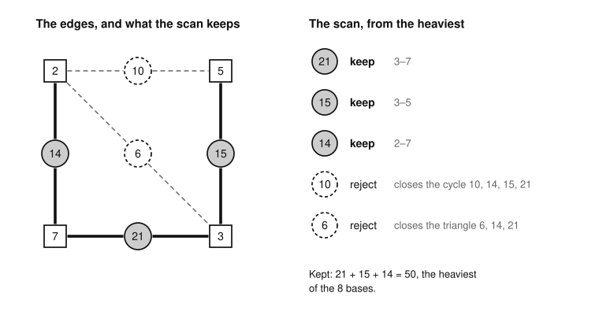
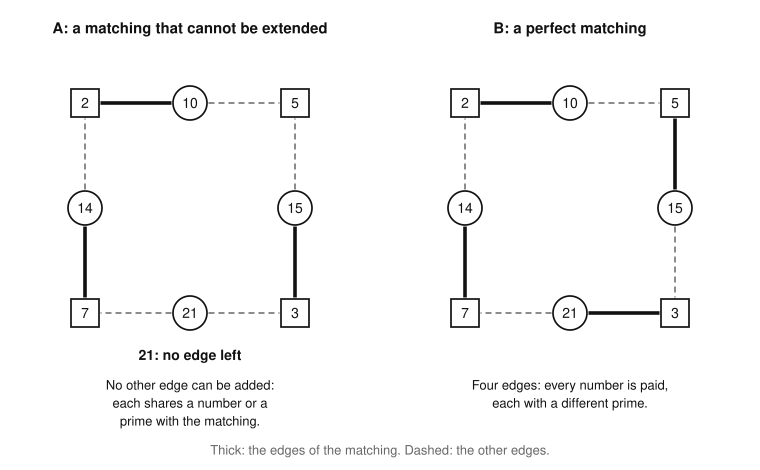

# Primer

This primer explains the standard mathematics that the proofs of [the theory](../THEORY.md) use.  It advances nothing:
each fact is in the textbooks, and the primer proves it where the proof is short and teaches something, and otherwise
cites it ([the references](#references) come last).  The examples are Taxman's.  A section can be read with the sections
it names, so that a proof elsewhere links the one section it uses.  A reader who knows proofs, sets, graphs and real
linear algebra can follow all of it, but for one quoted fact, linear programming duality.

*Conventions.*  For a set Y and an element x, Y + x is Y ∪ {x} and Y − x is Y ∖ {x}.  A weight function w on a set E
gives Y ⊆ E the weight w(Y), the sum of w(y) over y in Y.  A number s has a *vector* v(s) over a list of coordinates,
with a 1 at each of its [maximal factors](../GLOSSARY.md#the-game) in the list and a 0 elsewhere (6 has the maximal
factors 3 and 2); the theory calls it the incidence vector ([independence](playability.md#independence)).

## Finite fields and GF(2)

Linear algebra works over every field, and the field decides which sets of vectors are independent.  The field GF(2), in
which 1 + 1 = 0, is the one where two equal vectors cancel.

**Fields.**  A *field* 𝔽 is a set with an addition and a multiplication that obey the usual rules, including that every
element has a negative and every nonzero element has an inverse.  The rational and real numbers are fields; the integers
are not.  For a prime p, the integers mod p form the field GF(p): a residue a ≠ 0 is coprime to p, so αa + βp = 1 for
some integers α and β, and α inverts a.  GF(2) has the elements 0 and 1 with 1 + 1 = 0; because −1 = 1, subtracting is
adding, and *signs vanish*.  GF(3) has 0, 1 and 2 = −1, so 1 + 1 = 2 and 2 · 2 = 1.

**Linear algebra over a field.**  A family of vectors over 𝔽 is *linearly independent* when the only linear combination
of its members that is zero has every coefficient 0, and its *rank* is the size of its largest independent subfamily.
Row reduction divides only by nonzero elements, so what it proves holds over every field: a square matrix has
independent rows exactly when its determinant is not 0, and the rank of a matrix is the size of its largest square
submatrix with a nonzero determinant.  Over GF(2) the only nonzero coefficient is 1, so a family of 0/1 vectors is
dependent exactly when some nonempty subfamily lists every coordinate an even number of times.

**Example.**  The numbers 6, 10 and 15 have the maximal factors {3, 2}, {5, 2} and {5, 3}, so their vectors over the
coordinates 2, 3, 5 are the rows

    6    1 1 0
    10   1 0 1
    15   0 1 1

Each coordinate is listed twice, so the rows sum to zero over GF(2): they are dependent, with rank 2.  Their determinant
is −2, which is not 0 over the rationals and is 1 over GF(3), so they are independent over both.  The vectors of 10, 14,
15 and 21 over 2, 3, 5, 7 satisfy v(10) − v(14) − v(15) + v(21) = 0, so they are dependent over every field.

**Comparing fields.**  Integer vectors that are independent over GF(p), for a prime p, are independent over the
rationals; the example shows the converse failing at p = 2.  *Proof.*  Suppose d vectors are independent over GF(p).
Some d × d submatrix has a determinant that is nonzero mod p, so an integer that p does not divide, so not 0.  ∎

## Matroids

A matroid keeps what linearly independent vectors and the forests of a graph have in common, which is what the greedy
algorithm of a matroid needs.

**Definition.**  A *matroid* M on a finite *ground set* E is a family of subsets of E, the *independent sets*, such that
(1) the empty set is independent, (2) every subset of an independent set is independent, and (3) *augmentation*: if I
and I′ are independent and |I| < |I′|, some x in I′ ∖ I has I + x independent.  A set that is not independent is
*dependent*.  The models, below, are vectors and the forests of a graph.

**Terms.**

* A *basis* is a maximal independent set.  If one basis had fewer elements than another, augmentation would extend it,
  so all bases have one size.  The same argument inside any Y ⊆ E shows that the maximal independent subsets of Y have
  one size, the *rank* rk(Y) of Y, and that every independent subset of Y has at most rk(Y) members.
* A *circuit* is a minimal dependent set.  A *loop* is an element x with {x} dependent.  Two elements are *parallel*
  when they form a circuit.  A *coloop* is an element in every basis; if x is a coloop and I − x is independent, so is
  I, since I − x extends to a basis, which holds x.
* An independent set I *spans* an element y when y is in I or I + y is dependent, and spans a set when it spans each of
  its elements; for vectors, I spans y when y is in their span.  An independent subset of Y is maximal exactly when it
  spans Y.

**The fundamental circuit.**  If I is independent and I + y is dependent, then I + y holds exactly one circuit, and it
contains y (Oxley, Section 1.1).  We call it the *fundamental circuit* of y over I, or *the circuit of I + y*.  An
element x of I lies in it exactly when I − x + y is independent.  *Proof.*  Call the circuit H.  If x is in H, a circuit
inside I − x + y would be inside I + y, so would be H, which is impossible since H holds x; so I − x + y has no circuit.
If x is not in H, then H lies inside I − x + y, which is dependent.  ∎

### Linear and graphic matroids

Give each element of a finite set E a vector over a field 𝔽.  The sets whose vectors are linearly independent form a
matroid, the *linear matroid* of the vectors (Oxley, Section 1.1).  *Proof of (3).*  If |I| < |I′|, the vectors of I′
cannot all lie in the span of I, which holds at most |I| independent vectors; so some x in I′ lies outside it, and I + x
is independent.  ∎

The edges of a graph form a matroid whose independent sets are the forests, the edge sets with no cycle: the *graphic
matroid*.  Its circuits are the cycles, and its rank is the number of vertices less the number of components.  It is the
linear matroid over GF(2) of the vectors e_x + e_y, one for each edge xy (Oxley, Section 5.1).  *Proof.*  The edges of a
cycle sum to zero, so a set that is not a forest is dependent.  A forest is independent: each of its nonempty subsets is
a forest, and a nonempty forest has a vertex of degree 1, where the sum of its vectors has a 1.  ∎

**Example.**  A number pq with two different primes has the maximal factors p and q, so its vector is e_p + e_q: the
edge pq of a graph on the primes.  In the game of 21, the numbers 6, 10, 14, 15 and 21 are the edges 2–3, 2–5, 2–7, 3–5
and 3–7 on the primes 2, 3, 5, 7.  The circuits are the triangles {6, 10, 15} and {6, 14, 21} and the 4-cycle
{10, 14, 15, 21}.  The rank is 3, and there are 8 bases.

### Deletion, contraction, direct sums and truncation

* *Deletion.*  The matroid M ∖ Y has the ground set E ∖ Y and the independent sets of M that avoid Y.
* *Contraction.*  For an independent set Z, the matroid M/Z has the ground set E ∖ Z, and a set I is independent in M/Z
  exactly when I ∪ Z is independent in M.  It is a matroid: augment I ∪ Z from I′ ∪ Z in M, and the new element lies in
  I′ ∖ I.  A dependent Z would leave nothing independent, not even the empty set.  (The general definition is in Oxley,
  Section 3.1.)
* *Direct sum.*  If E splits into E₁ and E₂ with a matroid on each, the sets I with I ∩ E₁ and I ∩ E₂ independent form a
  matroid, the *direct sum*, whose *blocks* are the two.  Augment inside a block where I is smaller than I′.
* *Truncation.*  For a number d, the sets of M with at most d elements form a matroid, the *truncation* of M to d.
  *Proof.*  If |I| < |I′| ≤ d, the element x of I′ that can join I in M gives I + x with at most d elements.  ∎  (The
  theory's *truncation* of a set of sources is another thing, its part above a threshold:
  [sources.md](sources.md#components-and-truncations).)

For vectors, contraction and direct sum are linear algebra.

* *Contraction is a quotient.*  Vectors are *dependent modulo* a subspace W when some nontrivial combination of them
  lies in W.  The matroid M/Z of vectors over 𝔽 is the linear matroid of the same vectors modulo the span of Z's.
  *Proof.* The vectors of I are dependent modulo the span exactly when some vanishing combination of the vectors of
  I ∪ Z has a coefficient of I that is not 0; and since Z is independent, every nontrivial vanishing combination does.
  ∎  If Z's vectors are unit vectors, working modulo their span deletes those coordinates.
* *A direct sum of spaces gives a direct sum.*  If the vectors of E₁ lie in a subspace W₁, those of E₂ in a subspace W₂,
  and only the zero vector lies in both, then the linear matroid of all the vectors is the direct sum of the two, since
  a vanishing combination splits into one in W₁ and one in W₂.  A graphic matroid is the direct sum of those of its
  components: in the game of 35, the numbers 6 and 35 are the edges 2–3 and 5–7, with no prime in common, so the matroid
  of {6, 35} is the direct sum of two one-element blocks, and each element is a coloop.

**Example.**  Contract the edge 6, which is 2–3, in the graph above.  Its ends merge, 10 and 15 both join the merged
vertex to 5 and become parallel, and so do 14 and 21; every other pair stays independent.

## Sums over thresholds

A weighted sum is a positive combination of counts above thresholds.  So a set with at least as many members above every
threshold weighs at least as much under every increasing positive weighting.

**The identity.**  Let E be a finite set and w a positive weight function on E.  For each value ρ of w, let ρ⁺ be the
next smaller value, or 0 for the smallest.  For every Y ⊆ E,

    w(Y) = Σ_ρ (ρ − ρ⁺) · |Y ∩ {w ≥ ρ}|,    summed over the values ρ of w.

*Proof.*  A member of Y of weight ρ₀ is counted in the terms for ρ ≤ ρ₀, whose coefficients add up to ρ₀, since each
cancels against the next.  ∎  (A layer cake: the weight is stacked in layers of thickness ρ − ρ⁺, all positive.)

**Dominance.**  Let w be a positive weight function on a finite set E with distinct values on distinct elements, and let
S and S′ be subsets of E with |S ∩ {w ≥ t}| ≤ |S′ ∩ {w ≥ t}| for every t.  Then w(S) ≤ w(S′), with equality only if
S = S′.  For a set of numbers, w is any strictly increasing positive weighting, and {w ≥ w(x)} is the set of members
that are at least x.  *Proof.*  Every coefficient of the identity is positive, so w(S) ≤ w(S′) term by term.  Equality
forces equal counts at every value ρ.  The step from the next larger value to ρ adds one element, and the count rises by
1 exactly when that element is in the set, so S and S′ have the same elements.  ∎  Positivity matters: for E = {1, 2}
and w(x) = x − 10, the set {1, 2} has at least as many members above every threshold as {1}, but weighs −17 against −9.

**The converse.**  Let S and S′ be sets of numbers with |S ∩ {≥ t}| > |S′ ∩ {≥ t}| for some t.  Then some strictly
increasing positive weighting w has w(S) > w(S′).  *Proof.*  Take w(x) = εx + 1 for x ≥ t and w(x) = εx for x < t.  Then
w(S) − w(S′) = (|S ∩ {≥ t}| − |S′ ∩ {≥ t}|) + ε(ΣS − ΣS′), which is positive for small ε.  ∎  So dominance for every
such weighting needs dominance at every threshold.

**Example.**  Among the numbers 10, 14, 15, 21, let S = {10, 15, 21} and S′ = {14, 15, 21}.  The counts at the
thresholds 21, 15, 14, 10 are 1, 2, 2, 3 for S and 1, 2, 3, 3 for S′, so S′ dominates S, and with w(x) = x the identity
gives 46 for S and 50 for S′.  They are two bases of [the graphic matroid](#linear-and-graphic-matroids) above, and S′
is the scan's.

## The greedy algorithm of a matroid

In a matroid, the greedy algorithm (the scan) goes through the elements from heaviest to lightest and keeps each one
that stays independent.  It finds a heaviest basis for any weights and, once its members of weight at most 0 are
dropped, a heaviest independent set; and a set is heaviest exactly when no single change improves it.

*Three kinds of greedy.*  The scan is not the Taxman strategy that is often called greedy, which takes the largest legal
move, and it is not the theory's *descending greedy* ([sources.md](sources.md#descending-greedy)), which runs the same
scan on playable sets.

*Playable sets are no matroid.*  Already in the game of 4, {2} and {3, 4} are playable, but neither 3 nor 4 can join 2:
3 would need the 1 that 2 needs, and 4's only maximal factor is 2 itself.  Augmentation fails, so the theorem below does
not cover descending greedy.

**The scan.**  Let M be a matroid on E and w a weight function on E.  List E in decreasing order of weight, with ties in
any order.  Start with G empty, and for each element x in turn, put x in G if G + x is independent.

**Example.**  Take the graphic matroid above on 6, 10, 14, 15, 21, and let w be the number itself.  The scan keeps 21
(the edge 3–7), 15 (3–5) and 14 (2–7).  It rejects 10, which would close the 4-cycle, and 6, which would close the
triangle {6, 14, 21}.  So G = {21, 15, 14}, which weighs 50; the other seven bases weigh 30, 35, 37, 39, 42, 45 and 46.

*The graph, each edge a number between its two primes.  Thick: the edges the scan keeps.  Dashed: the edges it rejects.*

**What the scan finds.**  Let M be a matroid on E, w a real weight function on E, and G the scan's set for any order of
ties.  Let G⁺ be the part of G with positive weight.

* (a) G is a basis.
* (b) For every real t, G ∩ {w ≥ t} is a maximal independent subset of {w ≥ t}, that is, it spans {w ≥ t}.  So every
  independent set I has |I ∩ {w ≥ t}| ≤ |G ∩ {w ≥ t}|.
* (c) G is a heaviest basis, and G⁺ is a heaviest independent set among the independent sets of every size.
* (d) If the weights are distinct, G is the only heaviest basis, and if they are distinct and not 0, G⁺ is the only
  heaviest independent set.

*Proof.*  The idea is that the scan settles every element of weight at least t before it looks at a lighter one.

(b) Put Y = {w ≥ t}.  Every element of Y comes before every element outside it.  Take x in Y ∖ G.  The scan rejected x,
so the set kept before x, plus x, was dependent, and that kept set lies in G ∩ Y because only elements of Y came
earlier.  So (G ∩ Y) + x is dependent.  Nothing in Y can join G ∩ Y, which is independent as a subset of G, so G ∩ Y
spans Y and is a maximal independent subset of Y.  It has rk(Y) members, and an independent I ∩ Y has at most rk(Y).

(a) Take t at the least weight, so that Y = E.

(c) By the identity of [Sums over thresholds](#sums-over-thresholds), a set of positive weights has a weight that is a
positive combination of its counts |· ∩ {w ≥ t}|, and (b) bounds each count of an independent I by that of G.  Bases
have one size, so adding a constant to every weight leaves w(I) − w(G) unchanged; add one that makes all weights
positive.  For G⁺: w(I) ≤ w(I⁺), and the identity over the elements of positive weight bounds w(I⁺) by w(G⁺).

(d) Make the weights positive as in (c); they stay distinct.  By (b) and Dominance, w(I) ≤ w(G) for every basis I, with
equality only if I = G.  For G⁺: a heaviest I has w(I) = w(I⁺), so no member of weight below 0, and none of weight 0, so
I = I⁺; Dominance on the elements of positive weight, with (b), gives I = G⁺.  ∎

The weights must not be 0 for the last claim: in the matroid on {x, z} in which every set is independent, with w(x) = 1
and w(z) = 0, the sets {x} and {x, z} are both heaviest.  Only matroids have the property: if the scan finds a heaviest
set for every nonnegative weight function, a family closed under subsets is a matroid (Schrijver, Theorem 40.1; Edmonds
1971; Oxley, Section 1.8).

### The optimality criterion

A set can be certified heaviest by checking single changes, whatever algorithm produced it.

**The criterion.**  Let M be a matroid on E, w a real weight function on E, and I an independent set.  Then I is a
heaviest independent set, among the independent sets of every size, exactly when

1. w(x) ≥ 0 for every x in I;
2. w(y) ≤ 0 for every y outside I with I + y independent;
3. w(y) ≤ w(x) for every y outside I with I + y dependent and every x in I that lies in the circuit of I + y.

*Proof.*  The idea is that each condition guards against one improving change, and when none is left the proof of (c)
applies to I.  If I is heaviest, the conditions hold: a violation of (1) gives the heavier set I − x, one of (2) gives
the heavier independent set I + y, and one of (3) gives I − x + y, independent by the fact on the circuit of I + y and
heavier by w(y) − w(x).

Now suppose (1) to (3).  For t > 0 we claim that I ∩ {w ≥ t} spans {w ≥ t}.  Take y in {w ≥ t} ∖ I.  By (2), I + y is
dependent, since w(y) ≥ t > 0.  Let H be its circuit.  By (3), each x in H − y has w(x) ≥ w(y) ≥ t, so H − y lies in
I ∩ {w ≥ t}, and (I ∩ {w ≥ t}) + y holds H and is dependent.  So the claim holds.  As in (b), every independent I′ has
|I′ ∩ {w ≥ t}| ≤ |I ∩ {w ≥ t}| for t > 0.  By (1), w(I) = w(I⁺), and the argument of (c) gives w(I′) ≤ w(I′⁺) ≤
w(I⁺) = w(I).  ∎

**Example.**  In the graphic matroid above, with w the number itself, I = {21, 15, 14} meets the criterion.  Condition
(1) holds and (2) is empty, since I is a basis.  For (3), the circuits of I + 10 and I + 6 are {10, 14, 15, 21} and
{6, 14, 21}, and their members in I outweigh 10 and 6.  The basis I′ = {10, 15, 21} fails (3): the circuit of I′ + 14
holds 10, which weighs less than 14, and I′ − 10 + 14 = I is heavier.

*Dummy coloops.*  Equivalently, add rk(M) coloops of weight 0 to M and truncate the result to rk(M).  The independent
sets of M, padded with dummies, are the bases of the result, and (1), (2) and (3) are the exchanges of an element for a
dummy, a dummy for an element, and an element for an element: the classical test that no single exchange improves a
basis (Korte and Vygen, Section 13.4, Theorem 13.23).

## Matchings, permanents and determinants

The permanent of a 0/1 matrix counts the perfect matchings of its graph, the determinant counts them with signs, and mod
2 the signs vanish.  So a square 0/1 matrix is nonsingular over GF(2) exactly when its graph has an odd number of
perfect matchings.

**Definitions.**  A graph is *bipartite* when its vertices split into two sides and every edge joins the sides.  A
*matching* is a set of edges, no two with a vertex in common; it is *perfect* when the sides have d vertices each and
the matching has d edges.  The *matching number* ν of a graph is the size of its largest matching.  The *matrix* of a
bipartite graph has a row for each vertex x on one side, a column for each vertex y on the other, and a 1 where xy is an
edge and a 0 elsewhere.

**Permanent and determinant.**  Fix an order of the rows and of the columns of a d × d matrix Ψ.  A bijection τ from the
rows to the columns has a *sign* ±1, that of the permutation it makes.  The *permanent* and the *determinant* are

    per(Ψ) = Σ_τ ∏_x Ψ[x, τ(x)]        det(Ψ) = Σ_τ sign(τ) ∏_x Ψ[x, τ(x)].

For a 0/1 matrix, the product for τ is 1 exactly when every pair (x, τ(x)) is an edge, that is, when τ is a perfect
matching of the graph, and is 0 otherwise.  So per(Ψ) is the number of perfect matchings, and det(Ψ) is the number of
perfect matchings of sign +1 less the number of sign −1.  Another order changes every sign together, so whether two
matchings have the same sign does not depend on the order.

**What the theory uses.**

* *Mod 2.*  Since −1 = 1 in GF(2), det(Ψ) mod 2 equals per(Ψ) mod 2, so the matrix is nonsingular over GF(2) exactly
  when its graph has an odd number of perfect matchings.
* *Over the rationals.*  The matrix is nonsingular exactly when the signed count is not 0.  An odd number of perfect
  matchings gives an odd signed count, so a nonzero one; an even number can give a signed count of 0 or not.
* *Rank and matching number.*  Over every field, the rank of the matrix is at most ν of its graph.  *Proof.*  A nonzero
  d × d minor has a nonzero term in its expansion, and a nonzero term is a matching with d edges.  ∎

**Example.**  The numbers 6, 10 and 15 against the factors 2, 3, 5 have the matrix with the rows 1 1 0, 1 0 1 and 0 1 1.
Its graph has two perfect matchings, {(6, 2), (10, 5), (15, 3)} and {(6, 3), (10, 2), (15, 5)}, and each swaps two of
the columns, so both have sign −1.  (These are the payment schemes of the set {6, 10, 15}.)  So per = 2 and det = −2: an
even count, nonsingular over the rationals and singular modulo 2.

## Matroid intersection

Two matroids on one ground set can be combined by asking for sets that are independent in both.  These sets are in
general not a matroid, but a heaviest one can still be found in polynomial time.

**Definition.**  Let M and M′ be matroids on the same set E.  A *common independent set* is independent in both.

**Matchings.**  Split E into classes.  The sets with at most one element in each class form a matroid, a *partition
matroid*: I′ meets more classes than I does, and an element of I′ in a class that I misses can join I.  In a bipartite
graph, let M allow one edge at each vertex on the left and M′ one edge at each vertex on the right.  The common
independent sets are the [matchings](#matchings-permanents-and-determinants) of the graph.

**Example.**  A [payment scheme](playability.md#payment-schemes) pays each of several numbers with a different maximal
factor, so it is a matching from the numbers to their factors.  For 10, 14, 15 and 21 the edges (s, f), with f a maximal
factor of s, form the 8-cycle 10–2–14–7–21–3–15–5–10, which has two perfect matchings.  Yet
I = {(10, 2), (14, 7), (15, 3)} cannot be extended: each of the other five edges shares a number or a factor with an
edge of I, and paying 15 with 3 strands 21.  So the matchings have maximal sets of 3 and of 4 edges, and augmentation
fails for I and a perfect matching: *common independent sets are in general not a matroid*.

*The 8-cycle drawn on the square of 21.  Thick: the matching I (left) and a perfect matching (right).*

**What can be computed.**

* *The weight.*  Give the matroids by tests of independence.  A heaviest common independent set, for weights of either
  sign and sets of any size, can be found in time polynomial in |E| and the cost of a test (Edmonds 1979; Lawler 1975;
  Frank 1981).  The algorithms build a heaviest set of d elements from one of d − 1 by an augmenting path, and the best
  over d is the heaviest of any size (Schrijver, Section 41.3 and Theorem 41.7; Korte and Vygen, Sections 13.5 and
  13.7).  So the matching number of a bipartite graph can be computed: it is the size of the largest common independent
  set of the two partition matroids.
* *A limit on the size.*  The heaviest common independent sets of M and M′ with at most d elements are those of M and
  the truncation of M′ to d, so the limit costs nothing.

## Weak duality and Lagrangian relaxation

To bound the weight of every set that satisfies several constraints, split the weight among the constraints, and bound
each part by the best set that satisfies its own constraint alone.  Every split gives a valid bound, and for two
matroids the best split gives the exact answer.

For a matroid M and a weight function w, write max_M w for the weight of a heaviest independent set of M, of any size
and for weights of either sign: it is w(G⁺) for the scan's set G.

**Weak duality.**  Let Γ_i be families of subsets of E, one for each constraint i, and let w = Σ_i w_i be any split of
the weights into real weight functions.  Every set Y that is in all the families has

    w(Y) ≤ Σ_i max_{S ∈ Γ_i} w_i(S).

*Proof.*  w(Y) = Σ_i w_i(Y), and w_i(Y) ≤ max over Γ_i since Y is in Γ_i.  ∎

For two matroids M and M′ and a split w = w₀ + w₁, every common independent set Y has w(Y) ≤ max_M w₀ + max_{M′} w₁.  A
matroid on a part E′ of E also fits: take the sets Y with Y ∩ E′ independent in it, and a weight function that is 0
outside E′.

**Certificates.**  Suppose I is a common independent set, and for some split I meets the criterion of [The optimality
criterion](#the-optimality-criterion) in M for w₀ and in M′ for w₁.  Then w(I) = w₀(I) + w₁(I) = max_M w₀ + max_{M′} w₁,
and weak duality says that no common independent set weighs more.  The split proves that I is heaviest, whatever
algorithm produced I.

**Example.**  In the set {2, 10, 14, 15, 21} the move 2 is paid by 1, and a member of the set cannot pay for another, so
the others are left with the factors 3, 5 and 7: the edges (10, 5), (14, 7), (15, 3), (15, 5), (21, 3) and (21, 7).  Let
the edge (s, f) weigh s.  A heaviest matching is {(14, 7), (15, 5), (21, 3)}, which weighs 50.  Price each factor at 10:
let M′, one edge per factor, carry the weight 10 on every edge, and let M, one edge per number, carry the excess s − 10.
Then max_{M′} is 3 · 10 = 30 and max_M is 0 + 4 + 5 + 11 = 20, so no matching weighs more than 50.

**Relaxing a constraint.**  Let Y range over a family Γ, subject to one more linear constraint g(Y) ≤ b, with g a weight
function.  For every multiplier λ ≥ 0, each feasible Y has

    w(Y) ≤ w(Y) + λ(b − g(Y)) = (w − λg)(Y) + λb ≤ max_{S ∈ Γ} (w − λg)(S) + λb.

This is the *Lagrangian relaxation* of the constraint: it moves into the objective at the price λ, and the bound holds
for every λ ≥ 0 (for an equation g(Y) = b, every real λ).  A split is the same idea for constraints that are families.

**Linear programming duality** (quoted; Korte and Vygen, Chapter 3).  For a matrix Θ and vectors b and w, if
{x : Θx ≤ b} is nonempty and bounded, then max {w · x : Θx ≤ b} = min {b · y : y ≥ 0, Θᵀy = w}.

**The best bound.**  Let Δ_i be the convex hull in ℝ^E of the indicator vectors of the sets in Γ_i, and suppose the Δ_i
have a point in common.  Then the least value of the weak-duality bound over all splits is the value of a linear
program,

    max { w · x : x in every Δ_i }.

*Proof.*  Write Δ_i = {x : Θ_i x ≤ b_i}.  By duality, max over Δ_i of w_i · x is min
{b_i · y_i : y_i ≥ 0, Θ_iᵀ y_i = w_i}, so the least bound is min {Σ b_i · y_i : y_i ≥ 0, Σ Θ_iᵀ y_i = w}, which is the
dual of the program above.  ∎  (Guignard and Kim call the split Lagrangian decomposition.)

**For matroids.**  The hull of a matroid's independent sets is {x ≥ 0 : x(Y) ≤ rk(Y) for every Y ⊆ E}, where x(Y) is the
sum of x over Y (Edmonds 1970; Schrijver, Corollary 40.2b).  For two matroids, the hull of the common independent sets
is the intersection of their two hulls, so that its vertices are common independent sets (Edmonds 1970; Schrijver,
Corollary 41.12b).  So for two matroids the best split gives the weight of a heaviest common independent set exactly.
For three matroids it can give more (Schrijver, Section 41.4).

## Topological orders

A finite directed graph can be put in order, every edge pointing forward, exactly when it has no directed cycle.

**Definitions.**  A *directed graph* has vertices and edges x → y.  A *directed cycle* is a walk of one or more edges
that ends where it starts, so an edge x → x is a cycle.  A *topological order* lists the vertices so that every edge
goes from an earlier vertex to a later one.

**Cycles from out-edges.**  If every vertex of a nonempty finite directed graph has an edge leaving it, the graph has a
directed cycle.  *Proof.*  Start anywhere and keep following edges out.  Some vertex repeats after at most as many steps
as there are vertices, and the walk between its two visits is a cycle.  ∎  The same holds for edges entering.

**The theorem.**  A finite directed graph has a topological order exactly when it has no directed cycle.  *Proof.*
Around a cycle each vertex comes before the next, so an order would put a vertex before itself.  Conversely, suppose
there is no cycle, and induct on the number of vertices; with none, the empty order serves.  Some vertex x has no edge
entering it, by the fact above applied to the graph with its edges reversed.  Order the rest, which has no cycle either,
and put x first.  ∎

**Example.**  In the set {6, 12, 18}, pay 6 with 3, 12 with 4 and 18 with 9, as a [payment
scheme](playability.md#payment-schemes) does, and let x come before y when x's payment divides y, or x divides y.  The
edges are 6 → 12 and 6 → 18 and no more, and the topological orders are 6, 12, 18 and 6, 18, 12.  Both are legal games
on the board of 18, and the four other orders are not.  In the set {6, 10, 15}, paying 6 with 2, 10 with 5 and 15 with 3
gives the cycle 6 → 10 → 15 → 6, so there is no topological order for this payment.

## References

* J. Oxley, *Matroid Theory*, 2nd edition, Oxford University Press, 2011: Sections 1.1, 1.8, 3.1 and 5.1.
* A. Schrijver, *Combinatorial Optimization: Polyhedra and Efficiency*, Springer, 2003: Theorem 40.1, Corollary 40.2b,
  Section 41.3, Theorem 41.7, Section 41.4 and Corollary 41.12b.
* B. Korte and J. Vygen, *Combinatorial Optimization: Theory and Algorithms*, 2nd edition, Springer, 2002: Chapter 3
  (linear programming duality) and Sections 13.4 (Theorem 13.23), 13.5 and 13.7.  The numbers are those of the 2nd
  edition.
* J. Edmonds, "Submodular functions, matroids, and certain polyhedra", in *Combinatorial Structures and Their
  Applications* (Calgary, 1969), Gordon and Breach, New York, 1970, pp. 69–87.
* J. Edmonds, "Matroids and the greedy algorithm", *Mathematical Programming* 1 (1971) 127–136.
* J. Edmonds, "Matroid intersection", in *Discrete Optimization I*, Annals of Discrete Mathematics 4, North-Holland,
  1979, pp. 39–49.
* E. L. Lawler, "Matroid intersection algorithms", *Mathematical Programming* 9 (1975) 31–56.
* A. Frank, "A weighted matroid intersection algorithm", *Journal of Algorithms* 2 (1981) 328–336.
* M. Guignard and S. Kim, "Lagrangean decomposition: a model yielding stronger Lagrangean bounds", *Mathematical
  Programming* 39 (1987) 215–228.
