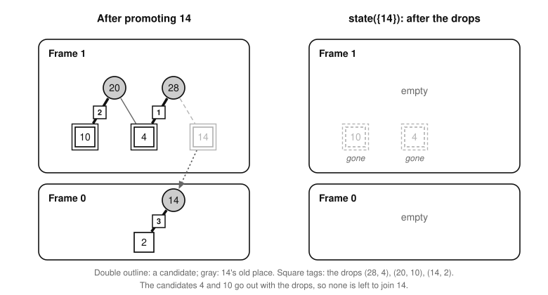
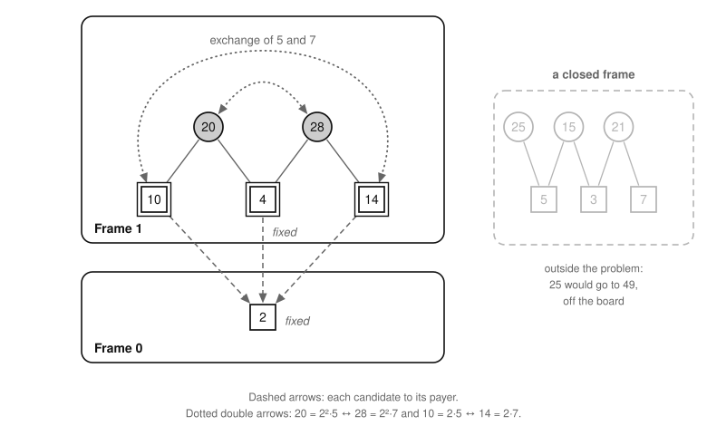

# The rules of a search

Part of [the theory](../THEORY.md).

A search of the frame model looks for a heaviest promotion set of a game's root problem Π_n.  Its answer ΣU\* + P\*(Π_n)
is opt(n) given [statement U](exactness.md#statement-u) at n, that some optimal set of n contains the sources
U\*_{≥3} (the corollary of U (X8)), but only if no part of the tree that the search leaves
unexplored holds a heavier set.  This file defines the searches that meet that condition, [exact
searches](#exact-searches), and proves every rule by which they may leave a part unexplored: [the state lemma
(R1)](#the-state-lemma), [the prime-exchange theorem (R2)](#the-prime-exchange-theorem) and [the exchange-pruning lemma
(R3)](#pruning-by-prime-exchanges), [the dual-bound lemma (R4)](#the-dual-bound-lemma) and [the floor lemma
(R5)](#the-floor-lemma), and [the repeat lemma (R6)](#the-repeat-lemma) and [the near-repeat lemma
(R7)](#the-near-repeat-lemma), which carry a proven game's answer to a later game.  [Bounds carried between
games](#bounds-carried-between-games) says what each bound on opt(n) rests on.

The frame model's words (root frames, candidates, homes, applying a set, promotion sets, the promotion limit, winnable,
live factors) are defined in [frame-model.md](frame-model.md#the-frame-model), and a node's promotions P, candidates
C, completions and state(P) under [Searching the frame model](frame-model.md#searching-the-frame-model).

## Exact searches

Throughout, Π is a root problem of the frame model: Π_n, or Π(B) of a board B with holes ([the holes theorem
(X9)](exactness.md#boards-with-holes)).  Of [the extended problem](extended-problem.md#the-extended-problem) Π⁺(O),
which a certificate of U searches, the file claims [the state lemma (R1)](#the-state-lemma), and the dual-bound and
floor lemmas ([R4](#the-dual-bound-lemma), [R5](#the-floor-lemma)) with no symmetric pair; it claims nothing of
[R2](#the-prime-exchange-theorem), [R3](#pruning-by-prime-exchanges), [R6](#the-repeat-lemma) or
[R7](#the-near-repeat-lemma) there.

A *search* of Π looks for a heaviest promotion set by exploring nodes.  At each moment it holds its *incumbent*, a value
V that only rises: the larger of the value that it started from (a *floor*, R5) and the weight of the best promotion
set that it has found, which it keeps.  It also holds its *open units*: the nodes whose completions it has still to
explore, the roots of every subtree not yet explored.  It starts with the root node as its one open unit, or resumes
from a *checkpoint*, a record of a search's incumbent and open units at one moment.

A step replaces an open unit (P, C) with other nodes, or with none, which ends the unit.  Typically they are the child
(P ∪ {x}, C ∖ {x}) that promotes a candidate x, when P ∪ {x} is a promotion set, and the node (P, C ∖ {x}) that goes on
without x.  A step may also offer a promotion set that it has found, which raises the incumbent if it is heavier.  A
step *gives up* each completion of its unit that is a completion of none of the nodes that replace the unit.  The
search *completes* when no open unit is left.

**Definition.**  A search of Π is *exact* when it starts from the root node or from a checkpoint of an exact search, and
each completion that a step gives up

1. is no heavier than the incumbent when the step gives it up, or
2. breaks the inequality c_p ≤ c_q of a symmetric pair (p, q) of Π, as R2 defines them.

A set that cannot be promoted is no completion, so dropping a candidate gives up nothing when the freedoms rule it out
([the promotion-limit lemma (F9)](frame-model.md#the-promotion-limit-lemma)), or when it would join the node's
promotions in a set known, from states by R1, not to be promotable: a set that holds one is none either, since a frame
stays winnable when a move is taken away or a factor put back.  A bound showing that no completion of a node beats
the incumbent, the near-repeat lemma (R7), and promoting together the [forced members](../GLOSSARY.md#the-search),
which every completion beating the incumbent promotes, give up completions of the first kind; the exchange-pruning
lemma (R3) gives up completions of the second.

An exact search covers everything that it still needs (R4, part 1): a checkpoint holds all that a resumed search must
explore, and a completed exact search of Π_n proves P\*(Π_n) ≤ V, with equality when V is the weight of a promotion
set.  A node is fixed by its promotions and candidates, so a unit rebuilt from a checkpoint, or on another thread, has
the same completions.  That the solver searches exactly is a claim about the program, which
[solver/docs/design/search.md, "The default step"](../../solver/docs/design/search.md#the-default-step) argues pruning by
pruning and the tests attack ([trust.md](../../solver/docs/design/trust.md)).

*Example.*  Game 28's root problem has two frames: frame 0 with no move and the factor 2, and frame 1 with the moves 20
and 28 and the factors 4, 10 and 14.  Its candidates 4, 10 and 14 have home 1, and the promotion limit is 1, so its
promotion sets are ∅, {4}, {10} and {14}, and P\* = 14.  A search that first promotes 14 replaces the root with ({14},
{4, 10}) and (∅, {4, 10}), and offers {14}.  The two nodes' completions are {14}, ∅, {4} and {10}, none of them
heavier than the incumbent 14, so steps may end both, and the search completes at P\*.  The root is drawn under the
prime-exchange theorem.

## The state lemma

A node's promotions matter only through the frames they leave: its state decides which of its completions can be
promoted, and a larger set's state is built from it.  So a search may keep each node as its state, and [the near-repeat
lemma (R7)](#the-near-repeat-lemma) compares states.  A frame j of a state *with X applied* gains the members of X of
home j + 1 as moves and loses those of home j as factors, as a root frame does.  In Π⁺(O) a promotion set (K, L) is
written as the set K ∪ L, which determines it, since its one-sided members are sources and its two-sided ones factors;
applying it also adds each one-sided member to the moves of its own frame, and state(P) is again the root frames with P
applied, then reduced.

**Lemma R1 (the state lemma).**  Let P be a promotion set of a root problem Π, and X a set of candidates of Π outside
P.  Then P ∪ X is a promotion set of Π exactly when every member of X is a factor of its home in state(P), and every
frame of state(P) is winnable with X applied.  When it is one, each frame of state(P ∪ X) is that frame of state(P)
with X applied, then reduced.  The same holds in an extended problem Π⁺(O), with the condition on homes asked of the
two-sided members of X only.

*Proof.*  Reducing settles moves that have one way left to be paid.  If X leaves each such payment in place, a frame
with X applied is winnable before reduction exactly when it is after; if X takes one away, both sides fail.

1. *Frame by frame.*  The set P ∪ X is a promotion set exactly when every root frame is winnable with P ∪ X applied,
   since its members are candidates, each with a home h ≥ 1 ([the reduction-step lemma
   (X6)](exactness.md#the-exactness-theorem)).  Fix a frame j, and let G₀ be root frame j with P applied, so that root
   frame j with P ∪ X applied is G₀ with X applied.  Each member of X has one home, so it is enough to show that G₀ with
   X applied is winnable exactly when the members of X of home j are factors of frame j of state(P) and that frame is
   winnable with X applied.
2. *The drops.*  The frame G₀ is winnable, since P is a promotion set, so by [the reduction lemma
   (F8)](frame-model.md#the-reduction-lemma) every order of drops reduces it to frame j of state(P).  Take one, the
   drops (a₁, y₁), …, (a_k, y_k): the move a_i has the single live factor y_i in the frame G_{i−1}, and G_i is G_{i−1}
   without a_i and y_i.  A member of X of home j is a factor of G₀, since applying P takes away only members of P, so it
   is missing from G_k exactly when it is one of the y_i.
3. *A drop survives later edits.*  By F8, if a move a has the single live factor y in a frame G, then after any edit
   that adds moves and removes factors other than y, G is winnable exactly when G without a and y is.  Applying X to
   G_{i−1} is such an edit unless y_i is in X.
4. *If no y_i is in X,* step 3 at every drop shows that G₀ with X applied is winnable exactly when G_k with X applied
   is, and by step 2 every member of X of home j is a factor of G_k.
5. *Otherwise* let y_i be the first of them in X.  By step 3, G₀ with X applied is winnable exactly when G_{i−1} with X
   applied is.  There the move a_i has lost its one live factor y_i and gained none, so it can never be taken.  And y_i
   is a member of X of home j that is missing from G_k.  Both sides fail.
6. *The state of P ∪ X.*  If P ∪ X is a promotion set, step 4 is the case, and each drop (a_i, y_i) is a drop of G_{i−1}
   with X applied too, since there a_i's live factors lie among {y_i} and y_i is present.  So reducing G₀ with X applied
   can pass through G_k with X applied, and since G₀ with X applied is winnable, by F8 every order of drops ends at the
   same frame.

*In Π⁺(O)* the steps read the same.  In step 1, a promotion set is a set of one-sided candidates and of two-sided ones
with homes that leaves every root frame winnable, and every two-sided candidate has a home (step 5 of the proof of [the
extended exactness theorem (E1)](extended-problem.md#the-extended-exactness-theorem)).  In step 2, the members of X of
home j are two-sided, and factors of root frame j.  In step 3, applying X adds its one-sided members to the moves of
their own frames, in those frames' layer of moves, so it is still an edit of the kind F8 allows; and no a_i, a member
of Φ or of P, is in X.  ∎

*Example.*  On game 28, promoting 14 leaves frame 1 with the moves 20 and 28 and the factors 4 and 10, and frame 0 with
the move 14 and the factor 2.  Reducing drops 28 with 4, then 20 with 10, and 14 with 2, so state({14}) has two empty
frames.  By R1 no candidate can join 14, since neither 4 nor 10 is a factor of its home there.

*Promoting 14 (left), and state({14}) after the drops (right).  Double outline: a candidate; gray: 14's old place.
Numbered square tags: the drops, in order.*

The search keeps each node's state and makes a child's state from its parent's ([solver/docs/design/search.md, "Search
state and order"](../../solver/docs/design/search.md#search-state-and-order)).

## The prime-exchange theorem

Exchanging two primes in every number preserves divisibility.  Where the exchange maps a root problem onto itself, no
heaviest promotion set gains by it, and that orders the two primes' shares of every heaviest set.

For primes p < q, the *exchange* π_{p,q} sends p^a q^b t, with t prime to pq, to p^b q^a t.  For a set S of numbers and
a prime r, c_r(S) is the sum of x/r over the members x of S that r divides: the sum of S's *cofactors* of r.

**Theorem R2 (the prime-exchange theorem).**  Let Π be a root problem of the frame model, and p < q primes such that
π = π_{p,q} maps the moves of every root frame onto themselves, the factors of every root frame onto themselves, and the
candidates onto themselves.  Then:

1. a set L of candidates is a promotion set exactly when π(L) is;
2. the difference Σπ(L) − ΣL is Σ_{x∈L} (π(x) − x), which is (q − p)(c_p(L) − c_q(L)) when no candidate is divisible
   by pq, p² or q²;
3. under that condition, every heaviest promotion set L\* has c_p(L\*) ≤ c_q(L\*).

A pair that meets all these hypotheses is *symmetric*, and part 3 holds for all the symmetric pairs of Π at once.

*Proof.*  The exchange is an automorphism of divisibility that fixes the problem, so it carries each frame's game with
L applied onto the same frame's game with π(L) applied.

1. *Maximal factors.*  The exchange is a bijection of the positive integers that multiplies, sends primes to primes (p
   and q to each other, the others to themselves), and is its own inverse.  So y = x/r with r prime exactly when π(y) =
   π(x)/π(r): the exchange maps the maximal factors of x onto those of π(x).
2. *Homes and winnability.*  The exchange maps each root frame's factors onto themselves, so π(x) has the home of x.
   With the hypotheses, it maps the moves and the factors of root frame h with L applied onto those of root frame h with
   π(L) applied, and by step 1 each move's live factors onto its image's.  So it carries legal orders to legal orders,
   and the one frame is winnable exactly when the other is.
3. *Part 1.*  A promotion set is a set of candidates, each with a home, that leaves every root frame winnable.  The
   exchange keeps candidates and homes, and by step 2 winnability.
4. *Part 2.*  The exchange is one-to-one, so Σπ(L) = Σ_{x∈L} π(x).  Under the condition, a candidate x is divisible by
   at most one of p and q, and by it once.  If p divides x, then π(x) = xq/p, a gain of (q − p)·x/p; if q divides x,
   then π(x) = xp/q, a loss of (q − p)·x/q; otherwise π(x) = x.
5. *Part 3.*  By part 1, π(L\*) is a promotion set, so Σπ(L\*) ≤ ΣL\*, and part 2 gives c_p(L\*) ≤ c_q(L\*), as q > p.
   The argument for one pair uses no other.  ∎

So within a class of primes any two of which are symmetric, every heaviest set gives the larger primes the larger
cofactor sums, with no sorting argument.

*Example.*  On game 28, π_{5,7} exchanges frame 1's moves 20 = 2²·5 and 28 = 2²·7 and its factors 10 and 14, and fixes
the factors 4 and 2.  No candidate is divisible by 35, 25 or 49, so (5, 7) is a symmetric pair.  The exchange maps
{10} to {14}, worth (7 − 5)·(2 − 0) = 4 more, and the heaviest set {14} keeps c₅ = 0 ≤ c₇ = 2.  It would send the
source 25 = 5² off the board, to 49, but 25 lies in a closed frame, with 15, 21 and the factors 3, 5 and 7, which takes
no part in the problem.

*The root of game 28.  Double outline: the candidates, with dashed arrows to their payer 2.  Dotted double arrows: the
exchange π_{5,7}.  Gray, dashed: the closed frame.*

*Why the condition on divisibility.*  Without it part 2's formula fails.  In game 21, π_{2,3} maps the root onto
itself: it exchanges frame 0's moves 14 and 21 and its factors 2 and 3, and frame 1's moves 12 and 18 and its candidates
4 and 9, and fixes 7 and 6.  But 4 = 2² and 9 = 3², and exchanging {4} for {9} gains 5, not (3 − 2)(c₂ − c₃) = 2.

The solver finds the symmetric pairs of the root and prunes by [R3](#pruning-by-prime-exchanges)
([solver/docs/design/gf2-bound.md, "Prime exchanges"](../../solver/docs/design/gf2-bound.md#prime-exchanges)).

## Pruning by prime exchanges

Two tests find completions that break a symmetric pair's inequality from a node's cofactor sums alone.

**Lemma R3 (the exchange-pruning lemma).**  Let (P, C) be a node of a search of a root problem Π, and (p, q) a
symmetric pair of Π.

1. If c_p(P) > c_q(P) + c_q(C), no completion of the node keeps the pair's inequality: the node is *hopeless*.
2. A candidate x in C divisible by p with c_p(P) + x/p > c_q(P) + c_q(C) is in no completion of the node that keeps the
   pair's inequality.
3. So an exact search of Π stays exact when it ends a hopeless node or drops such a candidate.

*Proof.*  Let P ∪ X be a completion, X ⊆ C.  Cofactor sums add over disjoint sets and have positive terms, so c_p(P ∪
X) = c_p(P) + c_p(X) ≥ c_p(P), and c_q(P ∪ X) = c_q(P) + c_q(X) ≤ c_q(P) + c_q(C).  Under part 1's hypothesis, c_p(P ∪
X) ≥ c_p(P) > c_q(P) + c_q(C) ≥ c_q(P ∪ X).  If X holds a candidate x as in part 2, then c_p(X) ≥ x/p, and c_p(P ∪ X)
≥ c_p(P) + x/p > c_q(P) + c_q(C) ≥ c_q(P ∪ X).  So the two steps of part 3 give up completions of the second kind
only.  ∎

*Example.*  On game 28 the root keeps 10, since c₅(∅) + 10/5 = 2 is not more than c₇({4, 10, 14}) = 2: the test does
not see the promotion limit.  Once the root has tried 14 and goes on as (∅, {4, 10}), c₇ of its candidates is 0, and 10
is dropped.

*Non-example.*  The cuts are unsound for a search of one node's best completion, which starts from that node.
[R2](#the-prime-exchange-theorem) speaks of the promotion sets of Π, and the image of a completion can change a member
of P or leave C.  Searched for its own best completion, the node (∅, {4, 10}) of game 28 would drop 10 and find {4},
though {10} is heavier: its image {14} is no completion of the node.

## The dual-bound lemma

What a stopped search has left to explore bounds its answer: with the incumbent, the best that its open units could
still hold is the *dual bound* of branch and bound.  A completed search has no open unit left, and its incumbent is the
answer.

**Lemma R4 (the dual-bound lemma).**  Let an exact search of a root problem Π have, at some moment, the incumbent V and
the open units (P₁, C₁), …, (P_t, C_t), and let ΣX ≤ β_i for every completion P_i ∪ X of the i-th, X ⊆ C_i.  Then:

1. every promotion set heavier than V that keeps the inequality of every symmetric pair of Π is a completion of an open
   unit;
2. P\*(Π) ≤ max(V, max_i (ΣP_i + β_i)), the search's *dual bound*;
3. if the search has completed (t = 0), then P\*(Π) ≤ V, with equality when V is the weight of a promotion set.

The right side of the inequality that [the frame bound (B2)](frame-bounds.md#the-frame-bound) gives at a node is such a
β_i; B2 adds ΣP_i to it to make the node's frame bound.

*Proof.*  The open units start out covering every promotion set, and a step uncovers only sets that cannot be the
answer: those no heavier than the incumbent, and those that a heavier mirror image beats.

1. *Part 1 at the start.*  Every promotion set is a completion of the root node.  A search resumed from a checkpoint of
   an exact search starts with that search's incumbent and open units, for which part 1 holds by this argument applied
   to that search.
2. *Part 1 after a step.*  Let L keep every symmetric pair's inequality and be heavier than the incumbent after the
   step.  The incumbent only rises, so L was heavier than it before the step too, and so a completion of an open unit.
   If the step replaced that unit, it did not give L up, since L is heavier than the incumbent and keeps the
   inequalities.  So L is a completion of a node that replaced the unit.
3. *Part 2.*  A heaviest promotion set L\* keeps every symmetric pair's inequality ([R2](#the-prime-exchange-theorem)).
   If ΣL\* > V, part 1 makes it P_i ∪ X for an open unit i and some X ⊆ C_i outside P_i, so P\*(Π) = ΣP_i + ΣX ≤ ΣP_i +
   β_i.
4. *Part 3* is part 2 with no open unit, and a promotion set weighs at most P\*(Π).  ∎

A search stopped before its first step has the dual bound max(V, the root's frame bound).  R4 and [R5](#the-floor-lemma)
use nothing of Π but its candidates, promotion sets and weights, which is why they hold in Π⁺(O), with the second kind
left out since R2 is not proved there.  The solver reads the dual bound from a stopped search's last checkpoint.

## The floor lemma

A search can start from a bare value instead of a set.  It then proves that no promotion set is heavier, or finds one
that is.

**Lemma R5 (the floor lemma).**  Let an exact search of a root problem Π start from a *floor* V₀: an incumbent value
with no promotion set behind it.

1. If the search completes having found no promotion set heavier than V₀, then P\*(Π) ≤ V₀.
2. Each promotion set that raises the incumbent is worth more than V₀, and if the search completes having found one,
   the last one found is worth P\*(Π).
3. If a limit stops the search, [R4](#the-dual-bound-lemma) holds with its incumbent, the larger of V₀ and the weight of
   the heaviest set found.

*Proof.*  Exactness speaks only of the incumbent's value, so R4 applies.  The incumbent rises from V₀, and only a
heavier set raises it, so the last set that raised it is worth the final incumbent V.  If the search completes, R4
gives P\*(Π) ≤ V.  With no set found, V = V₀; otherwise the last set found is a promotion set, so V ≤ P\*(Π) ≤ V.  ∎

So a floor at P\* prunes as a seeded heaviest set would, a floor above P\* finds nothing, a floor below P\* finds a
heaviest set, and a floor at or above the root's frame bound ends the search at its first check of that bound.

## The repeat lemma

The number that a board adds often lands where the frame model settles it before the search, leaving the problem as it
was.  Game n is a *repeat* of game m when a root problem of n equals one of m: the same root frames, numbered alike,
with the same moves and factors, and the same candidates with the same homes.  The solver compares the problems that
setup builds, which are Π_n and Π_m.  Below, U\*(n) is the set U\* of board n, and the game of n *made from* a promotion
set L of Π_n plays U\*(n) ∪ L, in an order that [the exactness theorem (X7)](exactness.md#the-exactness-theorem) makes
legal.

**Lemma R6 (the repeat lemma).**  Let n and m be games, and Π and Π′ root problems of n and of m with Π = Π′.

1. Every promotion set L of the problem makes a game of n worth ΣU\*(n) + ΣL.
2. Given U at n, opt(n) − ΣU\*(n) ≤ opt(m) − ΣU\*(m).
3. Given U at n, if the game of m made from a promotion set L is optimal, so is the game of n made from L.

*Proof.*  X7 and [X8](exactness.md#statement-u) hold for every root problem of a game, since all of a game's root
problems have the same promotion sets and the same P\*.  Part 1 is X7 at n.  Equal problems have the same promotion
sets, so P\*(Π) = P\*(Π′).  By X8 at m, ΣU\*(m) + P\*(Π′) ≤ opt(m), and given U at n, opt(n) = ΣU\*(n) + P\*(Π), by X8
at n; together these give part 2.  For part 3, opt(m) = ΣU\*(m) + ΣL and part 2 give opt(n) ≤ ΣU\*(n) + ΣL, which the
game of n made from L scores by part
1.  ∎

Given U at m as well, part 2 is an equality.  Part 3 asks only that m's game made from L be optimal, however that was
proven: by a search, or at m's ceiling.  Such an L is a heaviest promotion set, by X8 at m.

*Example.*  Games 38 and 39 pose the same problem: frame 0 with no move and the factors 4 and 6, frame 1 with the moves
24 and 36 and the candidates 8, 12 and 18, the promotion limit 1, and P\* = 18.  Board 39 adds the source 39 = 3·13,
which takes 22's place in U\*, so ΣU\* rises by 17, from 468 to 485.  Given U at 39, R6 bounds opt(39) by
opt(38) + 17 = 503, where [the ceiling lemma (N4)](neighbors.md#the-ceiling-lemma) gives only opt(38) + 39, and the
game of 39 made from {18} scores 503.

The solver concludes a repeat with the earlier game's promotions instead of searching
([solver/docs/design/same-search.md](../../solver/docs/design/same-search.md)).

## The near-repeat lemma

A search can end a node with the bound of a game m proven before: where the node's promotions leave, in m, frames no
harder than in the game n searched, wherever the node's candidates reach, every completion of the node is a promotion
set of Π_m.  Game n is a *near repeat* of game m when Π_n has the candidates of Π_m with the same homes and differs
from it in the moves and factors of a few frames, as when one move is swapped for another; there the lemma can end
most of the search ([what carries from one game's search to the
next](../../solver/notebook/search/what-carries-from-one-games-search-to-the-next-2026-10/README.md)).

Below, state_m(P) and state_n(P) are the states that P leaves in Π_m and in Π_n, and a set C of candidates *touches*
frame j when one of its members [touches](frame-bounds.md#signed-frames) it, having the home j or j + 1.

**Lemma R7 (the near-repeat lemma).**  Let m and n be games, Z a number with P\*(Π_m) ≤ Z, and (P, C) a node of a
search of Π_n.  Suppose that

1. every member of C is a candidate of Π_m, with the same home in Π_m as in Π_n;
2. the set P is a promotion set of Π_m; and
3. on every frame j that C touches, with the moves Y^m and the factors F^m in state_m(P), and the moves Y^n and the
   factors F^n in state_n(P): Y^m ⊆ Y^n, and every factor in F^n but not in F^m is no member of C, and a maximal factor
   of no member of Y^m and of no member of C of home j + 1.

Then every completion of the node is a promotion set of Π_m, and so is worth at most Z.  If the incumbent is worth at
least Z, an exact search may end the node (the first kind).

*Proof.*  By [the state lemma](#the-state-lemma) it is enough to compare the two states on the frames that C touches,
and there a winning order of n's frame, kept to m's moves, wins m's frame.

1. *Two facts suffice.*  Let P ∪ X be a completion, X ⊆ C.  By R1 in Π_n, each member of X is a factor of its home h
   in state_n(P), and each frame of state_n(P) is winnable with X applied.  By conditions 1 and 2, X is a set of
   candidates of Π_m outside its promotion set P, with the same homes.  So by R1 in Π_m it is enough to show the same
   two facts of state_m(P).
2. *Each member x of X is a factor of its home h in state_m(P).*  The set C touches frame h, and x is in F^n and in C,
   so condition 3 puts x in F^m.
3. *A frame that X does not touch* is as state_m(P) has it, and winnable, since P is a promotion set of Π_m and
   reducing keeps a frame winnable ([F8](frame-model.md#the-reduction-lemma)).
4. *A frame j that X touches* is touched by C too.  Let X_in be the members of X of home j + 1, which become moves of
   frame j, and X_out those of home j, which leave its factors.  Some order wins n's frame, the moves Y^n ∪ X_in against
   the factors F^n less X_out.  Keep in it only the moves Y^m ∪ X_in, all of them in n's frame since Y^m ⊆ Y^n.
5. *The kept order wins m's frame,* the moves Y^m ∪ X_in against the factors F^m less X_out.  At its turn in the whole
   order, a kept move a had a live factor y that no move before it had taken.  Since a is in Y^m or is a member of C of
   home j + 1, condition 3 puts y in F^m, and y is not in X_out.  No kept move b before a has y as a maximal factor,
   since y was still in n's frame after b's turn, and taking b removes all of its live factors.  So each kept move can
   be taken at its turn in m's frame.

So P ∪ X is a promotion set of Π_m, and Σ(P ∪ X) ≤ P\*(Π_m) ≤ Z.  ∎

*What it rests on.*  The proof compares the two problems' frames, candidates and homes, and nothing else: it needs no
[statement U](exactness.md#statement-u), and a completion is worth the sum of its members in either game.  So any root
problem whose P\* has a proven bound can stand in for Π_m, that of a board with holes say; the one-sided candidates of
[the extended problem](extended-problem.md#the-extended-problem) are not treated.  The incumbent may be a floor
([R5](#the-floor-lemma)).  An answer that uses the lemma rests on what Z rests on.  If Z is P\*(Π_m) as a completed
search of the same problem proved it, the lemma adds nothing.  If Z is hi(m) − ΣU\*(m), for an upper bound hi(m) on
opt(m) such as m's optimal score, then Z ≥ P\*(Π_m) by X8, and the answer rests on m's upper bound too: on what m's
proof assumes, and on U at the games that bound came through.

*Why each condition is needed.*  In the examples below, every condition holds but the one named, and the conclusion
fails.

* *Candidates of Π_m.*  The bound Z covers only the promotion sets of Π_m, which are sets of its candidates, and
  winnable frames do not make a number a candidate: at n = 98 the frames stay winnable with 22 promoted, but 22 is no
  candidate, and U\* ∪ {22} is not playable ([X7](exactness.md#the-exactness-theorem)).
* *The same home.*  A promoted number leaves its home for the frame in front of it; with another home in Π_m it would
  change frames that condition 3 does not compare.  P's members need no such check: condition 2 and the state carry
  what P does in Π_m.
* *P promotable in Π_m.*  Only a promotion set has a state, and the frames that C does not touch are winnable only
  because P is a promotion set of Π_m.
* *Y^m ⊆ Y^n.*  Take n = 48, m = 45, P = ∅ and C = {8, 12}, both of home 2.  Root frame 2 has the move 24 in game 45,
  where it is a source, but not in game 48, where it is a factor.  And {8, 12} is a promotion set of Π_48 but not of
  Π_45.
* *A factor of n's frame that m's lacks is no member of C.*  Take n = 54, m = 51, P = {8, 18} and C = {21}.  Frame 1 of
  state_51(P) is empty, and that of state_54(P) keeps the factor 21.  The completion {8, 18, 21}, worth 47, is a
  promotion set of Π_54 but not of Π_51, whose P\* is 39.
* *It pays for no kept move.*  Take n = 54, m = 51, P = ∅ and C = {20, 21}.  Root frame 1 holds the factor 15 in game 54
  only, and 15 pays for 30, a move of that frame in both games.  The completion {20, 21}, worth 41, is a promotion set
  of Π_54 but not of Π_51.
* *A proven Z.*  A provisional game of m may be worth less than P\*(Π_m), and ending nodes at its value could give up a
  heavier set.

*What is not needed.*  The freedoms, which winnability keeps at least 0; the maximal-factor relation, which is the same
in both games; the number of frames; and the frames that C does not touch.  The conditions allow n's frames moves that
m's lack, and factors that pay only for those.  A repeat meets all three conditions at the root, where P is empty.

The solver ends nodes by R7, with the game before as m ([solver/docs/design/search.md, "The near-repeat
cut"](../../solver/docs/design/search.md#the-near-repeat-cut)).

## Bounds carried between games

The lemmas of [neighbors.md](neighbors.md) and [the repeat lemma](#the-repeat-lemma) carry bounds on opt(n) between
games, both ways: a computation can keep a lower bound lo(n) and an upper bound hi(n) for many games at once, and prove
a game when they meet.  The two kinds of bound rest on different things.

*Lower bounds are games.*  Each lo(n) is the score of a [finished](neighbors.md#finished-games) game of n, legal, over
and opening with [q(n)](statements.md#notation), that a replay has checked, so lo(n) ≤ opt(n) rests on the replay
alone.  Every optimal game is finished (the finished-game lemma (N2)), so such bounds can
reach opt(n).  They cross between games by constructions, each counted once a replay finds its game finished:

* [monotonicity (N3)](neighbors.md#monotonicity) extends a finished game of n − 1 to one of a composite n;
* [the ceiling lemma (N4)](neighbors.md#the-ceiling-lemma) cuts a finished game of a composite n down to one of n − 1
  that loses at most n;
* [the prime formula (N5)](neighbors.md#the-prime-formula) exchanges the first move between a prime p and p − 1, both
  ways;
* the repeat lemma (R6) carries a promotion set L from the game of m made from L to the game of n made from L, played on
  with legal moves until it is over.

*Upper bounds rest on the frame model.*  Each hi(n) starts from a bound on P\*(Π_m) at some game m: the root's [frame
bound (B2)](frame-bounds.md#the-frame-bound), a dual bound ([R4](#the-dual-bound-lemma)), the value of a completed
search (R4), or a floor under which a search completed having found nothing ([R5](#the-floor-lemma)).  Each holds
without [statement U](exactness.md#statement-u), but for one case: a search that ended nodes by [the near-repeat
lemma](#the-near-repeat-lemma) with Z = hi(m′) − ΣU\*(m′), for an earlier game m′, rests on what hi(m′) rests on (R7).
ΣU\*(m) + P\*(Π_m) is opt(m) given U at m (X8).  An upper bound passes from n − 1 to n by adding n (N4), from n to n − 1
unchanged (N3), between p − 1 and a prime p by adding or taking away p − q(p − 1) (N5), and from m to n by taking away
ΣU\*(m) and adding ΣU\*(n) when root problems of n and m are equal (R6).  All of these passages hold without U but the
last, which needs U at n.  So hi(n) ≥ opt(n) rests on U at the game where its bound was made, at every game that a
repeat carried it to, and at the games behind any hi(m′) that the near-repeat lemma used.

So a game whose bounds meet is proven within the frame model, given U at the games its upper bound came through.  A
lower bound above an upper bound would be a bug, or a counterexample to U at one of those games: the lower bound is the
score of a real game, so only the upper side can fail.

The solver's ledger keeps such bounds ([solver/docs/design/trust.md, "The
ledger"](../../solver/docs/design/trust.md#the-ledger)).
