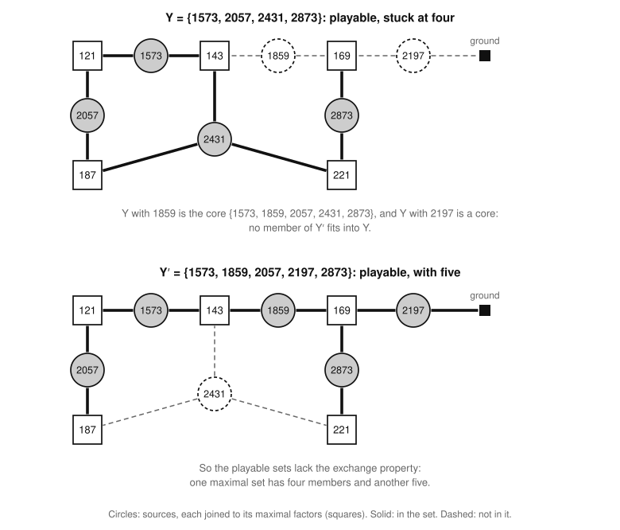
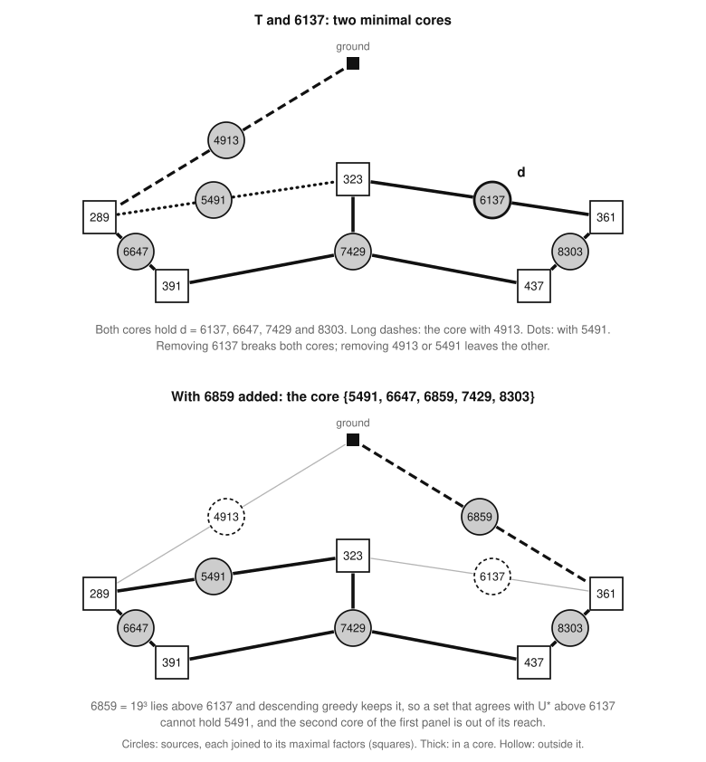

# The heaviest playable set of sources

Part of [the theory](../THEORY.md).

The [sources](../GLOSSARY.md#the-frame-model) of game n, its numbers above n/2, are each a move or nothing, and the
frame model fixes them to U\*: the set that descending greedy keeps, taking the sources from the largest down and
keeping each one that still fits with those kept before it.  This file asks whether U\* is the heaviest playable set of
sources.  That is [the sources conjecture](#the-sources-conjecture), and it is open.

## What is open

The theory has four open statements: [statement U](exactness.md#statement-u), which concerns the frame model, and three
about the sources.  Each is checked game by game, and [statements.md](statements.md#the-statements) gives each one's
standing.

* **[The sources conjecture (S1)](#the-sources-conjecture):** no playable set of sources outweighs U\*.
* **[The cardinality conjecture (★) (S4)](#the-cardinality-conjecture):** the same with sizes in place of weights, on
  every component of the sources and every truncation of one.
* **[The span conjecture (♦) (S5)](#the-span-conjecture):** every source that descending greedy rejects is a sum, over
  GF(2), of sources it kept above it.

The certificates run the other way.  The check of (♦) in a game is descending greedy with Gaussian elimination, and by
[the span theorem (S6)](#the-span-theorem) it proves (★) in that game, which gives the sources conjecture there, for
every weighting that increases with value.  A proof of (★) for every game would settle the sources conjecture, and a
proof of (♦) for every game would prove (★).  A refutation would be a game with a playable set of sources heavier than
U\*, or, for (★), a component and a threshold where descending greedy keeps fewer sources than fit.  A failure of (♦)
alone would refute neither, since (♦) is the stronger statement.  [The uniqueness
theorem](uniqueness-and-longest-games.md#the-uniqueness-theorem) (Q1) and part of [the length
lemma](uniqueness-and-longest-games.md#the-length-lemma) (Q3) assume (★).  The scores of the frame solver do not: they
rest on statement U.

The rest of the file is explanatory, and follows the ways a proof has been tried.  The textbook proof that a procedure
like descending greedy finds a heaviest set needs the exchange property of a matroid, which playable sets can lack
([where exchange breaks](#where-exchange-breaks)).  A direct proof compares U\* with a heavier set at their largest
disagreement.  It works where the obstruction there is made of members with at most two maximal factors ([the victim
law (S2)](#the-victim-law) and [the frontier theorem (S3)](#the-frontier-theorem)), and stops at a configuration of
sources built from the primes 17, 19 and 23.  Dropping the weights turns the conjecture into (★), and linear algebra
over GF(2) gives (♦).  The last sections list what the measurements say a proof must use, and prove the frontier
theorem.

## Definitions

### The sources' instance

The sources' instance of game n is the [reduction instance](playability.md#payment-schemes) whose members are the
sources, whose pool is the set of their maximal factors, and in which each member lists all its maximal factors.  No
source is a maximal factor of another, since a source's maximal factors are at most n/2.  So in the own instance of a
set of sources each member lists all its maximal factors too, as in the sources' instance (the argument of part 2 of
[the exclusion theorem (P8)](playability.md#the-exclusion-theorem)).  By [the playability theorem
(P2)](playability.md#the-playability-theorem), a set of sources is therefore playable in game n exactly when it is
playable in the sources' instance, and by [the core theorem (P7)](playability.md#the-core-theorem) exactly when it holds
no [core](playability.md#cores-and-the-residual): a nonempty set in which every factor a member lists is listed by
another member.  In game 21 the sources are 11 to 21, and the pool is 1 to 10:

    11: 1        14: 7, 2     17: 1        20: 10, 4
    12: 6, 4     15: 5, 3     18: 9, 6     21: 7, 3
    13: 1        16: 8        19: 1

### Descending greedy

*Descending greedy* takes the members of an instance in decreasing order, and keeps each one when it and the members
kept so far are still playable.  The set it keeps on the sources' instance of game n is U\*, and U\*_k is its part in
[layer](../GLOSSARY.md#the-frame-model) k.  In game 21 it keeps 21, 20, 19 and 18; it rejects 17, since 17 and 19 list
only the factor 1, which makes {17, 19} a core; it keeps 16, 15 and 14, rejects 13, keeps 12 and rejects 11.  So U\* =
{12, 14, 15, 16, 18, 19, 20, 21}, which sums to 135; the optimal game of 21 plays U\* and the factor 9, for 144.

### Components and truncations

The *incidence graph* of an instance joins each member to the factors it lists, and a *component* is the set of members
of one of its connected pieces.  Game 21's sources have four: {11, 13, 17, 19} on the factor 1, {12, 18, 20} on 4, 6, 9
and 10, {14, 15, 21} on 2, 3, 5 and 7, and {16} on 8.  The *truncation* of a set H at t is H ∩ [t, n], its members of
value t or more, where [t, n] is the integers from t to n.  Two facts follow from [the core
theorem](playability.md#the-core-theorem).

* *Playability splits over the components.*  A set of sources is playable exactly when its part in each component is.
  A member's factors are listed only by members of its own component, so the part of a core in a component is a core
  when it is not empty.  So a set holds a core exactly when its part in some component does.
* *So does descending greedy.*  Run on a component H, descending greedy keeps U\* ∩ H, and run on a truncation H ∩ [t,
  n] it keeps U\* ∩ H ∩ [t, n].  When it reaches a member x of H, the members kept so far are playable, so by the first
  fact they stay playable with x exactly when their part in H does.  Its decision on x therefore depends only on the
  members of H kept above x, as it does in the run on H, and stopping at t changes nothing above t.

*The four components of 21's sources (upper panel).  Gray circles: U\*; hollow: the rejected 11, 13 and 17.  The lower
panel is a run of [peel](playability.md#peel) on U\*.*

### Jams and victims

A *jam* (T, d) is a playable set T and a member d ∉ T such that T ∪ {d} is not playable.  A *victim* of the jam is a
member s of T whose removal repairs it: (T ∪ {d}) ∖ {s} is playable.  The victims depend on the pair, not on the set T ∪
{d} alone, since a victim must lie in T.

## The sources conjecture

**Conjecture S1 (the sources conjecture).**  For every game n, no playable set of sources of game n outweighs U\*: every
playable set S of sources has ΣS ≤ ΣU\*.

## Where exchange breaks

[The greedy algorithm of a matroid](primer.md#the-greedy-algorithm-of-a-matroid), which runs like descending greedy,
finds a heaviest independent set.  The independent sets of a matroid have the *exchange property*: within any set, all
the maximal independent subsets have one size ([matroids](primer.md#matroids)).  Playable sets of sources have it as
long as every member has at most two maximal factors.  Draw the factors as vertices, with one more vertex, the ground,
and each member as an edge between its two maximal factors, or between its one maximal factor and the ground.  By [the
two-factor proposition (P11)](playability.md#the-two-factor-proposition), a set of such members is playable exactly
when its edges form a forest.  The forests of a graph are the independent sets of its graphic matroid, and descending
greedy is that matroid's greedy algorithm.

A member with three or more maximal factors is a hyperedge, and with hyperedges the exchange property can fail.  It
fails in game 2873, on six sources built from the primes 11, 13 and 17; among the sources, no failure in a smaller game
is known (on the whole board the primer shows one in game 4):

| source | prime factors | maximal factors |
| --- | --- | --- |
| 1573 | 11²·13 | 121, 143 |
| 1859 | 11·13² | 143, 169 |
| 2057 | 11²·17 | 121, 187 |
| 2197 | 13³ | 169 |
| 2431 | 11·13·17 | 143, 187, 221 |
| 2873 | 13²·17 | 169, 221 |

The sets Y = {1573, 2057, 2431, 2873} and Y′ = {1573, 1859, 2057, 2197, 2873} are both playable.  No member of Y′ fits
into Y: Y ∪ {1859} and Y ∪ {2197} are themselves cores.  So among these six sources Y is a maximal playable set of size
4 and Y′ one of size 5, and the playable subsets of the six are not the independent sets of any matroid.  The textbook
proof does not apply.

*The six sources of the table, each joined to its maximal factors; 2431 is a hub with three.  Solid: the members of Y
(upper panel) and of Y′ (lower).*

Descending greedy still gets these six right.  It keeps {1859, 2057, 2197, 2431, 2873}, of size 5 and sum 11,417, the
heaviest of the five maximal playable sets, and Y, where it could be stuck, is the lightest.  The order of the values is
what saves it.  Of the 720 orders of the six sources, the 48 that put 1859 and 2197 last lead descending greedy to Y;
the true order puts 1573 below both.

## The victim law

The victim law is explanatory: [the frontier theorem](#the-frontier-theorem) uses it, and nothing else rests on it.  A
jam is repaired by removing one member exactly when that member lies in every minimal core of the jam, a core that holds
no smaller core.

**Lemma S2 (the victim law).**  Let H be a set of members of an instance, and s a member of H, with H ∖ {s} keeping the
instance's pool and lists.  Then H ∖ {s} is playable if and only if s lies in every core in H, and if and only if s lies
in every minimal one.  In particular, a member of T is a victim of a jam (T, d) exactly when it lies in every minimal
core in T ∪ {d}.

*Proof.*  By [the core theorem (P7)](playability.md#the-core-theorem) the cores are the only obstructions to
playability, and removing s clears them all exactly when s is in each.  The lists are the instance's, so whether a set
is a core depends on the set alone.

1. *If H ∖ {s} is playable, s lies in every core Q in H.*  Otherwise Q ⊆ H ∖ {s}, and a set that holds a core is not
   playable, by the core theorem.
2. *If s lies in every minimal core in H, then H ∖ {s} is playable.*  Otherwise H ∖ {s} holds a core Q, by the core
   theorem.  A core inside Q with the fewest members holds no smaller core, so it is a minimal core in H, and it misses
   s.
3. A member of every core is in every minimal one, so steps 1 and 2 close the circle.  ∎

The lists must stay the instance's.  On the board of 4 the own instance of {2, 4} has the pool {1}, in which 4 lists
nothing and so is a core by itself, which misses 2; yet {4} alone is playable on the board, since its own instance has
the pool {2}.

Six of the sources built from the primes 17, 19 and 23 show the law at work:

| source | prime factors | maximal factors |
| --- | --- | --- |
| 4913 | 17³ | 289 |
| 5491 | 17²·19 | 289, 323 |
| 6137 | 17·19² | 323, 361 |
| 6647 | 17²·23 | 289, 391 |
| 7429 | 17·19·23 | 323, 391, 437 |
| 8303 | 19²·23 | 361, 437 |

The set T = {4913, 5491, 6647, 7429, 8303} is playable, and (T, 6137) is a jam whose set has two minimal cores, {4913,
6137, 6647, 7429, 8303} and {5491, 6137, 6647, 7429, 8303}.  So its victims are 6647, 7429 and 8303, which lie in both,
while removing 4913 or 5491 leaves the other.

*Upper panel: the two minimal cores, with d = 6137 in both; long dashes mark the one through 4913, dots the one through
5491.  Lower panel: 6859 added, closing a core without 6137.*

## The frontier theorem

The frontier theorem is explanatory: it shows how far a direct proof of [the sources
conjecture](#the-sources-conjecture) gets, and nothing rests on it.  Compare descending greedy's set with a heavier
playable set at the largest member on which they disagree, the *frontier*.  The comparison proves descending greedy
right wherever the obstruction at the frontier is made of members with at most two maximal factors.

**Theorem S3 (the frontier theorem).**  Let H be a set of sources of game n, weighted by their values, and G the set
that descending greedy keeps when run on H.  Let T be a playable subset of H other than G, and d the largest member in
exactly one of G and T.  Then:

1. d is in G and not in T;
2. every core in T ∪ {d} holds d and a member of T below d;
3. if T ∪ {d} is not playable and every member of its residual has at most two maximal factors, some member s of T
   below d is a victim of the jam (T, d), and (T ∪ {d}) ∖ {s} outweighs T.

So if T is a heaviest playable subset of H, with T ≠ G, then (T, d) is a jam whose residual holds a member with three or
more maximal factors.

The idea of the proof: above d, T agrees with G, and descending greedy's acceptance of d shows that T's part above d
stays playable with d, so every obstruction to adding d to T reaches below d.  When the obstruction is a single cycle, a
member below d on it can be traded for d.  The proof is at [the end of the file](#proof-of-the-frontier-theorem).  It
uses of the weights only that they are positive and increase with the value.  It looks only at the residual R of T ∪
{d}, and rightly: by [the exclusion theorem (P8)](playability.md#the-exclusion-theorem), if removing a set E of members
repairs the jam, so does removing E's part in R.

### Where the frontier theorem stops

With a member of three maximal factors in the residual, a single trade below the frontier can fail, and the six sources
built from 17, 19 and 23 show it.  Take d = 6137 and T = {4913, 5491, 6647, 7429, 8303}; the member 7429 = 17·19·23 has
three maximal factors.  On these six alone, descending greedy keeps {6137, 6647, 7429, 8303}, of sum 28,516, while T is
playable and sums to 32,783: on the six alone descending greedy keeps four where five fit, and is wrong in weight too.
The two minimal cores of T ∪ {6137} have the parts {4913} and {5491} below d, which share nothing, so no member below d
is a victim.  The victims 6647, 7429 and 8303 are heavier than d, and a repair from below d must remove both 4913 and
5491, which sum to 10,404, more than d.

In a game the six sources lie in a larger component, which also holds 6859 = 19³, whose only maximal factor is 361 (the
lower panel of [the figure](#the-victim-law)).  The configuration appears in game 8303, the first whose sources include
all six, and in every later game sampled up to 9825, the last in which 4913 is a source: descending greedy rejects 4913
and 5491 and keeps 6137, 6647, 6859, 7429 and 8303.  The five sources 5491, 6647, 6859, 7429 and 8303 form a core, so a
playable set that agrees with U\* above 6137 cannot hold 5491, and the second minimal core of T ∪ {6137}, the one
through 5491, is out of its reach.  The check of (♦) passes in these games, so U\* is the heaviest playable set of
sources there ([S6](#the-span-theorem) and [Q1](uniqueness-and-longest-games.md#the-uniqueness-theorem)).  Whether
descending greedy is right thus depends on members outside the jam: a proof must charge the members a heavier set keeps
for what they lock out elsewhere in the component, not only at the frontier.  That is the open problem in its
irreducible form, and any proof must handle this configuration.

## The cardinality conjecture

The weights can be dropped from [the sources conjecture](#the-sources-conjecture), for a statement about sizes alone.
Say that *(★) holds in game n* when, for every component H of the sources' instance of game n and every t, no playable
subset of the truncation H ∩ [t, n] has more members than U\* ∩ H ∩ [t, n]: descending greedy, run on the truncation,
keeps a largest playable subset of it.

**Conjecture S4 (the cardinality conjecture (★)).**  Statement (★) holds in every game n.

Statement (★) in game n is equivalent to the sources conjecture holding in game n for every weighting of the sources
that is positive and strictly increasing in value.  It suffices, by [the uniqueness theorem
(Q1)](uniqueness-and-longest-games.md#the-uniqueness-theorem), which proves more.  It is needed: if a playable subset S
of a truncation H ∩ [t, n] has more members than U\* ∩ H ∩ [t, n], then S ∪ (U\* ∖ H) is playable, since playability
splits over the components, and it has more members of value t or more than U\* has.  So by the paragraph "The converse"
of [sums over thresholds](primer.md#sums-over-thresholds), some positive, strictly increasing weighting makes it heavier
than U\*.

## The span conjecture

Linear algebra over GF(2) ([finite fields](primer.md#finite-fields-and-gf2)) gives a certificate that proves (★) in a
game.  The incidence vector v(x) of a source x ([independence](playability.md#independence)) has a 1 at each of its
maximal factors.

**Conjecture S5 (the span conjecture (♦)).**  For every game n, every source x that descending greedy rejects on the
sources' instance of game n has v(x) equal, over GF(2), to a sum of the incidence vectors of sources it kept above x.

In game 21 descending greedy rejects 17, 13 and 11, and each has the vector e₁, a 1 at the factor 1 alone, which is
v(19), and 19 was kept above them.  So (♦) holds in game 21.
[solver/noframe/docs/star.md](../../solver/noframe/docs/star.md#conjecture--at-scale) describes the check in every game.

Statement (♦) is stronger than (★).  A rejection forced only by an [odd core](playability.md#odd-cores), a core whose
vectors are independent over GF(2), could break (♦) without breaking (★).  Odd cores occur among the sources: the core
{1573, 1859, 2057, 2431, 2873} of game 2873 is one, since its five vectors are independent over GF(2).  The failure of
exchange there needs one.  A set that is not playable but whose vectors are independent holds an odd core, so without
one the playable sets among the six would be exactly the sets with independent vectors ([the independence lemma
(P10)](playability.md#the-independence-lemma) gives the other direction), and those are a matroid's.  A rejection of x
forced only by an odd core is one where x's vector is not a sum of kept vectors, so the check of (♦) passing in a game
says exactly that descending greedy rejected no source of it because of an odd core.

## The span theorem

**Theorem S6 (the span theorem).**  If (♦) holds in game n, then (★) holds in game n, and so does the sources
conjecture, for every weighting of the sources that is positive and strictly increasing in value.

*Proof.*  Above any threshold, the members descending greedy keeps are independent and span the rest, so they are a
basis, and no playable set has more members than a basis.  Fix a component H and a threshold t, and let W = U\* ∩ H ∩
[t, n].

1. *W is independent.*  It is playable, as part of U\*, so its incidence vectors are independent over GF(2), by [the
   independence lemma (P10)](playability.md#the-independence-lemma).
2. *W spans H ∩ [t, n].*  A member of H ∩ [t, n] that descending greedy keeps is in W.  For a member x that it
   rejects, (♦) gives a set of kept sources above x whose vectors sum to v(x).  Members of other components list none
   of H's factors, so the vectors of the members of that set outside H sum to zero, and the independence of U\*'s
   vectors allows that only if there are none.  So the set lies in H, above x ≥ t, and in W.
3. *Sizes.*  So W is a basis of the space spanned by the vectors of H ∩ [t, n], and |W| is its rank.  A playable subset
   of H ∩ [t, n] has independent vectors (P10), so it has at most |W| members: that is (★) for H and t.
4. *Weights.*  [The uniqueness theorem (Q1)](uniqueness-and-longest-games.md#the-uniqueness-theorem) turns (★) into the
   weighted statement.  ∎

## What a proof must use

These are observations from computation, with their evidence in [evidence.md](evidence.md) and
[solver/noframe/docs/star.md](../../solver/noframe/docs/star.md).

* **The order of the integers protects descending greedy, not their magnitudes.**  The 48 orders of game 2873's six
  sources that trap descending greedy upset sizes: it keeps four where five fit.  Each five-member playable set is Y
  with one member traded for 1859 and 2197, so under such an order descending greedy fails in weight too whenever two
  members outweigh one, as any two values in (n/2, n] do.  No condition on the magnitudes of the values protects it,
  only their order.  The incidence structure alone permits the trap, so a proof must use the order of the values.  What
  the true order has is the *window law*: among the sources f·p that share a maximal factor f, with p prime, the order
  of value is the order of p.  At game 2873 the window law puts 1573 = 143·11 below 1859 = 143·13, so 1859 and 2197
  cannot both be last: the window law is the property that rules out these traps.
* **The component is the unit.**  Descending greedy can fail on part of a component and hold on the whole, as it does on
  the sources built from 17, 19 and 23.  An exact search of a component need only cover its residual, by [the exclusion
  theorem (P8)](playability.md#the-exclusion-theorem): the component of game 2873 that holds its six sources has 377
  members, 70 of them in its residual, and an exact search there finds descending greedy's six exclusions the fewest
  possible.
* **A matching certifies most thresholds.**  A playable set's members have distinct maximal factors
  ([P2](playability.md#the-playability-theorem)), so a playable subset of H has at most ν(H) members, the matching
  number of H's incidence graph.  Where descending greedy meets this bound, (★) holds there with no search, as it does
  at most thresholds.  Where the bound overshoots, the surplus is sets whose members have distinct factors but are not
  playable, such as the sources 22, 26, 33 and 39 of game 39: they list 2 and 11, 2 and 13, 3 and 11, and 3 and 13, a
  cycle, so they form a core.
* **The monomial-impossibility criterion.**  Two products of primes p < q < r, p^a q^b r^c and p^a′ q^b′ r^c′, are
  ordered alike by every choice of the primes, the first below, exactly when c ≤ c′, b + c ≤ b′ + c′ and a + b + c ≤
  a′ + b′ + c′, not all with equality.  The condition suffices: with log q = log p + u and log r = log q + u′, where u
  and u′ are positive, the difference of the two logarithms is the sum of those three differences times log p, u and
  u′.  So p²q is always below pq².  That nothing else is ordered alike by every choice of the primes is measured: it
  agreed with 300 sampled triples of primes.
* **Three primes.**  A *shape* is an instance whose members are products of three primes p < q < r written as monomials,
  each listing its maximal factors; the census took the minimal cores among such products, padded with up to two members
  that compete for their factors, to eight members.  A *trap order* of a shape is an order of its members under which
  descending greedy keeps fewer than fit, and a *realization* is a choice of the primes and of n that puts the shape's
  members among the sources of game n in that order.  A shape that is a minimal core cannot trap descending greedy:
  every one of its members is a victim ([S2](#the-victim-law)), so descending greedy keeps all but the smallest, as many
  as fit.  Padded shapes trap exactly when their maximal playable subsets come in two adjacent sizes, as the six sources
  of game 2873 do.  Each trap order found had one of three fates: it asks for an order of two members that no primes
  realize, by the sufficient condition above; it was never realized in the search; or it is one of seven realizable
  ones.  Each of the seven was defeated at every realization tested by a *window guard*: a source, q³ or q²r, that the
  shape's own members force into (n/2, n].  That the guard always suffices is measured, not proved.
* **The window law, for the primes that make the window.**  In the prover's adversarial runs, (♦) held under every
  order of the real incidence structure that obeys the window law, random or chosen adversarially, and also under the
  window law reversed.  It failed often under the window law taken for a random ranking of the primes, or for the primes
  multiplied by random factors 1 ± ε with ε of 20% or more: such orders keep the members and their lists, so the window
  (n/2, n] no longer agrees with the order.  When the members and their factors are rebuilt as products of the
  perturbed primes, with the window taken among those products, it never failed, even for ε = 50% (the table of
  [star.md, "Adversarial search: what protects
  greedy"](../../solver/noframe/docs/star.md#adversarial-search-what-protects-greedy)).

So a proof of (★) must show that within one component's residual the order of the integers makes descending greedy's
exclusions the fewest possible, with the window law as its engine.  Stated without magnitudes, the target is (♦) for
every instance built in that last way, from any increasing list of numbers standing in for the primes, under any order
that obeys its window law.

## Proof of the frontier theorem

We prove [the frontier theorem (S3)](#the-frontier-theorem), in the notation of its statement.

1. *The frontier is in G.*  The members of T above d are those of G above d.  If d were in T and not in G, descending
   greedy would have rejected d, so the members of G above d, together with d, would not be playable.  But they are
   the members of T of value d or more, a subset of the playable set T.
2. *Every obstruction reaches below d.*  Let Q be a core in T ∪ {d}.  It holds d, since T is playable and so holds no
   core.  The members of T ∪ {d} of value d or more are those of G, by step 1, and they are playable, so Q is not among
   them: it holds a member below d, which is a member of T.
3. *One cycle.*  Suppose T ∪ {d} is not playable, and let R be its residual, which is the union of the cores in it ([the
   residual theorem (P5)](playability.md#the-residual-theorem)).  Its members have at most two maximal factors, so draw
   R as the graph of [where exchange breaks](#where-exchange-breaks).  The set R ∖ {d} is part of T, so it is playable,
   and by [the two-factor proposition (P11)](playability.md#the-two-factor-proposition) its edges form a forest.  Adding
   the one edge d to a forest makes at most one cycle; call it Z.
4. *Z is the only minimal core.*  A core in T ∪ {d} lies in R and is not playable, so by P11 its edges hold a cycle,
   which can only be Z.  And Z is a core: at each factor on a cycle two of its edges meet, so each factor that a member
   of Z lists is listed by another member of Z.  The set T ∪ {d} is not playable, so it holds a core, by [the core
   theorem (P7)](playability.md#the-core-theorem); so Z exists, and every core in T ∪ {d} holds it.
5. *A trade.*  By step 2, Z holds a member s of T below d.  It lies in every minimal core in T ∪ {d}, so by [the victim
   law (S2)](#the-victim-law) it is a victim.  The set (T ∪ {d}) ∖ {s} outweighs T by d − s > 0.
6. *The conclusion.*  If T is a heaviest playable subset of H, with T ≠ G, then T ∪ {d} is not playable, since it would
   outweigh T.  By steps 3 to 5, if every member of its residual had at most two maximal factors, a trade would outweigh
   T; so some member has three or more.  ∎

The examples of games 21, 39, 2873 and 8303 are computed with `heuristics/core.py`: peel decides playability,
descending greedy gives U\*, and the cores among six sources and their 720 orders are enumerated, in seconds.
