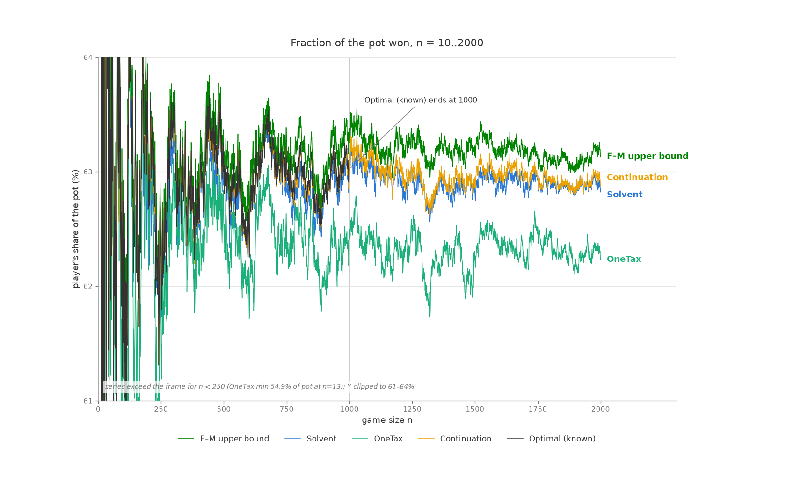
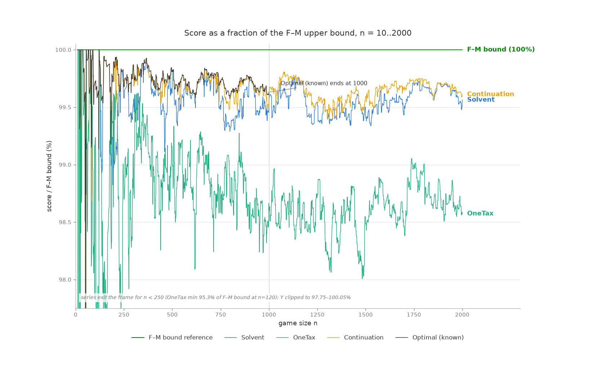

# Heuristic strategies

Taxman is played on the pot {1..n} ([the game](../docs/GLOSSARY.md#the-game)): picking c keeps c and surrenders every
divisor of c still in the pot, and the taxman takes the leftovers.  Finding an optimal game can be hard (Franklín and
Moniot prove a variant of the game NP-hard, below), but playing a nearly optimal game is not.

This is finished work: strategies that play good games quickly but don't guarantee optimal results, and the tools that
measured them.  It keeps some words of its own: a *pick* or *selection* is a [move](../docs/GLOSSARY.md#the-game), the
*upper half* is the numbers above n/2 (the frame solver's [sources](../docs/GLOSSARY.md#the-frame-model)), and the
*lower half* the numbers up to n/2.  The project's [glossary](../docs/GLOSSARY.md) defines the rest.

The two main strategies:

1. **Solvent**, an O(n² log n) strategy with no search and no lookahead, scores **99.85% of all optimal points** over
   n = 1..1000, and never below 99.08% in any game.  Its selections above n/2 are those of an optimal game, assuming
   [statement U](../docs/GLOSSARY.md#the-frame-model) holds.
2. **The continuation solver**, which builds each game from its own game of n − 1, scores **99.97% of all optimal
   points**, starting from nothing at n = 2.  It extends to n = 1001..2000, within 0.35% of the Franklín–Moniot upper
   bound in aggregate.  The optimal games of those n are in `results/strict.jsonl`, and
   [results/README.md](../results/README.md) says how they are proven.

This chart shows the player's share of the pot under each strategy.  Solvent and continuation stay close to the optimal
line.


This chart divides every score by the Franklín–Moniot upper bound, which removes the number-theoretic jitter all
strategies share: the bound becomes a flat 100% line, and the strategies separate into bands.  Past n = 1000 the
continuation chain stays at the level that the optimal scores reach below it.


## The theory: the upper half is a matching problem

No number above n/2 divides another (2c > n), so the upper half of any game is swept only through the lower half.  That
turns upper-half selection into a bipartite question about the [maximal factors](../docs/GLOSSARY.md#the-game) of a
number c, the divisors f for which c/f is prime.

> **Playability.**  A set S of selections can all be played, in some order, **iff** there is a matching assigning each
> member a distinct maximal factor not in S such that the precedence relation "a before b whenever a's assigned factor
> divides b, or a divides b" is acyclic.  Any topological order of the precedence is a legal game.

Both directions are proven ([the playability theorem (P2)](../docs/theory/playability.md#the-playability-theorem)) — the
harder one by the Franklín–Moniot [lifting argument](../docs/GLOSSARY.md#the-game) turned inward ([the lifting lemma
(P1)](../docs/theory/playability.md#the-lifting-lemma)), whose payoff is that maximal factors are the only factor
notion the whole project needs.

For the upper half alone, the lifting argument gives a hard ceiling: every legal game's upper picks use distinct maximal
factors from outside, so **no legal game's upper half can outscore M\*, the maximum-weight matchable upper set**, a
pure matching quantity that needs no theory.  The set the strategies compute, U\* from `solve_upper_half`, is
different: `optimize_mini` admits greedily with `peel` (the procedure the wiki calls `solve_mini`), a *playability*
test, stricter than matching.  So U\* ≤ M\*, and the inequality can be strict: at n=1000, M\* ≥ 291,515 (the F–M
bound's own matching witnesses it) while U\* = 291,258.  The 257-point difference is matchable-but-unplayable weight,
upper-half siblings of the n=21 set.

What is proven is that no game beats M\*.  What is measured (`verify.py`, 1000/1000) is that optimal games' upper halves
equal U\* exactly.  That no *playable* upper set outweighs U\* is proven wherever the frontier jam is hyperedge-free
([the frontier theorem (S3)](../docs/theory/sources.md#the-frontier-theorem)), certified game by game for every
n = 2..100,000 by a GF(2) linear-algebra certificate ([the span conjecture (♦, S5)](../docs/theory/sources.md#the-span-conjecture)),
and open in general; both the exchange route (n=2873) and the single-sacrifice route (n=9170) are provably closed.  `order_for_real_game` turns peel's assignment into a legal order.

What makes the game hard lies in the *lower* half: an optimal game sometimes skips a larger number to fund two smaller
ones, and those one-for-two trades cascade through chains of reassignments.

What is proven, measured or conjectured:

| claim | status |
|---|---|
| opt(n) ≤ n + opt(n−1) | proven (wiki) |
| no upper half beats M\*, the max-weight *matchable* upper set | proven (lifting: every game's picks pair with distinct factors) |
| U\* (`solve_upper_half`) equals the optimal game's upper half | measured, 1000/1000 |
| U\* is the *unique* heaviest playable upper set (every other playable upper set is termwise below it) | theorem given (★) ([the uniqueness theorem (Q1)](../docs/theory/uniqueness-and-longest-games.md#the-uniqueness-theorem)), so certified for every n ≤ 100,000 |
| *every* optimal game, not just the recorded one, has upper part U\* | measured: the prover ([`solver/noframe/docs/uniqueness.md`](../solver/noframe/docs/uniqueness.md)) enumerated every optimal set in every completely enumerated game; open in general.  **Theorem** for the members of U\* with one or two prime factors ([the bottom-layers theorem (F4)](../docs/theory/frame-model.md#the-bottom-layers-theorem)); the frame solver's answers rest on the weaker statement that *some* optimal game plays the rest, [statement U](../docs/theory/exactness.md#statement-u), which holds wherever the prover has proven the game ([results/README.md](../results/README.md)) |
| the optimal set (not just its upper half) is unique | measured for every n ≤ 424; **false** from 425 on, where some games have two or three optimal sets, differing by equal-sum exchanges below n/2 |
| optimal sets of n from those of n−1: T ∪ {n} at a game at its ceiling (opt(n) = n + opt(n−1)), T − p + n (a bijection) at a prime | theorem ([the step theorem (N6)](../docs/theory/neighbors.md#the-step-theorem)) |
| an optimal game plays the most moves any game of the board can (the wiki's open question) | **false**: at n = 833, 834 and 835 every optimal game is one move short of the longest; the heaviest 363-move game of 833 scores 29 less than opt(833) ([the length proposition (Q4)](../docs/theory/uniqueness-and-longest-games.md#the-length-proposition)).  True of every other game to 1300, the gap never above one ([`solver/noframe/docs/longest-games.md`](../solver/noframe/docs/longest-games.md)).  The bounds ℓ(n) ≤ ν(n) (a matching certificate) and ℓ(n−1) ≤ ℓ(n) ≤ ℓ(n−1) + 1, with ℓ(n) the most moves of a game of n, are theorems ([the length lemma (Q3)](../docs/theory/uniqueness-and-longest-games.md#the-length-lemma)) |
| no *playable* upper set outweighs U\* | conjecture — proven wherever the jam is hyperedge-free ([the frontier theorem (S3)](../docs/theory/sources.md#the-frontier-theorem)); the single-sacrifice route is **false** in general (n=9170 witness).  It is **equivalent to a pure cardinality claim** — descending greedy is maximum-cardinality on every component of the upper-half instance's incidence graph ([the cardinality conjecture (★, S4)](../docs/theory/sources.md#the-cardinality-conjecture)) — and **implied by a linear-algebra one**, (♦): every greedy rejection is a GF(2) dependency of the members kept above it ([the span conjecture (♦, S5)](../docs/theory/sources.md#the-span-conjecture) and [the span theorem (S6)](../docs/theory/sources.md#the-span-theorem)).  **Certified for every game n = 2..100,000** and 902 sampled games to 2,000,000 by checking (♦) exactly (`solver/noframe`), zero counterexamples; the five components the earlier campaign left undecided are settled.  The full 3-prime padded-jam census (428 shapes, 22,909 trap orderings) closes with **zero unprotected traps**: every trap dies by monomial inversion or a window-forced guard ([what a proof must use](../docs/theory/sources.md#what-a-proof-must-use)) |
| greedy weight-optimality when the frontier jam has only ≤2-prime members | theorem (unique minimal core: forest + one edge; [the frontier theorem (S3)](../docs/theory/sources.md#the-frontier-theorem)) |
| on members with ≤ 2 distinct primes, playable = forest in the factor-value graph | theorem ([the two-factor proposition (P11)](../docs/theory/playability.md#the-two-factor-proposition), via [the core theorem (P7)](../docs/theory/playability.md#the-core-theorem); verified on 89,400 random subsets) |
| playability ⟺ maximal-factor matching + acyclic precedence | proven ([the playability theorem (P2)](../docs/theory/playability.md#the-playability-theorem)) |
| playable ⟺ residual empty (no self-covering subset); for a set of numbers, the residual of its own instance | **theorem**, with no separation hypothesis ([the core theorem (P7)](../docs/theory/playability.md#the-core-theorem), via [the extension lemma (P6)](../docs/theory/playability.md#the-extension-lemma)).  Earlier, the unrestricted version was only fuzz-tested (30,000 trials clean) |
| minimal exclusion sets live inside the residual (exclusion confinement) | **theorem** for every instance, and for sets of numbers that are separated (no member is another's maximal factor — automatic above n/2) ([the exclusion theorem (P8)](../docs/theory/playability.md#the-exclusion-theorem)); **false** for sets of numbers that are not separated ({2,4,8} witness) — grounds the residual-restricted exact searches of the cardinality campaigns (validated 35/35 before the proof existed) |
| for prime n: opt(n) = n + opt(n−1) − (largest prime < n) | proven, verified 167/167 ([the prime formula (N5)](../docs/theory/neighbors.md#the-prime-formula)) |
| peel's assignment is always schedulable | **theorem** (the soundness half of [the peel theorem (P4)](../docs/theory/playability.md#the-peel-theorem)): the peel rules cannot emit a cyclic assignment.  Still asserted at runtime, as a defense in depth |
| peel's failure means the set is unplayable | **theorem** (the completeness half of P4) — not reducible to "no matching exists": matchable-but-unplayable sets are real (n=21 holds a 145-sum set whose every matching is precedence-cyclic; opt(21) is 144) and peel provably rejects exactly the unplayable.  With soundness, peel is a proven playability oracle |
| opt delta = U\* delta (the upper-delta certificate) | conjecture, holds on 70.4% of transitions where it applies, zero contradictions |
| optimal.json itself | independently certified to n=62 by brute force over pot states (`certify.py`); **verified for every n ≤ 2175**, the first 2175 games of the file, by the prover (`solver/noframe`), an exact branch and bound on the whole board that uses only the playability theorems, the Franklín–Moniot bound, [the parity bound (W1)](../docs/theory/parity-bound.md#the-parity-bound), the ceiling and the prime formula |

### The proofs

The proofs are in the [theory](../docs/THEORY.md), which the table cites:

* [the playability theorem (P2)](../docs/theory/playability.md#the-playability-theorem) (lifting: maximal factors
  suffice);
* [the peel theorem (P4)](../docs/theory/playability.md#the-peel-theorem): its soundness half says that peel's
  assignments can always be scheduled, so the ordering step never fails, and its completeness half that a peel refusal
  proves the set unplayable, which together make acceptance a proven decision procedure for playability;
* [the core theorem (P7)](../docs/theory/playability.md#the-core-theorem) (playable ⟺ core-free) and [the two-factor
  proposition (P11)](../docs/theory/playability.md#the-two-factor-proposition) (on ≤2-prime members, playable ⟺
  forest), with the n=2873 gadget where the [exchange property fails](../docs/theory/sources.md#where-exchange-breaks);
* [the frontier theorem (S3)](../docs/theory/sources.md#the-frontier-theorem), which proves greedy weight-optimal
  wherever the jam is hyperedge-free, and pins the remaining open problem to its first hard witness at n=9170;
* [the cardinality conjecture (★, S4)](../docs/theory/sources.md#the-cardinality-conjecture), which strips the weights
  from that open problem: greedy optimality is exactly the claim that descending greedy is maximum-cardinality on every
  component of the upper-half instance's incidence graph;
* [the span conjecture (♦, S5)](../docs/theory/sources.md#the-span-conjecture) and [the span theorem
  (S6)](../docs/theory/sources.md#the-span-theorem), which bound playable sets by a GF(2) rank and reduce the open
  problem to one statement of linear algebra, certified in every game to n = 100,000.

## Solvent: a near-quadratic strategy

Solvent is named for its acceptance test: a number joins only if the whole set stays *solvent*, every selection still
able to pay its tax with a distinct maximal factor from outside the set.  It is greedy over set membership, but it is
not what players call "greedy Taxman", taking the largest legal number each turn: that is `maxturn` below, a much
weaker strategy.

`reference/solvent.py` is the algorithm written to be read and run, and it gives exactly the fast implementation's
sets:

```python
def solvent(n):
    s = set()
    for c in range(n, 1, -1):
        if playable(s | {c}) is not None:
            s.add(c)
    pay = playable(s)
    return ordered(s, pay)
```

where `playable` runs `peel` (minus the returned sequence) over the outside maximal factors, and `ordered`
topologically sorts the precedence "s before t whenever pay(s) divides t, or s divides t".  This is `optimize_mini`
applied to the whole game; restricted to the numbers above n/2, it is `optimize_mini` again.  Its rejections are peel
refusals, which by the completeness theorem prove the set unplayable.  Since playable sets are downward-closed, a
rejection is permanent, so the output set is provably canonical: a function of playability, not of tie-breaking.
The fast version in `strategies/solvent.py` gives the same output, bit for bit, at a fraction of the cost.  It uses
incremental Kuhn matching: a failed augmenting search rejects outright, by Berge's lemma, and peel is consulted only
when the incremental matching goes precedence-cyclic, where it does real playability work.

Results over n = 2..1000 against the optimal scores (n=1 excluded: its optimal score is 0).  `onetax` and `maxturn` are
the two heuristics from [Robert Moniot's
comparison](https://www.dsm.fordham.edu/~moniot/taxman-strategies-comparison.html), reimplemented and validated against
his published table; `cascade` is the verified upper-half theory applied band by band with no promotions, what the
theory gives on its own:

| strategy | avg % of optimal | point share | worst game | exact |
|---|---|---|---|---|
| maxturn | — | 90.29% | 86.12% | 14/999 |
| cascade | — | 92.52% | 91.10% | 19/999 |
| onetax | 99.105% | 99.065% | 96.00% | 42/999 |
| solvent | 99.855% | 99.851% | 99.08% | 214/999 |
| solvent-b | 99.937% | 99.929% | 99.20% | 337/999 |
| continuation chain (below) | **99.978%** | **99.972%** | **99.52%** | **502/999** |

Where solvent still loses, the measurements find one mechanism, "self-blocking" (`results/mistake_catalog_1000.json`,
`results/signature_classification_1000.json`).  The 785 imperfect games decompose into 104 persistent mistake
episodes, and in every one of them solvent *picks* a number m that the optimal game instead keeps as the tax payment
of 2m.  The number paid for is always 2m, and that is forced: every mistake lies in (n/3, n/2], where 3m already
exceeds n, so 2m is the only number m can pay for.  In 100 of the 104 episodes keeping m as a payment is provably
necessary: ban m from the usable tax payments and the optimal set becomes unplayable, typically by a cascade that
strands a number sharing no factor with m.  The numbers stranded lie below m, unseen when the descending scan decides
m, so a one-pass strategy cannot price them; re-routing them by search is what the continuation solver does.  (The
band is where lower-half picks occur at all, not where mistakes prefer to form: optimal games place only 1.3% of their
picks below n/3, where a number has two or more multiples that want it as a payment, so both players leave it as tax.)

**solvent-b** (`strategies/solvent_b.py`) turns that diagnosis into a strategy.  After the base solvent pass, it audits
every kept pick that is also a maximal factor of another kept pick, a structural dual-use criterion with no thresholds,
by completing the game again with that pick banned and adopting the result on strict improvement, to a fixpoint.  The
reruns price the stranded numbers by playing them, which is the information a single descending pass cannot have.  It
scores 99.929% of all optimal points (337/999 exact, worst game 99.20%), recovering about 52% of solvent's loss.  What
remains is the handful of episodes that need *coordinated* moves of several numbers (the blocked valleys that the
continuation solver's bundles exist for).  It costs one factor of n over solvent, Θ(n³ log n), softened about 2x by
prefix-reuse forking (nothing above a fork point is computed again): about 9x solvent at n=500 and 59x at n=1000, as
measured.  Every audit is a fresh feasibility question, answered exactly by the same proven test.

## The continuation solver: search near n−1

Measurements of the step from n−1 to n motivated the design: the optimal game of n is a small, local change from that of
n−1 (76% of steps are pure insertions; mean lower-half churn ~1.2 numbers; 13.6% are "blocked valleys" crossable only
by atomic multi-flip bundles).  `strategies/continuation.py` solves games in sequence, each warm-started from the
previous game's own output:

1. the U\* upper half (`solve_upper_half` — no search; capped by the
   proven matching ceiling M\*, and empirically the optimal game's
   own upper half in all 1000 verified games);
2. carry the previous game's lower picks;
3. certificate check (below) — done instantly if it fires;
4. tier-1: steepest single flips to quiescence;
5. tier-2: removal-anchored add/remove bundles (the valley-crossers);
6. solvent re-anchor: also run solvent on n and adopt its solution if
   it scores higher — a floor, and a rescue that re-seeds the chain
   out of bad basins (fires in ~2% of games);
7. replay the result as a legal game (`check_sequence`) before
   recording it.

**The main result** (`results/chain_cold_1000.json`): started cold from n=2, with no optimal.json anywhere in the loop,
the chain scores **99.972% of all optimal points over 2..1000** (502/999 exact, worst game 99.52%).  It never scores
below solvent, and it beats the chain seeded with optimal games on points: by mid-range a perfect seed makes no
difference.  **Past n = 1000** (`results/chain_1001_2000.json`): seeded once from the optimal game of 1000, the chain
solved 1001..2000 at a mean 99.64% of the F–M bound (worst 99.40%), the level the optimal scores reach below 1000,
where the bound's own looseness averages 0.29%.  It beats solvent in 894 of those games and ties the other 106.  Each
of the 1000 games has a certified gap, its distance to the bound, which bounds its distance to opt(n) too.  The optimal
games to compare them with are in `results/strict.jsonl` ([results/README.md](../results/README.md) says how they are
proven).

### Certificates

Three record-level labels recognize a score as optimal *given the
previous game's score*, from the wiki's
["Reusing a previous solution"](https://github.com/bvchess/taxman/wiki/Reusing-a-previous-solution):

* **exact** (proven): score = n + score(n−1), the no-sacrifice upper
  bound met.
* **prime** (proven): for prime n, opt(n) = n + opt(n−1) − p̂ with p̂
  the largest prime below n — 1 dies with any game's first move and a
  prime's only payment is 1, so a solution holds at most one prime,
  played first; taking prime n forces dropping the previous solution's
  prime, and nothing cheaper can be forced.  Validated 167/167.
* **upper-delta** (conjecture-grade): score = score(n−1) + [U*(n) −
  U*(n−1)], optionally + n/2 for the boundary-crosser on even n.
  "exact" and "prime" are, empirically, its zero-eviction and
  prime-evicts-prime special cases; the general identity has no proof
  but holds wherever it can be checked.

Coverage: 688/999 cold-chain games (331 exact + 167 prime + 190
upper-delta = 68.9%, matching the wiki's remembered "roughly 70%")
and 633/1000 games in 1001..2000.

What a certificate means depends on the anchor.  On an optimal
predecessor it proves optimality outright.  In a self-fed chain it
proves something weaker but still sharp: since opt(n) ≤ n + opt(n−1),
a certified game satisfies gap(n) ≤ gap(n−1) — it *added no error of
its own*; any deficit was inherited.  Certificates therefore mark
where chain error is created (uncertified games only), which makes
them a work scheduler: to improve a chain, re-search just the
uncertified games and let gains flow downstream.

Certificates label; they do not steer.  Steering was tested and
rejected: an experimental mode that stopped searching when the score
reached the strongest certificate ceiling was run head-to-head against
the conservative chain — 969/999 games identical, but in games whose
predecessor was suboptimal the ceiling is invalid, and 4 such "repair"
games had their climbs stopped at exactly the ceiling, dragging 22
games and −511 points net, for only a ~7% speedup (games that end on
a certificate are cheap; the expensive searches are the uncertified
ones that must run regardless).

## The yardsticks

**The Franklín–Moniot upper bound** (`evaluation/bound.py`, exact values for every n = 2..2000 in
`results/fm_bound_2000.json`), from Franklín, A. F. and Moniot R. K., [The difficulty of beating the
Taxman](https://arxiv.org/abs/2211.00461), *Discrete Applied Mathematics*, 339, 166–171, (2023): the max-weight
matching over maximal-factor edges, what optimal play would score if payments needed no schedule and sweeps took only
the paid factor.  The same paper proves a Taxman variant NP-hard via graph matching.  The bound is the matching
relaxation of the game, and our claims past n=1000 are measured against it, as well as against the optimal games noted
above.  It is tight only through n=122.  Over 500..1000, opt(n) averages 99.71% of it (never below 99.57%), so most of
the band between the bound and the chain on the charts is the bound's looseness, not the strategy's error.  At n=1000
the gap of 1168 is 257 points of upper-half slack (the matching counts 4 picks no legal order can deliver) and 911 in
the lower half.  The matching's upper half never ties the real one: where they differ, the matching's is strictly
heavier, and so cannot be played.

**The born-free matching** (`evaluation/bornfree.py`) is the same
paper's constructive counterpart to that bound.  Theorem 1 there
identifies optimal play with the max-weight matching *restricted to
matchings free of flat alternating cycles*; dropping the restriction
gives `bound.py`, while the born-free algorithm keeps it by building a
matching that cannot contain such a cycle in the first place — for
each prime p ≤ n descending, pair x with p·x whenever both are unused.
No matching algorithm runs at all, and the pick set is always
playable, so `core.order_for_real_game` schedules it directly.  It takes 90.39% of the optimal total over n=2..1000 (a
shade above `maxturn`'s 90.29%), and settles at 56.89% of the pot out to n=100,000, matching the paper's figure.  Its
interest is not strength but provability: it is the only strategy here with a proved guarantee, and its gap to `onetax`
measures what refusing to search costs.  Two caveats found while implementing
it: the construction itself does not win at N=7 and N=13 (confirmed
here; the paper's proof of its Theorem 5 already notes it and plays
those two games by hand, so only a blanket claim of a win for every
N > 3 overstates it), and the descending order over x, though the paper
specifies it, has no effect on the result.

**Theory-free certification** (`evaluation/certify.py`): optimal.json was produced by the same theory this project
tests, so the audit uses none of it.  It uses an exhaustive bitmask search, the naive all-divisors matching bound, and
chains of opt(n) ≤ n + opt(n−1).  The search confirms the unique optimal upper sets through n=62, and enumerates the
whole optimal pick sets too, which `solver/noframe/tools/crosscheck_optsets.py` compares with the prover's enumeration
of every optimal set: they agree, one set each, for every n ≤ 57.  No audit has found a contradiction.

## Performance

Pure Python, one thread, best of 3 (`evaluation/bench.py`); k is the empirical
exponent in time ~ n^k:

| component | n=125 | n=250 | n=500 | n=1000 | ~n^k |
|---|---|---|---|---|---|
| onetax | 0.2 ms | 0.6 ms | 1.9 ms | 6.1 ms | 1.6 |
| maxturn | 0.3 ms | 1.2 ms | 4.4 ms | 19 ms | 1.9 |
| upper half (`solve_upper_half`) | 2.7 ms | 10 ms | 38 ms | 168 ms | 2.0 |
| cascade | 3.8 ms | 16 ms | 66 ms | 310 ms | 2.1 |
| solvent | 2.6 ms | 12 ms | 56 ms | 319 ms | 2.3 |

Exact complexities, fitted against models over n = 250..4000 (doubling
ratios, not just exponents):

* **solvent is Θ(n² log n)**, and the log is real: each of the ~0.44n acceptances runs an acyclicity check that
  enumerates multiples (a harmonic sum, Θ(n log n) per check).  That check decides answers: without it, solvent accepts
  the matchable-but-unplayable set at n=21.  What was only a safeguard is consulting peel after a failed augmenting
  search, which Berge's lemma already decides.  Removing it halved the constant (bit-identical output, verified over
  all 1000 games) without changing the class.
* **maxturn is Θ(n²)**: every turn scans the whole pot for the max (doubling ratios 3.9–4.0, no drift).
* **onetax is worst-case O(n²) but runs ~n^1.7**: its per-turn scan exits early near the top of the pot; the
  guaranteed work is the harmonic-sum divisor-count updates, Θ(n log n).  Doubling ratios drift up (3.0 → 3.7) as the
  worst case starts to show.
* **the upper half (solve_upper_half) is Θ(n² log log n)**: one peeling pass per candidate over a graph with Σω(c)
  edges; the log log is invisible at these sizes (ratios ~4.2).
* **cascade** uses the same machinery: about Θ(n²), measured k≈2.1.
* **the continuation chain** costs O(n²) per game before search (the
  solve_upper_half computation) plus the budgeted flip/bundle work, so a full
  chain 2..N is Θ(N³)-class in aggregate.

The readable reference implementation is *not* in the same class as
the fast one: `reference/solvent.py` re-derives every feasibility
answer from scratch (a full peeling per candidate, O(n²) per
question, n questions) and measures ~n^3.3, versus the fast
version's incremental matching at Θ(n² log n) — the same strategy,
one factor of n apart.  At n=500 that is 10.3 s vs 0.13 s; the
reference is for reading, not for speed.

The continuation chain runs ~2s/game (cold, full budget, PyPy, after
the Berge early-reject sped its evaluator ~2.4x): about 35
minutes for the cold chain 2..1000, ~1.5 hours for 1001..2000.
A budget-capped configuration (bundles ≤ 100) reaches 99.95% of
optimal at roughly a quarter of the cost and is the recommended
default; PyPy is ~2–3x CPython on all of it.

## Running it

Python 3.8+ (pytest for the suite; networkx for the bound; PyPy
recommended for long runs).  Run everything from this directory with
`python3 -m`.  Scripts write their outputs to uncommitted files by
default — the committed files under `results/` are only ever updated
deliberately.

```
python3 -m evaluation.verify            # the upper-half theory, n=1..1000
python3 -m reference.solvent 21         # the readable strategy, one game
python3 -m evaluation.scoreboard        # full strategy comparison (~10 min)
pypy3   -m strategies.continuation --from 2 --to 1000 --reanchor-solvent   # the cold chain (~80 min)
python3 -m evaluation.bound 21 128 1000 # F-M bound for specific games
python3 -m evaluation.bornfree 21 1000  # F-M born-free matching, same games
python3 -m evaluation.certify           # theory-free audit of optimal.json
python3 -m pytest evaluation/test_taxman.py
```

The continuation solver checkpoints its `--out` file every 5 games and
resumes with `--resume`, so an interruption costs at most a few games.

## Files

| file | contents |
|---|---|
| [`../docs/THEORY.md`](../docs/THEORY.md) | the index of the theory's proofs: playability, peel, cores and the residual, [the sources conjecture](../docs/theory/sources.md#the-sources-conjecture) and [the frontier theorem](../docs/theory/sources.md#the-frontier-theorem), and the theorems behind the frame solver (the parity and frame matroids, prime exchanges, the frame model's exactness) |
| `core.py` | shared foundations: `maximal_factors`, the wiki's `peel` / `optimize_mini`, `order_for_real_game`, `solve_upper_half`, divisor tables, `check_sequence` replay validation |
| `strategies/solvent.py` | the fast solvent implementation (incremental matching + complete fallback tier) |
| `strategies/solvent_b.py` | solvent-b: solvent plus the dual-use audit (recovers ~52% of solvent's loss for one factor of n in cost) |
| `strategies/onetax.py`, `strategies/maxturn.py`, `strategies/cascade.py` | the comparison strategies |
| `strategies/continuation.py` | the continuation solver: certificates, flip/bundle search, solvent re-anchor |
| `strategies/seteval.py` | incremental set evaluator used by the continuation search |
| `reference/solvent.py` | the solvent strategy written to be read (and run) |
| `reference/continuation.py` | the continuation solver written to be read — chains from 2 on top of the reference solvent, printing per-game certificates |
| `evaluation/verify.py` | checks the upper-half theory against optimal.json, n=1..1000 |
| `evaluation/scoreboard.py` | runs every strategy over a range and tabulates vs. optimal |
| `evaluation/bound.py` | the Franklín–Moniot upper bound |
| `evaluation/bornfree.py` | the Franklín–Moniot born-free matching: their constructive lower bound |
| `evaluation/certify.py` | theory-free certification of optimal.json (uses `evaluation/bitpot.py` bitmask primitives) |
| `evaluation/wiki_questions.py` | the wiki's two open questions, the tax of a move and reusing the game of n − 1 (`tax`, `adapt`; the results are in [solver/notebook/the-wikis-open-questions-2026-10/README.md](../solver/notebook/the-wikis-open-questions-2026-10/README.md)) |
| `evaluation/bench.py` | timings and scaling exponents |
| `evaluation/test_taxman.py` | the test suite |
| `results/solvent_1000.json`, `results/strategies_1000.json` | per-game scores vs. optimal, n=1..1000 |
| `results/chain_cold_1000.json` | the cold chain from n=2, with certificates |
| `results/chain_seeded_500_1000.json` | the optimal-seeded chain (drift experiment) |
| `results/chain_1001_2000.json` | the continuation chain's solutions for n=1001..2000 |
| `results/solvent_2000.json`, `results/onetax_2000.json`, `results/maxturn_2000.json` | strategies extended to n=2000 |
| `results/fm_bound_2000.json` | exact F–M bound, n=2..2000 |
| `results/moniot_table.json` | Moniot's published n≤128 results (validation) |
| `results/pot_fraction.png`, `results/score_vs_bound.png` | the two summary charts |

## Reading guide

The code is small enough to read end to end, and it also tours standard algorithms applied to a real problem.  A
suggested path: play n=21 by hand, read `reference/solvent.py` top to
bottom, then `core.py`, then [`docs/THEORY.md`](../docs/THEORY.md) for the proofs, then
`strategies/solvent.py`, then `reference/continuation.py` — the
warm-start chain in the same readable register — with
`strategies/continuation.py`'s docstring as the fast version's tour.

n=21 is the running example, cited wherever a concept needs a concrete case, because one small game shows every idea:

* [the wiki walks it through move by move](https://github.com/bvchess/taxman/wiki/Walkthrough-for-N=21), and
  `python3 -m reference.solvent 21` solves it (144, the optimal score);
* its optimal game opens with the highest prime and funds a one-for-two trade;
* it has the matchable-but-unplayable set {10,12,14,15,16,18,19,20,21}, which sums to 145, one point more than any
  legal game can score.  That set is the counterexample of the completeness row of the table of claims, and the reason
  the F–M bound reads 145 against opt(21) = 144: the relaxation counts exactly the set that peel refuses.

Where the well-known ideas do real work:

| concept | where it does real work here |
|---|---|
| bipartite matching, Kuhn's augmenting paths, Berge's lemma | `strategies/solvent.py` (`_augment`; failed search = conclusive rejection) |
| Hall's theorem — and its limits | matchability is *not* playability: the n=21 set in the table of claims has perfect matchings and no legal order |
| topological sort (Kahn's algorithm), DAGs | `core.order_for_real_game`, `strategies/solvent.py` `_is_acyclic` / `_playable_order` |
| greedy algorithms + matroids — and their limits | the natural matroid hypothesis for playable sets is *false* (n=2873; see "Dead ends") — the survival of greedy here is a fact about Taxman's weights, not about exchange |
| sieve of Eratosthenes | `core.smallest_prime_factors` (storing witnesses, not booleans) |
| amortized analysis, worklists | `core.peel` — degree-1 peeling in O(V+E) via the Kahn-queue trick |
| relaxations (as in LP relaxation), duality intuition | `evaluation/bound.py` — delete two constraints, get a poly-time upper bound |
| Edmonds' blossom algorithm — and when you don't need it | `evaluation/bound.py`: an Ω-parity argument shows the graph is bipartite, so blossoms never fire |
| bitmask DP, memoization, branch-and-bound | `evaluation/certify.py` + `evaluation/bitpot.py` |
| local search, hill climbing, escaping local optima | `strategies/continuation.py` (flips, then valley-crossing bundles) |
| undo logs / transaction rollback | `strategies/seteval.py` |
| NP-hardness | Franklín & Moniot's paper (cited above) — the hardness and our upper bound are two faces of the same matching structure |
| theorems vs. conjectures vs. measurements | the table of claims above: every claim has its grade of evidence |

The table of claims and the dead ends below show the working habits: label what is proven, conjectured or measured;
test an elegant hypothesis before trusting it; and keep the falsified ones in view, such as the n=21 counterexample and
the experiment that trusted certificates as cutoffs.

## Dead ends worth remembering

Rejected ideas worth knowing (git history has the details):

* **A 2-tax rule cannot be added to OneTax.**  Optimal games make
  2-tax moves in 946/999 games, but every locally-visible version of
  the rule is either unnecessary (the pick wins anyway) or
  unaffordable (fires exactly backwards); the provably-safe variant
  never fires at all.  The one-for-two trade only pays as part of a
  globally re-routed assignment — under 3% of any strategy's loss is
  2-tax residue; ~97% is one-for-one re-routing.
* **The fork oracle** (pricing picks by re-derived continuations,
  99.41% of optimal) was the best strategy until solvent's playability
  test was made complete — its false cycle-vetoes (15:1 over genuine
  matching failures) were worth 1.32M points across the range, and
  fixing them (98.97% → 99.86% mean) made solvent the best single
  strategy and the oracle obsolete.
* **Trusting certificates as search cutoffs** — see above: −511
  points for +7% speed.  Certificates label; they do not steer.
* **The matroid explanation.**  For most of the project, greedy's upper-half optimality was explained by matroid
  theory: matchable sets do form a transversal matroid, and on two-prime members playable sets form a graphic one, so
  the explanation kept passing tests.  It is false where it matters: playable sets with three-prime members admit
  maximal sets of different sizes (n=2873), so the exchange axiom fails and no matroid argument can justify greedy over
  playable sets.  What protects greedy is that Taxman's weights are the members themselves: the stuck configurations
  are provably reachable only through light members that descending greedy visits last.  Keep the matroid lens for
  matchability; drop it for playability.
* **"Acceptance is just matching-existence."**  Auditing solvent for wasted safety checks found one real redundancy
  (the complete-tier consultation after a *failed* augment, which Berge's lemma already decides; removing it is
  bit-identical and ~2x faster) and one falsified one: dropping the per-acceptance acyclicity gate changes answers,
  first at n=21, where a matchable-but-unschedulable set out-sums opt(21).  The second showed that peel rejects some
  sets that have perfect payment matchings: it is a playability oracle, not a matching oracle, which the code had
  relied on without stating.
* **Bitsets** win for state hashing (the brute-force certifier) and
  lose for whole-scan divisor work (harmonic-sum beats n²/64 past
  n≈600); PyPy beats both concerns at once for long runs.
